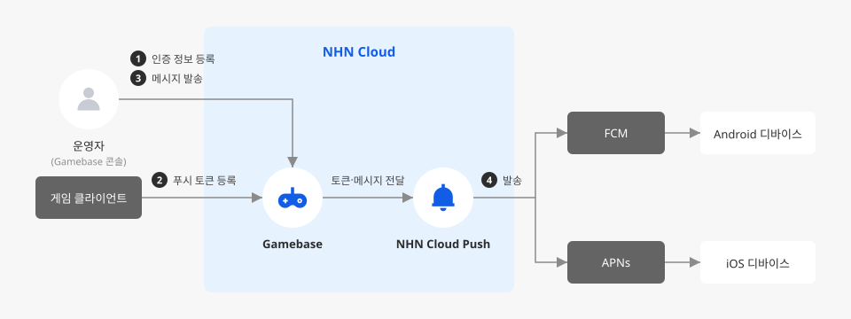

# Gamebase 연동 후 푸시 메시지 발송까지 완료하기

## 시작하기 전에

Gamebase는 게임 개발에 필요한 로그인, 결제, 푸시 등 공통 기능을 제공하는 NHN Cloud의 게임 플랫폼입니다. Gamebase는 내부적으로 NHN Cloud Push 서비스를 이용해 Android·iOS 앱으로 푸시 메시지를 발송합니다. 인증 정보 등록부터 발송까지 Gamebase 콘솔에서만 설정하면 되며, **Notification > Push** 서비스를 별도로 활성화하거나 설정할 필요는 없습니다.

클라이언트가 발급받은 푸시 토큰을 Gamebase SDK로 등록해 두면, Gamebase 콘솔에서 발송한 메시지가 등록된 토큰을 기준으로 FCM(Firebase Cloud Messaging, Android·iOS·웹용 크로스 플랫폼 메시지 발송 서비스) 또는 APNs(Apple Push Notification service, Apple 디바이스로 알림을 보내는 Apple의 플랫폼 알림 서비스)를 거쳐 각 디바이스에 전달됩니다.

여기에서는 Gamebase로 로그인 기능까지 구현한 게임에 푸시를 연동해 이벤트 공지나 복귀 유도 메시지처럼 로그인한 사용자에게 직접 알림을 보낼 수 있도록 구성하고, 테스트 발송으로 정상 동작 여부까지 확인하는 방법을 살펴봅니다.

<div data-with-frame="true"></div>

## 사전 준비하기

- Gamebase 서비스가 활성화되어 있고, 클라이언트에 로그인 기능이 구현되어 있어야 합니다.
- Android 앱이라면 FCM 연동을 위해 Firebase 콘솔에서 다음 두 파일을 준비합니다. 두 파일은 용도가 달라서 헷갈리면 인증 정보 등록 오류가 날 수 있습니다.

    | 파일 | 받는 방법 | 용도 | 사용 위치 |
    |---|---|---|---|
    | `google-services.json` | Firebase 프로젝트에 Android 앱을 추가(패키지명 입력)한 뒤 다운로드 | 앱의 Firebase 설정 | 클라이언트 프로젝트(Unity, Android Studio 등) |
    | 서비스 계정 인증 정보(Service Account Credential)가 담긴 JSON 파일 | Firebase 콘솔의 **프로젝트 설정 > 서비스 계정**에서 **새 비공개 키 생성** | 서버가 FCM을 호출할 권한 | Gamebase 콘솔의 **푸시 > 인증서** |

    Firebase 프로젝트 생성, 앱 추가, `google-services.json` 배치는 [Android 프로젝트에 Firebase 추가](https://firebase.google.com/docs/android?hl=ko)를 참고하세요. Unity나 Unreal로 빌드한다면 처리 방법이 다르므로 [Android SDK 사용 가이드 > 시작하기](https://docs.nhncloud.com/ko/Game/Gamebase/ko/aos-started/)의 Firebase Notification 항목을 참고하세요. Firebase 설정에 문제가 있으면 `registerPush`가 5101 오류(상세 코드 101)를 반환할 수 있습니다.

    FCM은 2024년 6월 20일부로 기존 서버 키(Server Key) 방식 지원을 중단했으므로, 서버 키가 아닌 서비스 계정 JSON 파일을 준비해야 합니다.

- iOS 앱이라면 APNs 인증 정보를 준비합니다. Gamebase는 JWT(JSON Web Token, 서명된 토큰으로 신원을 증명하는 인증 방식) 등록만 지원하므로, Apple Developer 계정에서 발급받은 Team ID, Key ID, Topic(일반적으로 앱의 Bundle ID), 개인 키(`.p8`) 파일을 준비해야 합니다.
- Android SDK를 사용한다면 `build.gradle`의 `dependencies`에 푸시 어댑터 모듈을 추가합니다. 추가하지 않으면 `registerPush`가 5101 오류(상세 코드 103)를 반환할 수 있습니다.

    ```gradle
    implementation "com.toast.android.gamebase:gamebase-adapter-push-fcm:$GAMEBASE_SDK_VERSION"
    ```

- iOS SDK를 사용한다면 Podfile에 푸시 어댑터를 추가합니다. CocoaPods를 사용하지 않는다면 `GamebasePushAdapter.xcframework`를 프로젝트에 직접 추가합니다.

    ```ruby
    pod 'GamebasePushAdapter'
    ```

    Xcode에서는 **Targets > Capabilities > Push Notifications**를 켜야 APNs로 메시지를 받을 수 있습니다. 자동 생성된 `.entitlements` 파일의 `APS Environment` 값은 Sandbox APNs라면 `development`, 운영 APNs라면 `production`으로 설정합니다. 자세한 설정은 [iOS SDK 사용 가이드 > 시작하기](https://docs.nhncloud.com/ko/Game/Gamebase/ko/ios-started/)와 [iOS 푸시 가이드](https://docs.nhncloud.com/ko/Game/Gamebase/ko/ios-push/)를 참고하세요.

## Gamebase 콘솔과 SDK에 푸시 연동하기

1. Gamebase 콘솔에서 대상 앱의 **푸시 > 인증서** 화면으로 이동하세요.

    인증 정보 등록부터 메시지 발송까지 모두 이 Gamebase 콘솔 안에서 처리합니다.

2. 서비스하는 앱의 플랫폼에 맞는 인증 정보를 등록하세요. Android 앱과 iOS 앱을 모두 서비스한다면 각각 등록합니다.

    - **Android 앱**: **FCM Service Account Credential** 항목의 **등록**을 클릭하고, 준비한 FCM 서비스 계정 JSON 파일 내용을 **JSON** 입력란에 붙여 넣은 뒤 **저장**을 클릭하세요. NHN Cloud Push는 이 인증 정보로 FCM API를 대신 호출해 Android 디바이스에 메시지를 전달합니다. 인증 정보가 없으면 Android 발송 채널 자체가 동작하지 않습니다.


서비스 계정 JSON 파일에는 개인 키가 들어 있으니, 메신저나 이메일, 외부 서비스로 공유하거나 소스 저장소에 커밋하지 말고 콘솔에 직접 등록하세요.


    - **iOS 앱**: **APNS JWT** 항목의 **등록**을 클릭하고, 준비한 **Team ID**, **Key ID**, **Topic**, **Private Key**(개인 키)를 입력한 뒤 **저장**을 클릭하세요. Gamebase는 APNs 인증 방식으로 JWT만 지원합니다. `.p12` 인증서 등록은 제공되지 않으므로, Apple Developer 계정에서 반드시 `.p8` 키 기반의 JWT 인증 정보를 발급받아 준비해야 합니다.


`.p8` 개인 키 파일도 메신저나 이메일, 외부 서비스로 공유하거나 소스 저장소에 커밋하지 말고 콘솔에 직접 등록하세요.


3. 클라이언트 로그인이 끝난 뒤, SDK에서 푸시 토큰을 등록하는 코드를 추가하세요.

    ```java
    PushConfiguration configuration = PushConfiguration.newBuilder()
            .enablePush(enablePush)
            .enableAdAgreement(enableAdPush)
            .enableAdAgreementNight(enableAdNightPush)
            .build();

    Gamebase.Push.registerPush(activity, configuration, new GamebaseCallback() {
        @Override
        public void onCallback(GamebaseException exception) {
            if (Gamebase.isSuccess(exception)) {
                // 토큰 등록 성공
            }
        }
    });
    ```

    `enableAdAgreement`, `enableAdAgreementNight`는 각각 광고성 정보 수신 동의, 야간 광고성 정보 수신 동의 여부를 나타냅니다. 사용자가 앱 내 약관 동의 화면에서 선택한 값을 그대로 전달하면, 이후 발송 시 Gamebase가 이 값을 기준으로 미동의 대상자를 발송 대상에서 제외합니다.


동의값은 사용자 ID 단위가 아니라 푸시 토큰 단위로 NHN Cloud Push에 저장됩니다. 푸시 토큰이 만료되는 경우도 있으므로, 로그인 이후에는 앱을 실행하거나 계정을 전환할 때마다 `registerPush` API를 호출해 최신 값을 서버에 반영하세요.


    로그인 전에 토큰을 등록하면 어떤 사용자의 디바이스인지 식별할 수 없으므로, 반드시 로그인 성공 콜백 이후에 호출합니다. Android에서는 로그인 전에 호출하면 5101 오류(상세 코드 102)가 발생하며, 상세 코드는 `exception.getDetailCode()`로 확인할 수 있습니다. iOS는 `TCGBPush registerPushWithPushConfiguration:completion:`으로 동일하게 구현합니다. 플랫폼별 전체 파라미터와 오류 코드는 [Android 푸시 가이드](https://docs.nhncloud.com/ko/Game/Gamebase/ko/aos-push/), [iOS 푸시 가이드](https://docs.nhncloud.com/ko/Game/Gamebase/ko/ios-push/)를 참고하세요.

## 동작 확인하기

테스트 메시지를 보내 인증 정보와 토큰 등록이 올바르게 연동되었는지 확인합니다.

1. Gamebase 콘솔의 **푸시 > 푸시** 화면에서 **등록**을 클릭하고, 테스트 메시지를 즉시 발송하세요.

    - **발송 타입**: **즉시 발송**을 선택합니다. 연동 결과를 바로 확인하기 위해서입니다.
    - **발송 대상**: **특정 회원에게만 발송**을 선택하고, 테스트 디바이스에서 로그인한 사용자 ID를 입력합니다. **전체 발송**을 선택하면 선택한 OS의 모든 사용자에게 메시지가 전달되므로, 연동 확인 단계에서는 테스트 계정으로 대상을 한정합니다.

    소수 디바이스로 먼저 테스트하면 인증 정보나 토큰 등록 오류를 전체 사용자 발송 전에 미리 발견할 수 있습니다.


발송하기 전에 테스트 디바이스에서 앱을 백그라운드로 내려 두세요. 앱이 포그라운드(화면에 떠 있어 사용 중인 상태)일 때는 알림이 표시되지 않습니다. 포그라운드 알림 노출 옵션(Android `enableForeground`, Unity·iOS `foregroundEnabled`)의 기본값이 `false`(iOS는 `NO`)이기 때문입니다.


2. 로그인해 둔 테스트 디바이스에서 메시지가 정상적으로 수신되는지 확인하세요.

    Android 8.0(API 26) 이상 디바이스에서도 별도 채널 설정 없이 정상적으로 알림을 받을 수 있습니다. Gamebase가 서버 측에서 채널 값을 자동으로 지정해 주기 때문입니다. 수신되지 않는다면 앱이 포그라운드 상태는 아닌지, 앞에서 등록한 인증 정보나 토큰 등록 코드가 올바른지 다시 확인합니다.

## 응용하기

<table data-view="cards"><thead><tr><th></th><th></th><th></th><th data-hidden data-card-target data-type="content-ref"></th></tr></thead><tbody><tr><td><h4><i class="fa-clock">:clock:</i></h4></td><td><strong>예약 발송</strong></td><td>이벤트 시작 시각에 맞춰 미리 메시지를 준비해 두려면, 즉시 발송 대신 예약 발송 옵션을 사용합니다. Gamebase 콘솔의 <strong>푸시 &gt; 푸시</strong> 화면에서 <strong>발송 타입</strong>으로 즉시·예약·반복 발송을 모두 선택할 수 있습니다.</td><td><a href="https://docs.nhncloud.com/ko/Game/Gamebase/ko/oper-push/">https://docs.nhncloud.com/ko/Game/Gamebase/ko/oper-push/</a></td></tr><tr><td><h4><i class="fa-scale-balanced">:scale-balanced:</i></h4></td><td><strong>야간 발송 제한 준수</strong></td><td>정보통신망법에 따라 광고성 메시지는 야간(21시∼08시)에 수신자의 별도 동의 없이 발송할 수 없습니다. 앞에서 다룬 <code>enableAdAgreementNight</code>(iOS는 <code>ADAgreementNight</code>) 값에 사용자의 실제 동의 여부를 정확히 반영해 두면, 별도 처리 없이 야간 발송 대상에서 미동의 사용자가 자동으로 제외됩니다.</td><td><a href="https://docs.nhncloud.com/ko/Game/Gamebase/ko/aos-push/">https://docs.nhncloud.com/ko/Game/Gamebase/ko/aos-push/</a></td></tr></tbody></table>

## 용어 알아보기

<table data-full-width="false"><thead><tr><th width="168">용어</th><th width="600">설명</th></tr></thead><tbody><tr><td>FCM</td><td>Android, iOS 및 웹 애플리케이션용 메시지 및 알림을 위한 크로스 플랫폼 클라우드 솔루션</td></tr><tr><td>APNs</td><td>타사 앱 개발자가 Apple 장치에 설치된 앱으로 알림 데이터를 보낼 수 있도록 Apple에서 만든 플랫폼 알림 서비스</td></tr></tbody></table>
