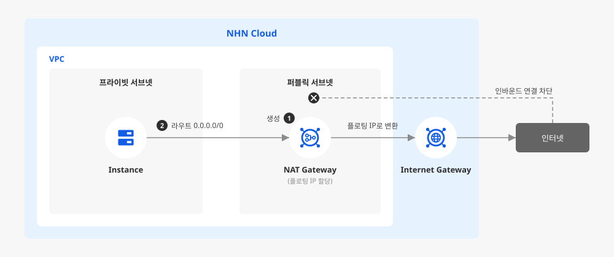

# NAT Gateway로 프라이빗 서브넷 인터넷 연결 구성하기

## 시작하기 전에

NAT Gateway는 인스턴스의 사설 IP를 플로팅 IP(Floating IP)로 변환해 주는 관리형 서비스입니다. 인터넷 게이트웨이가 연결되지 않은 프라이빗 서브넷의 인스턴스도 이 변환을 거쳐 인터넷에 접근할 수 있습니다. 라우팅 테이블에서 NAT Gateway를 게이트웨이로 지정하면 해당 경로로 나가는 트래픽의 발신지 IP가 NAT Gateway의 플로팅 IP로 바뀌고, 외부에서 이 주소로 접속을 시도하는 인바운드 트래픽은 자동으로 차단됩니다. 아웃바운드 트래픽을 세밀하게 커스터마이징해야 한다면 인스턴스를 직접 운영하는 NAT Instance를 선택할 수도 있지만, 별도 운영 부담 없이 아웃바운드 인터넷 연결만 필요하다면 관리형인 NAT Gateway가 더 간단합니다.

여기에서는 인터넷 게이트웨이 없이 외부 인터넷에 접근해야 하는 프라이빗 서브넷의 인스턴스가 외부 패키지 저장소나 API에는 접근할 수 있으면서, 외부에서의 직접 인바운드 접속은 차단되도록 NAT Gateway를 생성하고 라우팅 테이블에 연결하는 방법을 살펴봅니다.

<div data-with-frame="true"></div>

## 사전 준비하기

- VPC 안에 퍼블릭 서브넷과 프라이빗 서브넷이 구분되어 있어야 합니다. 프라이빗 서브넷은 인터넷 게이트웨이가 연결되지 않은 라우팅 테이블에 연결되어 있어야 합니다.
- NAT Gateway는 한국(판교), 한국(평촌) 리전에서만 제공됩니다.
- 동작 확인 단계에서 프라이빗 서브넷의 인스턴스에 접속해야 하므로, 퍼블릭 서브넷에 직접 구성한 배스천 호스트(bastion host, 외부에서 프라이빗 서브넷의 인스턴스로 접속할 때 거치는 중계 서버)나 NHN Cloud의 서버 접근 제어 서비스인 NHN Bastion 등 접속 경로를 준비합니다.
- NAT Gateway에 할당할 플로팅 IP가 필요합니다. 이미 확보한 플로팅 IP가 없다면 다음 순서로 먼저 할당합니다.

    1. NHN Cloud 콘솔에서 **Network > Floating IP**를 클릭하세요.
    2. **+ 플로팅 IP 생성** 버튼을 클릭하세요.
    3. 열리는 창에서 IP 풀은 **Public Network**로 표시됩니다. 필요하면 삭제 보호 여부와 레이블을 설정한 뒤 **생성**을 클릭하세요.

    이렇게 확보한 플로팅 IP는 잠시 뒤 NAT Gateway 생성 시 지정합니다.

## NAT Gateway 생성 및 라우팅 설정하기



### 퍼블릭 서브넷에 NAT Gateway 생성하기

프라이빗 서브넷의 트래픽이 최종적으로 이 NAT Gateway를 거쳐 나가므로, NAT Gateway는 인터넷 게이트웨이가 연결된 라우팅 테이블에 속한 서브넷(퍼블릭 서브넷)에 생성해야 합니다.

1. NHN Cloud 콘솔에서 **Network > NAT Gateway**를 클릭하세요.
2. **+ NAT 게이트웨이 생성** 버튼을 클릭하세요.
3. 다음 항목을 입력합니다.

    - **이름**: `private-subnet-nat`처럼 식별 가능한 이름을 입력합니다.
    - **VPC**: 프라이빗 서브넷이 속한 VPC를 선택합니다.
    - **서브넷**: 인터넷 게이트웨이가 연결된 라우팅 테이블에 연결된 서브넷(퍼블릭 서브넷)을 선택합니다.
    - **플로팅 IP**: 앞서 할당한 플로팅 IP를 선택합니다. NAT Gateway를 거쳐 인터넷으로 나가는 트래픽의 발신지 IP가 이 플로팅 IP로 변환되며, 생성한 뒤에는 다른 플로팅 IP로 바꿀 수 없습니다.
    - **설명**: 필요하다면 용도를 적어 둡니다.

4. 입력한 내용을 검토한 뒤 **확인**을 클릭하세요.



### 프라이빗 서브넷의 라우팅 테이블에 경로 추가하기

NAT Gateway를 만들었다고 해서 프라이빗 서브넷의 트래픽이 자동으로 NAT Gateway로 전달되지는 않습니다. 프라이빗 서브넷이 연결된 라우팅 테이블에 NAT Gateway를 가리키는 경로를 추가해야 실제로 트래픽이 전달됩니다.

1. NHN Cloud 콘솔에서 **Network > Routing**을 클릭하세요.
2. 라우팅 테이블 목록에서 프라이빗 서브넷이 연결된 라우팅 테이블을 선택합니다.
3. 상세 화면의 **라우트** 탭으로 이동합니다.
4. **라우트 생성** 버튼을 클릭하고 다음 항목을 입력합니다.

    - **대상 CIDR**: 프라이빗 서브넷에서 나가는 모든 인터넷 트래픽을 NAT Gateway로 보내기 위해 `0.0.0.0/0`을 입력합니다.
    - **게이트웨이**: 1단계에서 생성한 NAT Gateway를 선택합니다.

5. **확인**을 클릭해 저장하세요.


같은 VPC 안이라면 하나의 NAT Gateway를 여러 라우팅 테이블에서 함께 사용할 수 있습니다. 프라이빗 서브넷이 여러 개라면 각 서브넷의 라우팅 테이블에 같은 방식으로 경로를 추가하면 됩니다.




## 동작 확인하기

라우팅 설정은 화면에 별도의 완료 메시지가 나타나지 않으므로, 프라이빗 인스턴스에 접속해 실제로 인터넷 통신이 되는지 직접 확인합니다.

1. 배스천 호스트나 NHN Bastion 등으로 프라이빗 서브넷의 인스턴스에 접속합니다.
2. 외부 호스트로 `ping`을 보내 응답이 오는지 확인합니다.

    ```sh
    ping -c 4 8.8.8.8
    ```

3. 실제로 접근하려는 외부 API 또는 패키지 저장소에 `curl`로 요청을 보내 응답을 확인합니다.

    ```sh
    curl -I https://example.com
    ```

4. `curl ifconfig.me`로 현재 인스턴스가 외부와 통신할 때 사용하는 발신지 IP를 확인합니다. 이 값이 1단계에서 NAT Gateway에 지정한 플로팅 IP와 같다면, 트래픽이 실제로 NAT Gateway를 거쳐 나가고 있다는 뜻입니다.

    ```sh
    curl ifconfig.me
    ```

5. 반대로 VPC 밖의 PC에서 NAT Gateway의 플로팅 IP로 직접 접속을 시도해 차단되는지도 확인합니다. 응답이 없으면 아웃바운드만 허용되는 구성이 의도대로 동작하는 것입니다.

    ```sh
    ping -c 4 {nat_floating_ip}
    ```

## 응용하기

<table data-view="cards"><thead><tr><th></th><th></th><th></th><th data-hidden data-card-target data-type="content-ref"></th></tr></thead><tbody><tr><td><h4><i class="fa-network-wired">:network-wired:</i></h4></td><td><strong>목적지별로 경로 분리하기</strong></td><td>대상 CIDR을 좁혀서 특정 대역으로 나가는 트래픽만 NAT Gateway를 거치게 하고, 나머지는 다른 게이트웨이로 보내는 식으로 라우팅 테이블 안에서 여러 NAT Gateway를 함께 사용할 수 있습니다.</td><td><a href="https://docs.nhncloud.com/ko/Network/VPC/ko/console-guide/">https://docs.nhncloud.com/ko/Network/VPC/ko/console-guide/</a></td></tr><tr><td><h4><i class="fa-server">:server:</i></h4></td><td><strong>NAT Instance로 전환이 필요한 경우</strong></td><td>아웃바운드 트래픽에 방화벽 정책을 세밀하게 적용하거나 인스턴스 사양을 직접 조정해야 한다면, 네트워크 인터페이스의 <strong>스푸핑 방지</strong> 기능을 해제한 NAT Instance를 검토할 수 있습니다. 이 경우 관리형인 NAT Gateway와 달리 인스턴스 운영과 패치를 직접 관리해야 합니다.</td><td><a href="https://docs.nhncloud.com/ko/Network/Network%20Interface/ko/console-guide/">https://docs.nhncloud.com/ko/Network/Network%20Interface/ko/console-guide/</a></td></tr><tr><td><h4><i class="fa-layer-group">:layer-group:</i></h4></td><td><strong>여러 NAT Gateway로 확장하기</strong></td><td>NAT Gateway의 Quota는 3개이고, 라우팅 테이블당 라우트는 최대 10개까지 생성할 수 있습니다. 여러 프라이빗 서브넷이나 여러 VPC에 걸쳐 NAT Gateway를 설계할 때는 이 한도를 미리 고려해야 합니다.</td><td><a href="https://docs.nhncloud.com/ko/Network/NAT%20Gateway/ko/console-guide/">https://docs.nhncloud.com/ko/Network/NAT%20Gateway/ko/console-guide/</a></td></tr></tbody></table>

## 리소스 정리하기

실습 목적으로 따라 한 경우, 만든 순서의 역순으로 리소스를 삭제해 불필요한 과금을 방지합니다.

1. **Network > Routing**에서 라우팅 테이블 상세 화면의 **라우트** 탭으로 이동해 앞서 추가한 경로를 삭제합니다.
2. **Network > NAT Gateway**에서 생성한 NAT Gateway를 선택하고 **NAT 게이트웨이 삭제** 버튼을 클릭하세요.
3. 더 이상 필요하지 않다면 **Network > Floating IP**에서 할당한 플로팅 IP도 삭제합니다. 삭제 보호를 설정했다면 먼저 삭제 보호를 해제해야 삭제할 수 있습니다.


플로팅 IP를 삭제한 뒤 같은 주소를 다시 할당받을 수 있다고 보장할 수 없습니다. 다른 용도로 재사용할 계획이 있다면 삭제 전에 다시 한번 확인하세요.


## 용어 알아보기

<table data-full-width="false"><thead><tr><th width="168">용어</th><th width="600">설명</th></tr></thead><tbody><tr><td>인터넷 게이트웨이</td><td>VPC의 리소스를 인터넷에 연결하기 위해 사용되는 서비스</td></tr><tr><td>NAT Gateway</td><td>인터넷 게이트웨이가 연결되지 않은 인스턴스들이 인터넷에 액세스할 수 있게 IP 주소를 플로팅 IP로 변환해 주는 서비스</td></tr><tr><td>플로팅 IP</td><td>외부 네트워크와 통신할 수 있도록 별도 요청을 통해 지정된 네트워크로부터 할당 받는 IP 주소</td></tr><tr><td>라우팅 테이블</td><td>네트워크 통신을 위해 목적지로 가는 경로 정보를 담고 있는 테이블</td></tr><tr><td>NAT Instance</td><td>프라이빗 네트워크의 인스턴스가 인터넷에 액세스할 수 있게 해 주는 NHN Cloud 서비스</td></tr><tr><td>VPC</td><td>논리적으로 분리된 가상의 네트워크</td></tr><tr><td>CIDR</td><td>IP 주소를 효율적으로 사용하기 위한 IP 주소 할당 방법</td></tr></tbody></table>
