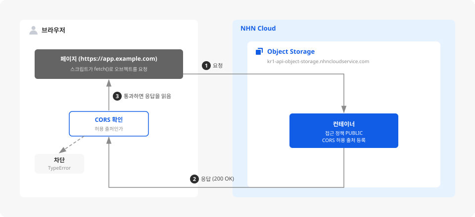

# Object Storage 컨테이너에 CORS 설정하기

## 시작하기 전에

Object Storage는 데이터를 오브젝트 단위로 저장하는 스토리지 서비스입니다. 컨테이너에 올린 오브젝트는 URL로 접근할 수 있으므로, 웹 페이지의 스크립트가 브라우저에서 오브젝트를 직접 읽고 쓸 수 있습니다.

다만 브라우저는 스크립트가 **다른 출처**의 응답을 읽지 못하도록 기본적으로 막습니다. 출처는 주소에서 프로토콜과 호스트, 포트만 떼어 낸 부분입니다. 웹 페이지의 주소와 Object Storage의 API 엔드포인트는 호스트가 달라 서로 다른 출처이므로, 브라우저에서 오브젝트를 직접 다루려면 이 제한을 먼저 풀어야 합니다.

브라우저에서 보낸 요청이 성공하려면 컨테이너의 접근 정책이 요청을 허용해야 하고, 브라우저가 응답을 읽을 수 있도록 교차 출처 리소스 공유(CORS)에 요청을 보내는 출처가 등록되어 있어야 합니다.

여기에서는 특정 웹사이트에서 실행되는 스크립트가 컨테이너의 오브젝트에 접근할 수 있도록 CORS를 설정하고, 설정이 실제로 적용되었는지 확인하는 방법을 살펴봅니다.

<div data-with-frame="true"></div>

## 사전 준비하기

- NHN Cloud 콘솔에서 Object Storage 서비스가 활성화되어 있어야 합니다.
- 설정할 컨테이너와 요청해 볼 오브젝트를 준비합니다. 컨테이너가 없다면 **Storage > Object Storage**에서 **+ 컨테이너 생성**을 클릭해 만들고, 컨테이너 **이름**을 클릭해 들어간 뒤 **객체 업로드**로 이미지나 텍스트 파일 하나를 올립니다. 자세한 내용은 Object Storage 콘솔 사용 가이드의 [컨테이너 생성](https://docs.nhncloud.com/ko/Storage/Object%20Storage/ko/console-guide/#create-container)과 [오브젝트 관리](https://docs.nhncloud.com/ko/Storage/Object%20Storage/ko/console-guide/#manage-object)를 참고하세요.
- 컨테이너의 접근 정책을 확인합니다. 이 가이드는 로그인 없이 오브젝트를 읽을 수 있는 **PUBLIC** 컨테이너를 기준으로 합니다. PRIVATE 컨테이너는 스크립트가 요청할 때마다 인증 토큰을 함께 보내야 합니다. 접근 정책을 바꾸는 방법은 [접근 정책 설정 가이드](https://docs.nhncloud.com/ko/Storage/Object%20Storage/ko/acl-guide/)를 참고하세요.
- 허용할 웹사이트의 주소를 확인합니다. 주소는 `https://app.example.com`이나 `http://localhost:8000`과 같은 형식으로 사용합니다. 스크립트를 실행할 웹사이트가 아직 없다면 「동작 확인하기」의 샘플 페이지를 로컬 웹 서버로 띄워 확인할 수 있습니다. 이 경우 허용할 웹사이트 주소로 `http://localhost:8000`을 등록합니다.

## CORS 허용 출처 등록하기

브라우저는 스크립트가 실행 중인 출처와 다른 주소로 보낸 요청의 응답을 기본적으로 읽지 못하게 막습니다. 컨테이너에 허용 출처를 등록해 두면 Object Storage가 응답에 허용 헤더를 실어 보내고, 브라우저가 응답을 통과시킵니다.


컨테이너 앞에 CDN을 두었다면 컨테이너에 등록한 허용 출처만으로는 부족합니다. CDN은 원본 서버의 응답을 캐시에 담아 재사용하는데, 첫 요청에 `Origin` 헤더가 없으면 허용 헤더가 빠진 응답이 캐시에 남고 이후 요청은 `Origin` 값과 상관없이 그 응답을 받습니다. CDN 서비스의 **HTTP 응답 헤더** 설정에서 `Access-Control-Allow-Origin`을 직접 지정하세요. 자세한 내용은 [CDN 콘솔 사용 가이드](https://docs.nhncloud.com/ko/Contents%20Delivery/CDN/ko/console-guide/#http-response-header)를 참고하세요.


1. 컨테이너 목록에서 설정할 컨테이너를 클릭해 하단 상세 정보를 열고 **기본 정보** 탭으로 이동하세요.


컨테이너 **이름**을 클릭하면 오브젝트 목록으로 이동합니다. 상세 정보를 열려면 이름이 아닌 행의 다른 영역을 클릭하세요.


2. **교차 출처 리소스 공유(CORS)** 항목의 **변경**을 클릭하세요.

3. 허용할 웹사이트 주소를 한 줄에 하나씩 입력하세요.

    ```text
    https://app.example.com
    https://admin.example.com
    http://localhost:8000
    ```

    주소에는 프로토콜(`https://` 또는 `http://`)이 반드시 들어가야 합니다. 빠뜨리면 `{N}번 줄의 주소 형식이 잘못되었습니다.`라는 오류가 표시됩니다. 허용 출처는 최대 100개까지 등록할 수 있습니다.


경로나 마지막 슬래시를 붙여도 저장은 되지만, 브라우저가 보내는 출처 값에는 프로토콜과 호스트, 포트까지만 담깁니다. 등록한 문자열과 정확히 일치하는 출처만 허용되므로 `https://app.example.com/upload`가 아니라 `https://app.example.com`으로 입력하세요.



`*`만 입력하면 모든 웹사이트의 스크립트가 응답을 읽을 수 있습니다. 공개해도 되는 오브젝트를 읽기 전용으로 제공할 때만 사용하고, 업로드나 삭제를 허용하는 컨테이너에는 출처를 명시하세요.


4. **확인**을 클릭하세요.

## 동작 확인하기

설정은 저장하는 즉시 반영되지만 화면에 결과가 보이지 않으므로, 허용 출처로 등록한 주소에서 실제로 오브젝트를 요청해 확인합니다.


설정을 바꾼 뒤 다시 확인할 때는 강력 새로고침(`Ctrl+F5`)으로 캐시를 건너뛰세요. 브라우저가 이전 응답을 캐시에 두고 재사용하면 바뀐 설정이 반영되지 않은 결과가 보입니다.


1. 허용 출처로 등록한 주소에서 페이지를 열고 오브젝트를 요청하세요. 스크립트를 실행할 웹사이트가 없다면 다음 내용을 `cors-test.html`로 저장해 사용합니다. `{ }` 부분은 실제 값으로 바꾸고, 파일은 UTF-8로 저장합니다.


`{Object Store 엔드포인트}`는 컨테이너 목록 위쪽의 **API 엔드포인트 설정**을 클릭하면 **Object Store** 항목에서 확인할 수 있습니다. `{컨테이너 이름}`은 컨테이너 목록에 표시된 이름이고, `{오브젝트 이름}`은 컨테이너 **이름**을 클릭하면 열리는 오브젝트 목록에서 확인합니다.


    ```html
    <!doctype html>
    <html lang="ko">
    <head>
      <meta charset="utf-8">
      <title>CORS 확인</title>
    </head>
    <body>
      <button id="run">요청 보내기</button>
      <pre id="out"></pre>
      <script>
        document.getElementById("run").addEventListener("click", async () => {
          const url = "{Object Store 엔드포인트}/{컨테이너 이름}/{오브젝트 이름}";
          const out = document.getElementById("out");
          try {
            const response = await fetch(url, { cache: "no-store" });
            out.textContent = `status: ${response.status}`;
          } catch (e) {
            out.textContent = `${e.name}: ${e.message}`;
          }
        });
      </script>
    </body>
    </html>
    ```

이 페이지는 웹 서버로 띄운 주소에서 열어야 합니다. 파일이 있는 폴더에서 `python -m http.server 8000`을 실행하면 `http://localhost:8000`에서 열립니다. 브라우저에서 페이지를 열고 **요청 보내기**를 클릭하세요.


PRIVATE 컨테이너라면 `fetch`의 `X-Auth-Token` 헤더에 발급받은 토큰을 실어 보냅니다. 이때 토큰은 동작을 확인하는 용도입니다. 공개된 페이지의 스크립트에 토큰을 심으면 누구나 컨테이너에 접근할 수 있으므로, 실제 서비스에서는 응용하기에서 안내하는 서명된 URL을 사용하세요.


2. 상태 코드가 `200`이면 CORS를 통과한 것입니다. CORS에서 막히면 `fetch`는 상태 코드를 돌려주지 못하고 `TypeError: Failed to fetch`로 실패합니다. 자세한 실패 원인은 개발자 도구 콘솔에서 확인할 수 있습니다.

    | 증상 | 원인 | 확인할 것 |
    | --- | --- | --- |
    | `No 'Access-Control-Allow-Origin' header is present on the requested resource` | CORS | 스크립트가 실행되는 주소가 프로토콜과 포트까지 등록한 허용 출처와 정확히 일치하는지 확인합니다 |
    | `401 Unauthorized` | 접근 정책 | 컨테이너가 PRIVATE이라면 유효한 토큰을 함께 보냈는지 확인합니다 |
    | `403 Forbidden` | 접근 정책 | 역할 기반 접근 정책을 사용한다면 수행하려는 작업에 맞는 권한(`Read`/`Write`)이 선택되어 있는지 확인합니다 |

## 응용하기

<table data-view="cards"><thead><tr><th></th><th></th><th></th><th data-hidden data-card-target data-type="content-ref"></th></tr></thead><tbody><tr><td><h4><i class="fa-link">:link:</i></h4></td><td><strong>오브젝트 하나만 한시적으로 공개</strong></td><td>접근 제어는 모두 컨테이너 단위로 걸리므로, 특정 오브젝트 하나만 열어 주려면 컨테이너를 열지 말고 서명된 URL을 사용합니다. 유효 기간이 지나면 자동으로 만료되어 공유용으로 적합합니다.</td><td><a href="https://docs.nhncloud.com/ko/Storage/Object%20Storage/ko/presigned-url-guide/">https://docs.nhncloud.com/ko/Storage/Object%20Storage/ko/presigned-url-guide/</a></td></tr><tr><td><h4><i class="fa-terminal">:terminal:</i></h4></td><td><strong>콘솔 대신 API로 설정</strong></td><td>컨테이너를 여러 개 운영한다면 API로 같은 설정을 한 번에 적용할 수 있습니다. CORS는 <code>X-Container-Meta-Access-Control-Allow-Origin</code> 헤더로 지정하며, 콘솔과 달리 허용 출처는 공백으로 구분합니다. 컨테이너 정책의 <code>cors</code> 키를 사용하면 프리플라이트 응답 캐시 시간(<code>max_age</code>)과 브라우저에 노출할 응답 헤더(<code>expose_headers</code>)까지 지정할 수 있습니다.</td><td><a href="https://docs.nhncloud.com/ko/Storage/Object%20Storage/ko/api-guide/#set-container-cors-policy">https://docs.nhncloud.com/ko/Storage/Object%20Storage/ko/api-guide/#set-container-cors-policy</a></td></tr><tr><td><h4><i class="fa-shield-halved">:shield-halved:</i></h4></td><td><strong>접근 위치를 IP로 제한</strong></td><td>사내 도구나 배포 서버처럼 접근하는 위치가 고정되어 있다면 컨테이너에 IP ACL을 걸어 그 밖의 요청을 거부할 수 있습니다. 접근 정책과 IP ACL을 함께 설정하면 두 조건을 모두 충족해야 하므로, 불특정 다수가 브라우저로 접속하는 서비스에는 맞지 않습니다.</td><td><a href="https://docs.nhncloud.com/ko/Storage/Object%20Storage/ko/acl-guide/">https://docs.nhncloud.com/ko/Storage/Object%20Storage/ko/acl-guide/</a></td></tr></tbody></table>

## 리소스 정리하기

확인을 마쳤다면 열어 둔 설정을 되돌리세요. 접근 정책과 허용 출처는 직접 지우기 전까지 계속 유효합니다.

1. 컨테이너 목록에서 컨테이너를 선택한 다음 **기본 정보** 탭에서 **교차 출처 리소스 공유(CORS)** 항목의 **변경**을 클릭하고, 입력란을 비운 다음 **확인**을 클릭하세요. 동작을 확인하려고 `*`를 입력했다면 반드시 지워야 합니다.

2. 공개할 필요가 없는 컨테이너라면 **접근 정책 설정 변경**에서 접근 정책을 PRIVATE으로 되돌리세요. PUBLIC인 컨테이너의 오브젝트는 URL을 아는 누구나 내려받을 수 있습니다.

3. 실습용으로 컨테이너를 새로 만들었다면 **컨테이너 비우기**로 오브젝트를 삭제한 다음 **컨테이너 삭제**를 클릭하세요.


컨테이너 비우기를 실행하면 컨테이너에 저장된 모든 오브젝트가 삭제되며 복구할 수 없습니다.


## 용어 알아보기

<table data-full-width="false"><thead><tr><th width="168">용어</th><th width="600">설명</th></tr></thead><tbody><tr><td>오브젝트 스토리지</td><td>데이터를 오브젝트 단위로 관리하는 데이터 스토리지로, 많은 양의 데이터를 저장할 수 있음</td></tr><tr><td>컨테이너</td><td>오브젝트 스토리지에서 최상위 폴더를 의미. 기본적으로 접근 권한 설정의 단위가 됨</td></tr><tr><td>오브젝트</td><td>오브젝트 스토리지의 기본적인 관리 단위</td></tr><tr><td>토큰</td><td>API와 상호 작용을 위해 사용자를 인증하고 권한을 부여하는 데 사용되는 식별 정보</td></tr><tr><td>출처</td><td>주소에서 프로토콜과 호스트, 포트만 떼어 낸 부분. 셋 중 하나라도 다르면 다른 출처가 됨</td></tr><tr><td>교차 출처 리소스 공유(CORS)</td><td>다른 출처에서 실행되는 스크립트가 응답을 읽을 수 있도록 서버가 허용하는 방식</td></tr><tr><td>프리플라이트</td><td>브라우저가 다른 출처로 본 요청을 보내기 전에 허용 여부를 먼저 확인하는 <code>OPTIONS</code> 요청</td></tr></tbody></table>
