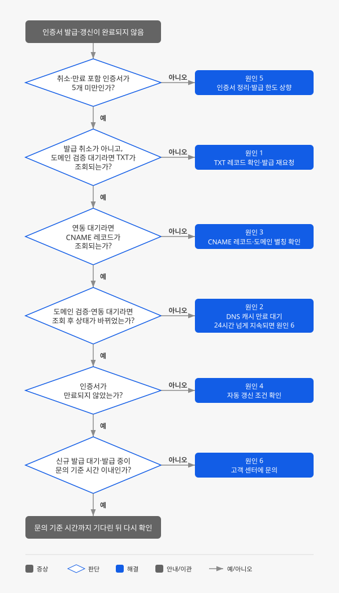

# CDN 인증서 발급·갱신에 실패합니다

## 증상

소유한 도메인으로 CDN에 HTTPS를 적용하려고 **Contents Delivery > CDN**의 **인증서 관리** 탭에서 **신규 인증서 발급**을 요청했는데, 인증서 상태가 단계별 문의 기준 시간([원인 6](#원인-6-nhn-cloud-측-발급-처리-지연) 참고)을 넘겨도 다음 단계로 넘어가지 않거나 발급 요청 자체가 거부됩니다. 다음과 같은 형태로 나타납니다.

- 인증서 상태가 **신규 발급 대기** 또는 **도메인 검증 대기**에서 바뀌지 않습니다.
- 인증서 발급과 배포가 끝났는데 상태가 **CDN 서비스 연동 대기**에서 **정상**으로 바뀌지 않습니다.
- 인증서 상태가 **발급 취소(도메인 검증 기간 초과)**로 바뀌고, 도메인 검증 기한이 지났다는 안내 메일을 받습니다.
- 사용 중이던 인증서가 자동으로 갱신되지 않고 상태가 **인증서 만료**로 바뀌어, 브라우저에서 해당 도메인으로 HTTPS 접속 시 인증서 오류(보안 경고)가 표시됩니다.
- 연동된 CDN 서비스가 없다는 안내 메일을 받습니다.
- 발급이 취소되었거나 만료된 인증서와 같은 도메인으로 신규 인증서 발급을 요청하면, **인증서 도메인** 입력란에 "이미 등록된 인증서 도메인입니다." 메시지가 표시되며 요청할 수 없습니다.
- **인증서 관리** 목록에 인증서가 5개(발급 취소·만료 포함) 있는 프로젝트에서 새 인증서를 발급할 수 없습니다.

## 진단 흐름도

CDN 인증서는 다음 순서로 발급되고 유지됩니다. 1번과 2번은 서로 따로 진행하며, 두 작업이 모두 끝나야 3번 CDN 서비스 연동을 할 수 있습니다.

1. 인증서 발급 요청 및 도메인 검증(**인증서 관리** 탭) → 인증서 발급 및 배포(NHN Cloud에서 처리, 사용자 작업 없음)
2. 도메인 등록 및 소유권 검증(**도메인 별칭** 탭)
3. CDN 서비스에 도메인 별칭 연동(**CDN 서비스** 탭)과 인증서 도메인의 CNAME 레코드 설정(DNS 서비스 제공 업체)
4. 인증서 만료 전 자동 갱신(**인증서 갱신 시작일**부터 5일 이내)

**인증서 관리** 탭의 인증서 상태는 다음과 같이 표시됩니다. 최종 상태는 **정상**, **발급 취소(도메인 검증 기간 초과)**, **인증서 만료** 세 가지이며, 그 외 상태에서 문의 기준 시간을 넘겨 머물러 있다면 아래 흐름도에서 원인을 찾으세요.

| 단계 | 상태 | 의미 | 확인할 원인 |
|---|---|---|---|
| 작업 대기 | 신규 발급 대기 | 발급 요청 직후 준비 중 | 원인 6 |
| 도메인 검증 | 도메인 검증 대기 | TXT 레코드 또는 HTTP 페이지 검증 필요 | 원인 1, 원인 2 |
| 인증서 발급 및 배포 | 인증서 발급 중(도메인 검증 완료) | 검증을 통과해 발급·배포 진행 중 | 원인 6 |
| CDN 서비스 연동 | CDN 서비스 연동 대기 | 발급 완료, CNAME 레코드 또는 도메인 별칭 미설정 | 원인 3, 원인 2 |
| 완료 | 정상 | 발급 완료, CNAME 레코드와 도메인 별칭 모두 확인됨 | - |
| 취소 | 발급 취소 중 → 발급 취소(도메인 검증 기간 초과) | 발급 요청 후 5일 안에 도메인 검증을 통과하지 못함 | 원인 1 |
| 만료 | 인증서 만료(처리 중) → 인증서 만료 | CDN 서비스 미연동으로 갱신 실패 | 원인 4 |
| 작업 대기 | 삭제 중 | 삭제가 끝나면 목록에서 사라짐 | - |



## 빠른 확인

다음 두 가지를 먼저 확인하세요. 5분 안에 원인을 좁힐 수 있습니다.

1. **인증서 관리** 탭에서 문제가 된 인증서의 **인증서 상태**와 **인증서 갱신 시작일**을 확인합니다. 어느 상태에서 멈췄는지에 따라 확인할 원인이 달라지므로, 위 [진단 흐름도](#진단-흐름도)의 상태표를 참고하세요. 상태에 ⓘ 표시가 있으면 해당 행을 클릭해 하단의 인증서 상세 정보에 표시되는 안내를 함께 확인합니다.
2. 외부 공인 DNS(`8.8.8.8`)로 인증서 도메인의 레코드를 조회합니다. CDN은 CDN 서비스 연동 여부(CNAME 레코드)를 Google 공인 DNS(`8.8.8.8`)로 확인하고, 인증서 도메인 검증(TXT 레코드 또는 HTTP 페이지)도 공인 DNS를 기준으로 진행합니다. 따라서 사내 DNS나 로컬 PC에서만 조회되는 레코드는 인식하지 못합니다.

   ```sh
   # 도메인 검증 단계: TXT 레코드가 조회되는지 확인
   nslookup -type=TXT _acme-challenge.cdn.example.com. 8.8.8.8

   # CDN 서비스 연동 대기 단계: CNAME 레코드가 CDN 서비스 도메인을 가리키는지 확인
   nslookup -type=CNAME cdn.example.com 8.8.8.8
   ```

   `dig`를 사용한다면 `dig +short TXT _acme-challenge.cdn.example.com @8.8.8.8`, `dig +short CNAME cdn.example.com @8.8.8.8`로 같은 내용을 확인할 수 있습니다.

## 원인과 해결 방법

### 원인 1: 도메인 검증 레코드가 없거나 검증 기한이 지남

CDN은 인증서를 발급하기 전에 요청한 사람이 도메인의 실제 소유자인지 확인합니다. 콘솔에 표시된 TXT 레코드(또는 HTTP 페이지)를 도메인에 추가해야 검증이 진행되며, 레코드가 외부 공인 DNS에서 조회되지 않으면 상태가 **도메인 검증 대기**에 머뭅니다.

CDN에는 성격이 다른 검증이 두 가지 있으며, 둘 다 완료해야 합니다. 도메인 소유권 검증을 마치지 않으면 CDN 서비스의 도메인 별칭에 도메인을 선택할 수 없고, 인증서 도메인 검증을 마치지 않으면 인증서가 발급되지 않습니다. 두 검증은 레코드 이름과 기한이 다르므로 각각 콘솔에 표시된 값으로 진행해야 합니다.

| 구분 | 진행 위치 | 검증 방식 | 기한 |
|---|---|---|---|
| 도메인 소유권 검증 | **도메인 별칭** 탭 | DNS TXT 레코드(`_akamai-host-challenge.[도메인]`), HTTP 파일 인증, HTTP 리다이렉트 인증 중 하나 | 토큰 발급일부터 14일 |
| 인증서 도메인 검증 | **인증서 관리** 탭 | DNS TXT 레코드(`_acme-challenge.[인증서 도메인].`), HTTP 페이지(`/.well-known/acme-challenge/`) 중 하나 | 인증서 발급 요청일부터 5일 |

기한 안에 검증을 마치지 않으면 다음과 같이 처리됩니다.

- **인증서 도메인 검증**: 인증서 상태가 **발급 취소 중**을 거쳐 **발급 취소(도메인 검증 기간 초과)**로 바뀌고, 도메인 검증 기한이 지났다는 안내 메일이 발송됩니다. 취소된 인증서는 목록에 남아 발급 한도에 포함됩니다.
- **도메인 소유권 검증**: 등록 후 14일이 지나면 상태가 **검증 토큰 만료**로 바뀌고 안내 메일이 발송됩니다. 만료 7일 전에도 안내 메일이 발송됩니다. 토큰이 만료되면 **검증 실행**을 할 수 없고, 만료된 뒤에 레코드를 등록해도 검증은 통과하지 않습니다.

도메인 소유권 검증은 실패해도 상태가 **검증 진행 중**으로 유지되고, 토큰이 만료될 때만 상태가 바뀝니다. 따라서 **검증 진행 중** 상태가 오래 이어진다면 검증에 실패하고 있는 것일 수 있습니다. 연동 단계에서 쓰는 CNAME 레코드만 등록하고 검증용 TXT 레코드를 등록하지 않은 경우에도 검증이 진행되지 않습니다.

**해결 방법**

1. 콘솔에서 해당 도메인을 선택해 검증에 필요한 레코드 이름과 값을 확인합니다. **도메인 별칭** 탭에서는 하단 **검증 정보**에 레코드 이름과 값, **검증 토큰 만료 일시**가 함께 표시됩니다. **인증서 관리** 탭에서는 인증서 행을 클릭하면 하단 **인증서 상세 정보**의 **도메인 검증** 항목에 TXT 레코드 이름과 값, HTTP 페이지 URL과 페이지 콘텐츠가 표시됩니다. 프로젝트 멤버에게 발송된 도메인 검증 가이드 메일에도 같은 값이 있습니다.
2. 도메인의 DNS 서비스 제공 업체에서 TXT 레코드를 추가합니다. 레코드 타입은 `TXT`, TTL은 `60`으로 설정합니다. TTL을 60으로 설정할 수 없다면 DNS 서비스 제공 업체가 허용하는 최솟값으로 설정하세요. TTL이 작을수록 값을 고쳤을 때 빨리 반영됩니다.
3. 외부 공인 DNS로 레코드가 조회되는지 확인합니다.

   ```sh
   nslookup -type=TXT _acme-challenge.cdn.example.com. 8.8.8.8
   ```

4. **도메인 별칭** 탭의 검증이라면 콘솔에서 **검증 실행** 버튼을 클릭하고, **검증 방식**에서 설정한 방식(**DNS TXT Record** 또는 **HTTP File / Redirect**)을 선택한 뒤 실행합니다. 레코드가 올바르면 15분 이내에 상태가 **검증 완료**로 바뀝니다. 15분이 지나도 **검증 진행 중**이라면 레코드 이름과 값을 다시 확인합니다. 상태가 **검증 토큰 만료**라면 **토큰 재발급** 버튼으로 새 토큰을 발급받습니다. 재발급하면 이전 검증 정보가 초기화되므로, 새 토큰 값으로 TXT 레코드를 수정한 뒤 다시 검증합니다.
5. **인증서 관리** 탭의 검증 기한(5일)이 지나 상태가 **발급 취소(도메인 검증 기간 초과)**로 바뀌었다면, 다음 순서로 다시 발급받습니다.
   1. **인증서 관리** 탭에서 취소된 인증서를 선택하고 **삭제** 버튼을 클릭한 뒤, **인증서 삭제** 창에서 **확인**을 클릭합니다. 취소된 인증서는 목록에 남아 있고 발급 한도에도 포함되므로 먼저 삭제해야 합니다.
   2. **신규 인증서 발급**을 클릭해 같은 도메인으로 다시 요청합니다.
   3. 상태가 **도메인 검증 대기**로 바뀌면 인증서 행을 클릭해 하단 **인증서 상세 정보**에서 새 레코드 값을 확인합니다. 이전 요청의 레코드 값은 사용할 수 없습니다.
   4. DNS에 새 TXT 레코드 값을 등록하고, 5일 안에 검증을 마칩니다.

   취소된 인증서를 삭제하지 않고 같은 도메인으로 다시 요청하면 "이미 등록된 인증서 도메인입니다." 메시지가 표시되고 요청이 진행되지 않습니다.

HTTP 방식으로 검증한다면 웹 서버의 포트 조건을 확인하세요. 인증서 도메인 검증의 HTTP 페이지 방식은 HTTP 기본 포트(80)로, 도메인 소유권 검증의 HTTP 파일·리다이렉트 방식은 HTTPS 기본 포트(443)로 운영 중인 웹 서버에서만 사용할 수 있습니다. 포트를 맞출 수 없다면 DNS TXT 레코드 방식을 사용하세요. 검증 방식별 자세한 설정은 [CDN 콘솔 사용 가이드](https://docs.nhncloud.com/ko/Contents%20Delivery/CDN/ko/console-guide/)를 참고하세요.

### 원인 2: DNS 전파 또는 캐시 지연

DNS 레코드는 추가하거나 수정해도 전 세계 DNS 서버에 바로 반영되지 않습니다. 이전 값이나 "레코드 없음" 응답이 캐시 DNS 서버에 TTL 동안 남아 있으면, 레코드를 올바르게 설정했더라도 CDN이 공인 DNS로 조회할 때 아직 이전 결과를 받을 수 있습니다. 이 경우 도메인 검증이 지연되거나, 인증서가 실제로는 정상 적용되었는데도 콘솔 상태가 **CDN 서비스 연동 대기**로 표시될 수 있습니다.

같은 이유로 DNS 조회가 일시적으로 실패하면, 실제로는 연동되어 있는데도 연동된 CDN 서비스가 없다는 안내 메일이 발송되기도 합니다.

**해결 방법**

1. 외부 공인 DNS로 레코드를 조회해 올바른 값이 반환되는지 확인합니다. 올바른 값이 반환된다면 설정에는 문제가 없습니다.
2. 기존 레코드의 TTL만큼 기다립니다. 레코드를 새로 추가했거나 값을 바꿨다면, 이전 값의 TTL이 지나야 모든 캐시 DNS 서버에 새 값이 반영됩니다.
3. 브라우저에서 `https://` 주소로 접속해 인증서가 정상 적용되었는지 확인합니다. 정상 적용되어 있다면 서비스에는 영향이 없으므로, 콘솔 상태가 바뀔 때까지 기다립니다.
4. 외부 DNS 조회가 정상인데도 **CDN 서비스 연동 대기** 상태가 24시간 넘게 지속되면 [원인 6](#원인-6-nhn-cloud-측-발급-처리-지연)에 해당하므로 [문의하기](#문의하기)를 참고해 문의합니다.

### 원인 3: CNAME 레코드가 CDN 서비스 도메인으로 조회되지 않음

인증서를 발급한 뒤에는 인증서 도메인을 CDN 서비스에 연동해야 상태가 **정상**이 됩니다. CDN은 Google 공인 DNS(`8.8.8.8`)로 인증서 도메인의 CNAME 레코드를 조회해, 이 레코드가 연동할 CDN 서비스 도메인(`[서비스ID].toastcdn.net`)을 가리키는지 확인해 연동 여부를 판단합니다. CNAME 레코드를 추가했는데도 외부에서 이 값이 조회되지 않으면 상태가 **CDN 서비스 연동 대기**에 머뭅니다. CNAME 레코드가 조회되지 않는 대표적인 경우는 다음과 같습니다.

- **루트 도메인에 ALIAS 레코드를 사용함**: DNS 표준상 루트 도메인(예: `example.com`)에는 CNAME 레코드를 등록할 수 없습니다. 일부 DNS 업체가 제공하는 ALIAS·ANAME 레코드는 CNAME으로 조회되지 않으므로 CDN은 연동을 확인하지 못합니다. CDN은 CNAME 레코드를 이용한 연동만 지원합니다.
- **네임서버가 실제 레코드를 호스팅하는 DNS와 다름**: 도메인 등록 업체에 설정된 네임서버(NS)가 레코드를 관리하는 DNS 서비스와 다르면, 레코드를 추가해도 외부에서는 조회되지 않습니다. 사내 DNS에 같은 레코드가 등록되어 있으면 내부망에서는 정상으로 보이기 때문에 알아차리기 어렵습니다.
- **네임서버가 오류 응답을 반환함**: 권한 있는 네임서버(authoritative DNS)가 `SERVFAIL`을 반환하거나 CAA 레코드 질의에 응답하지 못하면, 레코드가 등록되어 있어도 CDN이 조회에 실패한 것으로 판단해 발급·갱신이 실패할 수 있습니다.
- **도메인 별칭에 인증서 도메인이 없음**: CNAME 레코드는 올바르지만 CDN 서비스의 도메인 별칭에 인증서 도메인을 추가하지 않은 경우입니다.

**해결 방법**

1. 외부 공인 DNS로 CNAME 레코드와 네임서버를 조회합니다.

   ```sh
   # CNAME이 CDN 서비스 도메인([서비스ID].toastcdn.net)을 가리키는지 확인
   nslookup -type=CNAME cdn.example.com 8.8.8.8

   # 네임서버가 실제로 레코드를 관리하는 DNS 서비스와 일치하는지 확인
   nslookup -type=NS example.com 8.8.8.8
   ```

2. 루트 도메인을 사용 중이라면 `www.example.com`처럼 서브도메인으로 바꿔 CNAME 레코드를 설정하고, 그 서브도메인으로 인증서를 발급받습니다. 루트 도메인은 CDN 서비스에 연동할 수 없습니다. 루트 도메인으로 발급한 인증서를 삭제하려면, 먼저 CDN 서비스의 도메인 별칭에서 루트 도메인을 제거해야 합니다.
3. 네임서버가 다르다면 도메인을 구매한 등록 업체의 관리 페이지에서 네임서버를 변경합니다. 레코드를 관리하는 DNS 서비스의 네임서버를 입력하세요. NHN Cloud **DNS Plus**를 사용한다면 DNS Plus에 표시된 네임서버로 설정합니다. 네임서버 변경이 전파되면 CDN 연동은 자동으로 진행됩니다.
4. 네임서버가 `SERVFAIL`을 반환한다면 DNS 서비스 제공 업체에 상위 존 설정과 응답 상태 확인을 요청합니다.
5. **CDN 서비스** 탭에서 연동할 CDN 서비스를 선택하고 **수정** 버튼을 클릭한 뒤, 도메인 별칭에 인증서 도메인이 설정되어 있는지 확인합니다. 설정되어 있지 않다면 드롭다운에서 인증서 도메인을 선택하고 **CDN 서비스 수정**을 클릭해 저장합니다. 도메인 별칭에는 **도메인 별칭** 탭에서 검증이 완료된 도메인만 선택할 수 있습니다. 도메인을 선택했을 때 다음 경고가 표시되면 인증서 발급이 아직 끝나지 않은 것이므로, 인증서 상태가 **CDN 서비스 연동 대기**가 된 뒤 설정하세요.

   > "[인증서 도메인] 도메인은 발급된 인증서가 없습니다. 발급된 인증서가 없는 경우 HTTPS 서비스 시 인증서 오류가 발생합니다."

CNAME 레코드 설정 방법은 DNS 서비스 제공 업체마다 다릅니다. 업체별 설정 방법은 해당 업체에 문의하세요.

### 원인 4: 자동 갱신 조건이 충족되지 않아 인증서가 만료됨

CDN 인증서는 만료 전에 자동으로 갱신되며, 갱신은 **인증서 관리** 목록에 표시된 **인증서 갱신 시작일**부터 5일 이내에 진행됩니다. 인증서 행을 클릭하면 하단 **인증서 상세 정보**의 **인증서 갱신 기간**에서 갱신이 진행되는 기간을 확인할 수 있습니다. 갱신할 때도 CDN은 발급 때와 마찬가지로 도메인 검증을 다시 수행합니다.

인증서 도메인이 CNAME 레코드로 CDN 서비스에 연결되어 있으면, 갱신 검증은 CDN이 응답하는 HTTP 경로(`/.well-known/acme-challenge/*`)를 통해 자동으로 통과합니다. 그래서 발급 후 `_acme-challenge` TXT 레코드를 삭제해도 갱신에는 영향이 없습니다. 반대로 CNAME 연결이 끊겨 있으면 갱신 검증에 실패하고, 갱신 기간의 마지막 날에 인증서가 만료 처리됩니다. 이미 **정상**인 인증서도 CNAME 레코드가 조회되지 않으면 상태가 **CDN 서비스 연동 대기**로 바뀝니다. 갱신 기간 전에 이 상태로 바뀌었다면 CNAME 연결이 끊긴 것이므로, 갱신 기간이 끝나기 전에 조치하세요.

따라서 갱신이 성공하려면 다음 조건이 모두 유지되어야 합니다.

- 인증서 도메인의 CNAME 레코드가 연동된 CDN 서비스 도메인을 가리킵니다.
- 연동된 CDN 서비스의 도메인 별칭에 인증서 도메인이 설정되어 있습니다.
- 인증서가 연동된 CDN 서비스가 일시 정지되거나 삭제되지 않았습니다.
- 인증서 도메인의 네임서버와 DNS 설정이 정상적으로 유지됩니다([원인 3](#원인-3-cname-레코드가-cdn-서비스-도메인으로-조회되지-않음) 참고).

다른 CDN 서비스에서 사용하던 도메인을 NHN Cloud CDN으로 옮겨 온 경우, 이전 서비스에 해당 도메인의 인증서 정보가 남아 있으면 갱신이 실패할 수 있습니다.

**해결 방법**

아직 만료되지 않았다면 갱신 기간이 끝나기 전에 다음과 같이 조치합니다.

1. [원인 3](#원인-3-cname-레코드가-cdn-서비스-도메인으로-조회되지-않음)의 방법으로 CNAME 레코드, 네임서버, 도메인 별칭 설정을 확인합니다.
2. 인증서가 연동된 CDN 서비스를 일시 정지했다면 **인증서 갱신 시작일** 전에 **재시작**합니다. 서비스를 삭제할 예정이라면 삭제하기 전에 운영 중인 다른 CDN 서비스에 인증서 도메인을 연동합니다.
3. 다른 CDN 서비스에서 옮겨 온 도메인이라면 이전 서비스에서 해당 도메인의 인증서와 서비스를 정리했는지 확인합니다.

이미 만료된 인증서는 갱신할 수 없으므로 같은 도메인으로 새로 발급받아야 합니다. 이때 순서가 중요합니다. 같은 도메인의 인증서는 기존 항목을 삭제하기 전까지 다시 등록할 수 없고("이미 등록된 인증서 도메인입니다." 메시지 표시), 만료된 인증서는 CDN 서비스에 연동된 상태에서는 삭제할 수 없습니다. 연동된 상태에서는 인증서를 선택해도 **삭제** 버튼이 비활성화되며, 버튼에 마우스를 올리면 다음 안내가 표시됩니다.

> "연동된 CDN 서비스 도메인이 있는 경우 인증서를 삭제할 수 없습니다. 연동된 CDN 서비스의 도메인 별칭에서 삭제할 인증서 도메인을 제거한 후 삭제하시기 바랍니다."

따라서 **도메인 별칭 연동 해제 → 만료 인증서 삭제 → 신규 발급** 순서로 진행합니다.

> [!WARNING]
> 새 인증서가 발급·배포되기 전까지 해당 도메인의 HTTPS 접속이 중단됩니다. 발급과 배포에는 9시간 이상 걸릴 수 있으므로, 서비스 영향이 적은 시간에 진행하세요.

1. **CDN 서비스** 탭에서 만료된 인증서 도메인이 연동된 CDN 서비스를 선택하고 **수정** 버튼을 클릭한 뒤, 도메인 별칭에서 인증서 도메인을 제거하고 **CDN 서비스 수정**을 클릭해 저장합니다.
2. **인증서 관리** 탭에서 만료된 인증서를 선택하고 **삭제** 버튼을 클릭한 뒤, **인증서 삭제** 창에서 **확인**을 클릭합니다. **인증서 만료** 상태의 인증서는 즉시 삭제됩니다. 상태가 **인증서 만료(처리 중)**이면 **삭제** 버튼이 비활성화되므로, **인증서 만료**로 바뀐 뒤 삭제합니다.
3. **신규 인증서 발급**으로 같은 도메인의 인증서를 다시 요청하고, 새로 발급된 TXT 레코드 값으로 도메인 검증을 진행합니다.
4. 상태가 **CDN 서비스 연동 대기**가 되면 CDN 서비스의 도메인 별칭에 인증서 도메인을 다시 추가합니다.

> [!NOTE]
> 인증서가 처리 중(**신규 발급 대기**, **발급 취소 중**, **인증서 만료(처리 중)**, **삭제 중**)이거나 CDN 서비스에 연동되어 있으면 **삭제** 버튼이 비활성화됩니다. 발급 취소·만료 상태의 인증서는 즉시 삭제되고, 그 외 상태의 인증서는 **삭제 중** 상태를 거쳐 목록에서 사라집니다.

### 원인 5: 프로젝트의 인증서 발급 한도를 초과함

CDN 인증서는 프로젝트당 5개까지 발급할 수 있습니다. 한도는 삭제한 인증서를 제외한 모든 항목을 기준으로 계산하므로, 발급이 취소되었거나 만료된 인증서도 콘솔에서 삭제하기 전까지 한도에 포함됩니다. 그래서 실제로 쓰는 인증서가 5개보다 적어도 새 인증서를 발급하지 못할 수 있습니다.

**해결 방법**

> [!WARNING]
> 삭제한 인증서는 복구할 수 없습니다. 같은 도메인을 다시 사용하려면 신규 인증서 발급과 도메인 검증을 처음부터 다시 진행해야 합니다.

1. **인증서 관리** 탭에서 발급이 취소되었거나 만료된 인증서, 사용하지 않는 인증서가 있는지 확인하고 삭제합니다. 만료된 인증서가 CDN 서비스에 연동되어 있다면 [원인 4](#원인-4-자동-갱신-조건이-충족되지-않아-인증서가-만료됨)의 방법으로 먼저 연동을 해제해야 삭제할 수 있습니다.
2. 인증서가 5개보다 더 필요하면 NHN Cloud 고객 센터에 한도 상향을 요청합니다. 요청할 때 프로젝트 ID와 프로젝트 이름, 필요한 인증서 개수를 함께 전달합니다.

> [!NOTE]
> CDN에서는 CDN에서 발급한 단일 도메인 인증서만 사용할 수 있습니다. 다른 인증 기관(CA)에서 발급한 인증서를 업로드해 사용할 수 없으며, 와일드카드 인증서와 멀티 도메인 인증서도 지원하지 않습니다. 도메인마다 인증서를 따로 발급하므로 필요한 도메인 수만큼 한도를 미리 확보하세요.

### 원인 6: NHN Cloud 측 발급 처리 지연

인증서 발급과 배포는 외부 인증 기관과 연동해 NHN Cloud가 처리합니다. CDN 인증서는 사용자별로 따로 발급되는 것이 아니라, 사용자가 인증서를 추가하면 NHN Cloud가 관리하는 인증서에 사용자 도메인을 추가하는 방식입니다. 이 과정에서 처리가 지연되거나 실패하면, 사용자 설정이 올바르더라도 콘솔 상태가 한 단계에서 멈춥니다. 이때는 NHN Cloud의 확인과 조치가 필요합니다.

단계별 문의 기준 시간은 다음과 같습니다. 이 시간을 넘겼고 원인 1~3에 해당하지 않으면 이 원인을 의심하세요.

| 단계 | 이 시간이 지나도 상태가 바뀌지 않으면 문의 |
|---|---|
| 발급 요청 후 **신규 발급 대기** → **도메인 검증 대기** | 2시간 |
| 도메인 검증 통과 후 **인증서 발급 중(도메인 검증 완료)** → **CDN 서비스 연동 대기** | 9시간 이상(공식 가이드 안내) |
| CNAME 레코드 설정 후 **CDN 서비스 연동 대기** → **정상** | 24시간 |

**해결 방법**

1. 원인 1~3의 방법으로 TXT 레코드, CNAME 레코드, 네임서버 설정이 외부에서 올바르게 조회되는지 다시 확인합니다.
2. 설정에 문제가 없는데도 위 처리 시간을 넘겼다면 [문의하기](#문의하기)를 참고해 문의합니다. NHN Cloud에서 발급·배포 상태를 확인하고, 필요하면 수동으로 처리합니다.

## 문의하기

위 방법으로 해결되지 않으면 [NHN Cloud 고객 센터](https://www.nhncloud.com/kr/support/inquiry)에 문의하세요. 문의할 때 다음 정보를 함께 전달하면 빠른 진단에 도움이 됩니다.

- 문제가 발생한 인증서 도메인(FQDN, 예: `cdn.example.com`)
- 프로젝트 ID와 프로젝트 이름
- 인증서 발급을 요청한 시각과 현재 인증서 상태, 상태가 바뀌지 않은 기간(KST 기준)
- 요청이 거부되었다면 표시된 오류 메시지 원문
- 연동할 CDN 서비스 도메인(`[서비스ID].toastcdn.net`)
- 도메인의 DNS 서비스 제공 업체와 네임서버
- 외부 공인 DNS로 TXT, CNAME, NS 레코드를 조회한 결과(`nslookup ... 8.8.8.8` 출력 전문)
- 콘솔의 인증서 상태 화면 캡처와 수신한 안내 메일
- 다른 CDN 서비스에서 옮겨 온 도메인이라면 이전 서비스 이름과 정리 여부

## 문제 예방하기

- **인증서 안내 메일을 받을 담당자를 프로젝트 멤버로 등록**: 도메인 검증 가이드, 발급 완료, 연동 요청 등 인증서 관련 메일은 프로젝트 멤버에게 발송됩니다. 실제 DNS를 관리하는 담당자가 프로젝트 멤버가 아니면 검증 기한이나 갱신 문제를 놓치기 쉽습니다.
- **도메인 이전 전에 TTL을 미리 줄이기**: 다른 CDN이나 서버에서 NHN Cloud CDN으로 옮길 예정이라면, 작업 하루 전에 기존 CNAME 레코드의 TTL을 60초로 줄여 둡니다. 레코드를 바꾼 뒤 이전 값이 오래 캐시되어 연동 대기가 길어지는 것을 줄일 수 있습니다.
- **처음부터 서브도메인으로 설계**: CDN은 CNAME 레코드로만 연동하므로, 서비스 주소를 루트 도메인 대신 `www`나 `cdn` 같은 서브도메인으로 정하고 루트 도메인은 웹 서버에서 서브도메인으로 리다이렉트합니다.
