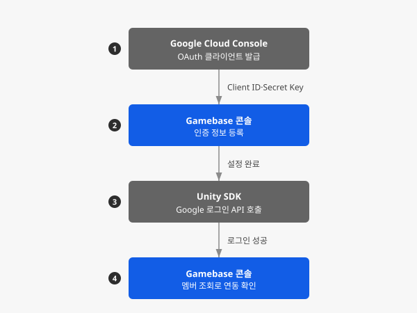
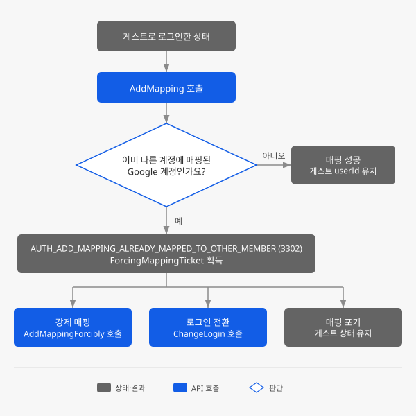

# Gamebase에 Google IdP를 연동해 소셜 로그인 구현하기

## 시작하기 전에

Gamebase는 게임 개발에 필요한 로그인, 결제, 푸시 등 공통 기능을 제공하는 NHN Cloud의 게임 플랫폼입니다. Gamebase로 소셜 계정 로그인을 구현하려면 Google 같은 외부 IdP(identity provider, 사용자 식별 정보를 관리하고 인증 서비스를 제공하는 시스템)와 연동해야 합니다. Google IdP 연동은 Google Cloud Console, Gamebase 콘솔, 클라이언트 SDK 세 곳에 설정이 나뉘어 있어 어떤 순서로 무엇을 해야 할지 헷갈리기 쉽습니다.

여기에서는 Google Cloud Console에서 OAuth 클라이언트를 발급하고 Gamebase 콘솔과 Unity SDK에 연결해, Android 게임 사용자가 Google 계정으로 로그인하고 기존 게스트 계정을 Google 계정에 매핑할 수 있도록 구성하는 방법을 살펴봅니다.



## 사전 준비하기

이 가이드를 따라 하려면 NHN Cloud 계정과 별개로 Google 계정이 필요합니다.

- **Google 계정**(개인 Gmail 또는 Google Workspace 조직 계정): Google Cloud Console에서 OAuth 클라이언트를 발급할 때 사용합니다.
- **NHN Cloud 계정**: Gamebase 콘솔에서 인증 정보를 등록할 때 사용합니다.
- **Gamebase 서비스 활성화**: NHN Cloud 프로젝트에서 Gamebase 서비스를 활성화합니다. 서비스를 활성화하면 앱이 자동으로 생성되므로 앱을 따로 만들 필요는 없습니다(프로젝트당 앱 1개).
- **Gamebase SDK 설치**: 게임 클라이언트 프로젝트에 Gamebase SDK를 설치합니다. 이 가이드는 Gamebase Unity SDK 2.81.4 이상을 기준으로 합니다.
- **Android 앱 정보**: APK 서명에 사용하는 키스토어의 SHA-1 인증서 지문과 애플리케이션 패키지 이름을 확인합니다.

> [!NOTE]
> 이 가이드는 Android 앱을 기준으로 합니다. iOS 앱의 Google 로그인 설정은 [iOS SDK 사용 가이드 > 시작하기](https://docs.nhncloud.com/ko/Game/Gamebase/ko/ios-started/)를 참고하세요.
>
> 앱을 Google Play에 배포할 계획이라면 **Google Play 개발자 계정**(최초 1회 등록비 발생)도 필요합니다. 로컬 APK로 개발 단계 테스트만 한다면 이 계정 없이 디버그 키스토어만으로 이 가이드의 전 과정을 따라 할 수 있습니다.

## Google OAuth 클라이언트 발급하기

Gamebase는 Google 로그인을 처리할 때 Google이 발급한 클라이언트 자격 증명을 사용합니다. Android에서는 내부적으로 OAuth 2.0(사용자 비밀번호를 넘기지 않고 제3자 앱에 접근 권한을 위임하는 인가 프레임워크) 기반의 OIDC(OpenID Connect) 방식으로 ID 토큰을 전달받습니다. 클라이언트를 발급하고 콘솔에 등록하는 절차는 이 내부 동작과 관계없이 같습니다.

> [!NOTE]
> Android 단말의 Google Play services 버전이 낮으면 구버전 Google Sign-In API를 쓰는 레거시(legacy) 경로로 자동 전환되며, 이때만 OAuth 2.0 인증 코드(authorization code) 방식을 사용합니다.




### 동의 화면(브랜딩) 구성하기

OAuth 클라이언트 ID를 발급하려면 먼저 Google 인증 플랫폼에서 동의 화면을 구성해야 합니다. 동의 화면은 사용자가 Google 로그인 시 어떤 앱이 권한을 요청하는지 확인하는 화면입니다. 이미 구성했다면 다음 단계로 넘어가세요.

1. [Google Cloud Console](https://console.cloud.google.com/)에서 연동할 프로젝트를 선택하고, 왼쪽 메뉴에서 **Google 인증 플랫폼 > 개요**로 이동하세요.

    새로 만든 프로젝트에서는 왼쪽 메뉴에 **Google 인증 플랫폼**이 바로 보이지 않을 수 있습니다. 이때는 상단 검색창에서 "Google 인증 플랫폼"을 검색하거나 **API 및 서비스 > OAuth 동의 화면**으로 이동하세요.

2. **동의 화면 구성**을 클릭하고 **시작하기**를 클릭한 뒤, 마법사의 각 단계를 입력하세요.

    - **앱 정보**: 앱 이름과 사용자 지원 이메일을 입력합니다.
    - **대상**: **외부**를 선택합니다. 게임처럼 불특정 다수의 사용자에게 서비스하는 앱이기 때문입니다. **내부**는 Google Workspace 조직 내 사용자만 사용하는 앱에 한정되며, 개인 Gmail 계정으로 만든 프로젝트에서는 선택할 수 없습니다.
    - **연락처 정보**: 담당자 이메일을 입력합니다.
    - **완료**: 약관에 동의합니다.

3. **만들기**를 클릭하세요.

    구성이 끝나면 **Google 인증 플랫폼 > 개요** 화면에 **OAuth 클라이언트 만들기** 버튼이 나타납니다.

> [!NOTE]
> **대상**을 **외부**로 설정한 앱은 "테스트 중" 상태로 시작하며, **테스트 사용자** 목록에 **+ Add users**로 추가한 계정만 로그인할 수 있습니다. 앱 인증(정식 게시) 전까지 허용되는 테스트 사용자는 앱의 전체 수명 주기 기준으로 최대 100명입니다. 정식 서비스로 전환하려면 Google의 앱 인증 절차를 별도로 거쳐야 합니다.



### Android 클라이언트 발급하기

게임 클라이언트가 Google 로그인을 요청할 때 사용할 Android 클라이언트 ID를 발급합니다. Google은 패키지 이름과 서명 지문으로 로그인을 요청한 앱이 정상 앱인지 확인합니다.

1. 왼쪽 메뉴에서 **Google 인증 플랫폼 > 클라이언트**를 클릭하고 **+ 클라이언트 만들기**를 클릭하세요. **개요** 화면의 **OAuth 클라이언트 만들기**를 클릭해도 됩니다.

2. **애플리케이션 유형**에서 **Android**를 선택하고 다음 정보를 입력하세요.

    - **이름**: 클라이언트를 구분할 이름입니다. 기본값이 자동으로 입력됩니다.
    - **패키지 이름**: APK의 패키지 이름(예: `com.example.mygame`)입니다. `AndroidManifest.xml` 파일에서 확인할 수 있습니다.
    - **SHA-1 인증서 디지털 지문**: 서명 키스토어의 SHA-1 지문입니다.

    서명 키스토어의 SHA-1 지문은 다음 명령으로 확인합니다.

    ```sh
    keytool -keystore {keystore_path} -list -v
    ```

    개발 단계에서 디버그 키스토어를 사용한다면 다음 명령으로 확인합니다. 디버그 키스토어는 macOS/Linux에서는 `~/.android/debug.keystore`, Windows에서는 `%USERPROFILE%\.android\debug.keystore`에 있습니다. Windows 명령 프롬프트는 `~`를 경로로 인식하지 않으므로 전체 경로를 입력하세요.

    ```sh
    keytool -list -v -keystore {debug_keystore_path} -alias androiddebugkey -storepass android -keypass android
    ```

    `keytool`은 JDK에 포함된 도구입니다. Java가 설치되지 않은 환경에서는 "Unable to locate a Java Runtime" 오류가 발생하므로, Unity의 Android Build Support 모듈과 함께 설치되는 OpenJDK의 `keytool`을 전체 경로로 실행하세요. 다음은 Unity Hub 기본 설치 경로 기준입니다.

    - macOS: `/Applications/Unity/Hub/Editor/{unity_version}/PlaybackEngines/AndroidPlayer/OpenJDK/bin/keytool`
    - Windows: `C:\Program Files\Unity\Hub\Editor\{unity_version}\Editor\Data\PlaybackEngines\AndroidPlayer\OpenJDK\bin\keytool.exe`

    화면 하단의 **앱 소유권 확인(선택사항)** 항목은 입력하지 않아도 됩니다.

3. **만들기**를 클릭하세요.

    Android 클라이언트는 클라이언트 보안 비밀번호(client secret) 없이 클라이언트 ID만 발급됩니다. 이 클라이언트 ID는 Google이 앱을 확인하는 데만 사용하며, Gamebase 콘솔에는 등록하지 않습니다.

> [!NOTE]
> Google Play에 앱을 등록했다면 Play 앱 서명이 적용된 SHA-1 지문으로 Android 클라이언트를 추가로 발급해야 합니다. 이 지문은 Google Play Console에서 앱을 선택한 뒤 **Google Play로 보호됨 > Play 스토어 보호 > 앱 서명 키 보호 > Play 앱 서명 관리**의 **앱 서명 키** 섹션에서 확인할 수 있습니다.



### 웹 애플리케이션 클라이언트 발급하기

Gamebase 서버가 Google 토큰의 유효성을 검증할 때 사용할 웹 애플리케이션 클라이언트를 발급합니다. Gamebase 콘솔에 등록하는 클라이언트 ID와 보안 비밀번호는 이 클라이언트에서 발급한 값입니다.

1. **Google 인증 플랫폼 > 클라이언트** 화면에서 **+ 클라이언트 만들기**를 클릭하세요.

2. **애플리케이션 유형**에서 **웹 애플리케이션**을 선택하고 **이름**을 입력하세요.

3. **승인된 리디렉션 URI**에 다음 두 값을 모두 추가하세요. Gamebase 서버가 Google 인증 결과를 전달받는 콜백 주소로, 첫 번째는 Gamebase 알파 환경용이고 두 번째는 실서비스 환경용입니다. Google은 Gamebase 서버가 보내는 주소와 정확히 일치해야 로그인을 허용하므로, 값을 바꾸지 말고 그대로 입력하세요.

    ```text
    https://alpha-id-gamebase.toast.com/oauth/callback
    https://id-gamebase.toast.com/oauth/callback
    ```

4. **만들기**를 클릭하고, 생성된 **클라이언트 ID**와 **클라이언트 보안 비밀번호**를 메모하세요.

> [!WARNING]
> Gamebase 콘솔에 등록하는 Client ID와 Secret Key는 반드시 **웹 애플리케이션** 클라이언트에서 발급한 값이어야 합니다. Android 클라이언트 ID를 등록하면 Gamebase 서버가 토큰을 검증할 수 없습니다.




## Gamebase 콘솔에 인증 정보 등록하기

발급한 클라이언트 정보를 Gamebase 콘솔에 등록합니다. 이 단계를 마쳐야 Gamebase가 Google 로그인 요청을 처리할 수 있습니다.

1. [NHN Cloud 콘솔](https://console.nhncloud.com/)에서 **Game > Gamebase**를 클릭하세요.

2. 상단 메뉴에서 **앱**을 클릭하고, **인증 정보** 탭에서 **수정**을 클릭하세요.

3. **+** 버튼을 클릭해 행을 추가하고 다음 정보를 입력하세요.

    - **Identity Provider**: **Google**을 선택합니다.
    - **Client ID**: 위 칸에 웹 애플리케이션 클라이언트 ID(`{web_client_id}`)를 입력합니다. 아래 칸은 iOS 클라이언트 ID를 입력하는 곳이므로 Android 앱만 서비스한다면 비워 둡니다.
    - **Secret Key**: 웹 애플리케이션 클라이언트의 클라이언트 보안 비밀번호를 입력합니다.
    - **토큰 재검증**: 기본값인 **검증 안 함**을 유지합니다. 마지막으로 로그인한 IdP로 다시 로그인할 때(`Gamebase.LoginForLastLoggedInProvider()`) Gamebase 내부 토큰만 검증합니다. **항상 검증**을 선택하면 Google 토큰까지 매번 검증합니다.
    - **추가 정보**: Google 로그인 후 프로필에서 이메일 정보를 받으려면 `{ "scope": ["email"] }`를 입력합니다. scope는 앱이 Google에 요청하는 접근 권한 범위로, 필요한 값을 배열에 추가할 수 있습니다. 사용 가능한 scope는 [Google OAuth 2.0 Scopes](https://developers.google.com/identity/protocols/oauth2/scopes)를 참고하세요.

    **Callback URL**은 Google의 경우 입력할 수 없으며, Gamebase 서버가 사용하는 고정 콜백 주소(`https://id-gamebase.toast.com/oauth/callback`)를 보여 줍니다. 앞에서 웹 애플리케이션 클라이언트의 **승인된 리디렉션 URI**에 등록한 값과 같습니다.

    > [!NOTE]
    > **추가 정보**에 등록한 값은 기본값입니다. Unity SDK의 `Gamebase.Login(providerName, additionalInfo, callback)`으로 추가 정보를 직접 전달하면 콘솔에 등록한 값 대신 코드에서 전달한 값을 사용합니다.

4. **저장**을 클릭하세요. 저장한 인증 정보가 반영되기까지 최대 10분이 걸릴 수 있습니다.

각 필드의 상세 명세는 [Gamebase 콘솔 가이드 > 앱 > 인증 정보](https://docs.nhncloud.com/ko/Game/Gamebase/ko/oper-app/#authentication-information)를 참고하세요.

## Unity SDK에서 Google 로그인 구현하기




### SDK 초기화하기

Gamebase SDK는 초기화를 마친 뒤에만 로그인 API를 호출할 수 있으므로, 앱 시작 시 한 번 초기화하세요.

```csharp
var configuration = new GamebaseRequest.GamebaseConfiguration
{
    appID = "{app_id}",            // Gamebase 앱 ID(콘솔에서 확인)
    appVersion = "1.0.0",          // 클라이언트 버전
    displayLanguageCode = GamebaseDisplayLanguageCode.Korean
};

#if UNITY_ANDROID
    configuration.storeCode = GamebaseStoreCode.GOOGLE;
#elif UNITY_WEBGL
    configuration.storeCode = GamebaseStoreCode.WEBGL;
#elif UNITY_EDITOR_OSX || UNITY_STANDALONE_OSX
    configuration.storeCode = GamebaseStoreCode.MACOS;
#else
    configuration.storeCode = GamebaseStoreCode.WINDOWS;
#endif

Gamebase.Initialize(configuration, (launchingInfo, error) =>
{
    if (Gamebase.IsSuccess(error))
    {
        Debug.Log("Gamebase 초기화 성공");
    }
    else
    {
        Debug.LogError($"초기화 실패: {error}");
    }
});
```

`storeCode`는 앱을 배포하는 스토어를 나타내는 필수 항목입니다. 설정하지 않고 초기화하면 `INVALID_PARAMETER(3)` 오류가 반환됩니다.



### Google 로그인 호출하기

초기화 성공을 확인한 뒤 Google 로그인을 호출하세요.

```csharp
Gamebase.Login(GamebaseAuthProvider.GOOGLE, (authToken, error) =>
{
    if (Gamebase.IsSuccess(error))
    {
        string userId = authToken.member.userId;
        Debug.Log($"Google 로그인 성공. userId: {userId}");
    }
    else
    {
        if (error.code == (int)GamebaseErrorCode.SOCKET_ERROR ||
            error.code == (int)GamebaseErrorCode.SOCKET_RESPONSE_TIMEOUT)
        {
            Debug.LogWarning("네트워크 오류입니다. 재시도가 필요합니다.");
        }
        else
        {
            Debug.LogError($"로그인 실패: {error}");
        }
    }
});
```

`Gamebase.Login()`을 호출하면 기기에 Google 계정 선택 화면이 표시됩니다. 사용자가 계정을 선택하고 권한을 허용하면 콜백으로 `authToken`이 전달되며, 여기에는 Gamebase `userId`, 액세스 토큰, IdP 정보가 들어 있습니다. 전체 인증 흐름과 오류 코드는 [Unity SDK 사용 가이드 > 인증](https://docs.nhncloud.com/ko/Game/Gamebase/ko/unity-authentication/)을 참고하세요.

> [!NOTE]
> Standalone이나 WebGL 플랫폼에서는 `GamebaseAuthProviderCredential.REDIRECT_URI`를 추가로 입력해야 합니다. 입력하지 않으면 기본값(Standalone: `http://localhost:8080/`, WebGL: `http://localhost/`)을 사용하므로, 어느 쪽이든 사용하는 값을 웹 애플리케이션 클라이언트의 **승인된 리디렉션 URI**에 등록하세요. Android에서는 필요하지 않습니다.
>
> `REDIRECT_URI`는 Gamebase 콘솔의 **Callback URL**과 용도가 다릅니다. **Callback URL**은 Gamebase 서버가 사용하는 고정 주소이고, `REDIRECT_URI`는 Standalone/WebGL 클라이언트가 로그인을 마친 뒤 자기 자신으로 돌아오기 위해 개발자가 지정하는 주소입니다.




## 게스트 계정을 Google 계정에 매핑하기

많은 게임이 처음 실행할 때 게스트로 플레이하게 하고, 나중에 Google 계정에 연결해 게임 데이터를 이어받게 합니다. Gamebase에서는 이를 매핑(mapping, 하나의 Gamebase 계정에 여러 IdP 계정을 연결하는 기능)이라고 합니다. 매핑을 마치면 Google 계정으로 로그인해도 기존 게스트 `userId`와 게임 데이터가 그대로 유지됩니다.



1. 게스트로 로그인한 상태에서 매핑 API를 호출하세요.

    ```csharp
    Gamebase.AddMapping(GamebaseAuthProvider.GOOGLE, (authToken, error) =>
    {
        if (Gamebase.IsSuccess(error))
        {
            Debug.Log("Google 계정 매핑 성공");
        }
        else if (error.code == (int)GamebaseErrorCode.AUTH_ADD_MAPPING_ALREADY_MAPPED_TO_OTHER_MEMBER)
        {
            // 매핑하려는 Google 계정이 이미 다른 Gamebase 계정에 매핑된 경우
            GamebaseResponse.Auth.ForcingMappingTicket forcingMappingTicket =
                GamebaseResponse.Auth.ForcingMappingTicket.From(error);

            Debug.LogWarning("이미 다른 계정에 매핑된 Google 계정입니다.");
        }
        else
        {
            Debug.LogError($"매핑 실패: {error}");
        }
    });
    ```

    매핑하려는 Google 계정이 이미 다른 Gamebase 계정에 매핑되어 있으면 `AUTH_ADD_MAPPING_ALREADY_MAPPED_TO_OTHER_MEMBER`(3302) 오류가 반환됩니다. 로그에는 오류 코드 `3302`와 메시지 "Already mapped to other member"가 기록됩니다. 이때 `ForcingMappingTicket.From()`으로 다음 단계에 필요한 티켓을 얻습니다.

2. 오류가 반환됐다면 서비스 정책에 따라 다음 세 가지 중 하나로 처리하세요.

    - **강제 매핑**: 기존 계정과의 매핑을 해제하고 현재 게스트 계정에 매핑합니다. "최근 기기가 우선"인 정책에 적합합니다.

        ```csharp
        Gamebase.AddMappingForcibly(forcingMappingTicket, (authTokenForcibly, errorForcibly) =>
        {
            if (Gamebase.IsSuccess(errorForcibly))
            {
                Debug.Log("강제 매핑 성공");
            }
            else
            {
                Debug.LogError($"강제 매핑 실패: {errorForcibly}");
            }
        });
        ```

    - **로그인 전환**: 현재 게스트 계정 대신, 해당 Google 계정이 이미 매핑된 계정으로 로그인합니다.

        ```csharp
        Gamebase.ChangeLogin(forcingMappingTicket, (authTokenForcibly, errorForcibly) =>
        {
            if (Gamebase.IsSuccess(errorForcibly))
            {
                Debug.Log("로그인 전환 성공");
            }
            else
            {
                Debug.LogError($"로그인 전환 실패: {errorForcibly}");
            }
        });
        ```

    - **매핑 포기**: 두 API를 호출하지 않으면 매핑 시도 전의 게스트 로그인 상태가 유지됩니다. "먼저 연결한 계정이 우선"인 정책이라면 사용자에게 안내 메시지를 표시하고 매핑을 포기하도록 유도합니다.

매핑 관련 전체 API와 오류 코드는 [Unity SDK 사용 가이드 > 인증](https://docs.nhncloud.com/ko/Game/Gamebase/ko/unity-authentication/)의 매핑 항목을 참고하세요.

## 동작 확인하기

실제 기기에서 로그인해 Gamebase에 Google 계정이 연결됐는지 확인합니다.

1. 앱을 기기에 설치하고 Google 로그인을 실행하세요.

    "테스트 중" 상태의 앱이라면 동의 화면에서 테스트 사용자로 추가한 Google 계정으로 로그인해야 합니다.

2. 로그인 콜백에서 `Gamebase.IsSuccess(error)`가 `true`이고 `userId`가 출력되는지 확인하세요.

3. [NHN Cloud 콘솔](https://console.nhncloud.com/)의 **Game > Gamebase**에서 상단 메뉴의 **멤버**를 클릭하세요.

4. 로그인 콜백에서 출력한 `userId` 또는 IdP ID로 검색하고, 멤버 상세 화면의 **아이디 제공자** 항목에 Google이 표시되는지 확인하세요.

    Google이 표시되면 연동이 완료된 것입니다. 매핑을 테스트했다면 상세 화면 하단의 **아이디 매핑 이력** 탭에서 매핑 처리 결과도 확인할 수 있습니다. **멤버** 메뉴의 상세 설명은 [Gamebase 콘솔 가이드 > 회원](https://docs.nhncloud.com/ko/Game/Gamebase/ko/oper-member/)을 참고하세요.

## 응용하기

- **다중 IdP 연결**: Apple 등 다른 IdP를 인증 정보에 등록하고 같은 계정에 매핑합니다. [Unity SDK 사용 가이드 > 인증](https://docs.nhncloud.com/ko/Game/Gamebase/ko/unity-authentication/)
- **서버에서 토큰 검증**: 게임 서버에서 Gamebase 액세스 토큰을 REST API로 다시 검증합니다. [Gamebase API 가이드 > 인증](https://docs.nhncloud.com/ko/Game/Gamebase/ko/api-guide/#authentication)

## 용어 알아보기

| 용어 | 설명 |
|---|---|
| IdP | 사용자 식별 정보를 생성, 유지 및 관리하고 인증 서비스를 제공하는 시스템 |
| OAuth 2.0 | 사용자 비밀번호를 공유하지 않고 제3자 애플리케이션에 리소스 접근 권한을 위임하는 인가 프레임워크 |
| OIDC | OAuth 2.0 프레임워크를 기반으로 한 상호 운용 가능한 인증 프로토콜 |
| SHA-1 인증서 지문 | 앱 서명 키스토어 인증서를 SHA-1 해시로 나타낸 값으로, Google이 로그인을 요청한 Android 앱을 식별하는 데 사용 |
| 매핑 | 하나의 Gamebase 계정에 여러 IdP 계정을 연결하는 기능 |
