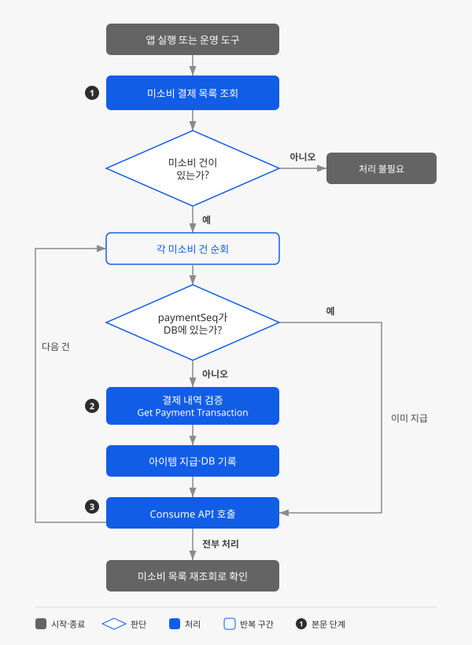

# Gamebase 미소비 결제 건 조회하고 재처리하기

## 시작하기 전에

Gamebase Purchase(IAP)는 Google Play, App Store, ONE Store 등 여러 스토어의 인앱 결제(in-app purchase, 모바일 앱 내 결제 시스템을 통해 결제가 이루어지는 방식)를 하나의 SDK와 서버 API로 통합해 처리하는 Gamebase의 결제 기능입니다. 스토어 결제가 끝나면 게임 클라이언트는 게임 서버에 소비 처리를 요청하고, 게임 서버는 아이템을 지급한 뒤 Gamebase의 소비(consume) API를 호출해 결제 처리를 마쳤음을 알립니다. 이 호출까지 이르지 못하면 결제는 완료됐지만 아이템은 지급되지 않은 **미소비(not consumed)** 건이 남습니다. 미소비는 오류가 아니라, 지급이 실패하더라도 나중에 복구할 수 있도록 Gamebase가 결제 기록을 남겨 두는 의도된 방어 로직입니다.

여기에서는 클라이언트와 게임 서버 양쪽에서 미소비 결제 건을 조회하고, 위조·중복 지급 없이 아이템을 재지급한 뒤 소비 처리까지 완료하는 방법을 살펴봅니다.



## 사전 준비하기

- Gamebase IAP 연동이 완료되어 있어야 합니다. 즉, 스토어 결제 요청과 첫 소비 처리가 정상 동작하는 상태여야 합니다.
- 게임 서버에서 Gamebase Server API를 호출할 수 있어야 합니다. 요청 헤더의 `X-Secret-Key`에 Gamebase 콘솔에서 발급한 시크릿(secret, API 키처럼 민감한 데이터를 안전하게 저장하고 관리하는 데 쓰이는 값)을 실어야 하며, 앱 ID(`appId`)는 요청 경로의 변수로 전달합니다.
- 결제 아이템 지급 로직이 게임 서버에 이미 구현되어 있어야 합니다. 이 가이드는 그 지급 로직을 미소비 건에 대해 다시 실행하고 Gamebase에 소비 처리를 알리는 흐름을 다룹니다.

## 미소비 건 조회하고 재처리하기

미소비 건은 다음과 같은 상황에서 발생합니다.

- 결제 완료 응답을 클라이언트가 받은 직후 앱이 강제 종료되어 게임 서버에 소비 처리 요청조차 보내지 못하는 경우
- 지급 API 호출 도중 게임 서버가 응답하지 못하는 경우
- 게임 서버와 Gamebase 사이에 네트워크 오류가 발생해 소비 처리 요청 자체가 Gamebase까지 도달하지 못하는 경우

이런 경우 스토어와 Gamebase에서는 결제가 끝났지만, 게임에서는 아직 아이템을 지급하지 않은 상태로 남습니다. 미소비 건을 방치하면 사용자는 결제 금액을 내고도 아이템을 받지 못한 채로 남고, 이는 스토어 환불 사유가 될 수 있습니다. 더 나아가 이전 결제가 소비되지 않은 상태로 남아 있으면 해당 사용자의 다음 결제 시도 자체가 실패할 수 있으므로, 미소비 건은 발견 즉시 재처리해야 합니다.




### 미소비 목록 조회하기

1. 클라이언트에서 아래 네 시점에 미소비 목록을 조회하세요. [Gamebase Android SDK 결제 가이드](https://docs.nhncloud.com/ko/Game/Gamebase/ko/aos-purchase/)가 권장하는 재처리 호출 시점입니다.

    - 로그인 완료 후
    - 결제 전
    - 게임 내 상점(또는 로비) 진입 시
    - 유저 프로필 또는 우편함 확인 시

    로그인 직후 한 번만 확인하면 그 이후에 발생한 미소비 건은 다음 로그인 때까지 방치될 수 있으므로, 사용자가 게임을 이용하는 동안 자연스럽게 거치는 여러 지점에서 반복 확인하는 것이 안전합니다.

    ```java
    final PurchasableConfiguration configuration = PurchasableConfiguration.newBuilder()
        .setAllStores(true)
        .build();
    Gamebase.Purchase.requestItemListOfNotConsumed(activity, configuration,
        new GamebaseDataCallback<List<PurchasableReceipt>>() {
            @Override
            public void onCallback(List<PurchasableReceipt> data, GamebaseException exception) {
                if (Gamebase.isSuccess(exception)) {
                    // data: 미소비 결제 건 목록(PurchasableReceipt)
                    // 각 항목의 paymentSeq, purchaseToken을 게임 서버로 전달
                }
            }
        });
    ```

    `setAllStores`의 기본값은 `false`로, 현재 접속한 스토어의 미소비 건만 조회합니다. 여러 스토어에 출시한 게임이라면 `true`로 설정해 같은 사용자 ID로 다른 스토어에서 구매한 미소비 건까지 함께 조회할 수 있습니다. 조회 결과로 받는 `PurchasableReceipt`에는 결제 식별자인 `paymentSeq`와 서버의 소비 처리 API 호출 시 인증 값으로 쓰는 `purchaseToken`이 들어 있습니다. 이 두 값을 게임 서버로 전달합니다. 클라이언트의 `purchaseToken`은 서버 API에서는 `accessToken`이라는 이름으로 전달하며, 두 이름은 같은 값을 가리킵니다.

2. 게임 서버에서도 같은 사용자의 미소비 목록을 조회하세요.

    클라이언트가 아예 실행되지 않는 경우(예: 사용자가 재설치 없이 게임을 떠난 경우)에도 미소비 건을 찾아낼 수 있도록, 서버가 주기적으로 또는 CS 문의 시점에 List Consumables API로 직접 조회합니다.

    ```http
    POST /tcgb-inapp/v1.3/apps/{appId}/consumable
    ```

    요청 본문에 `userId`와 함께, 조회할 스토어를 지정하는 `marketIds`(예: `["GG", "AS"]`)를 배열로 담아 보내면 Google Play, App Store 등 여러 스토어의 미소비 건을 한 번에 조회할 수 있습니다. `marketIds`를 비워두면 전체 스토어를 대상으로 조회하지만, Amazon 스토어가 포함된 전체 스토어를 조회하려면 대상 스토어를 모두 명시적으로 나열해야 합니다. 응답에는 건별로 `paymentSeq`, `accessToken`, `gamebaseProductId`, `productType`, `marketId`, `purchaseTime` 등이 담겨 옵니다.

> [!NOTE]
> 콘솔에서 결제 상태를 환불 완료(Refund)로 변경한 건은 미소비 조회 결과에서 자동으로 제외되며, 별도의 소비 처리가 필요하지 않습니다.



### 지급 대상 확인하고 아이템 지급하기

1. 조회한 `paymentSeq`가 게임 DB에 이미 기록되어 있는지 확인하세요.

    `paymentSeq`가 DB에 있다면 이미 지급을 마친 건이므로, 지급 없이 바로 소비 처리 단계로 넘어갑니다. 이 확인을 건너뛰면 같은 건이 중복 지급될 수 있습니다.

2. DB에 없는 건이 클라이언트가 전달한 값이라면, Get Payment Transaction API로 결제 내역을 검증하세요.

    클라이언트가 보낸 값을 그대로 믿으면 위조된 값으로 아이템을 요청하는 부정 사용에 그대로 노출됩니다. 해당 `paymentSeq`와 `accessToken`(클라이언트의 `purchaseToken`) 조합이 실제 Gamebase 결제 내역과 일치하는지 확인하고, 응답의 `isConsumable` 값이 `true`인지 확인합니다. `true`이면 아직 소비되지 않은 건이므로 지급을 진행해도 안전합니다. 게임 서버가 List Consumables API로 직접 조회한 값은 Gamebase가 직접 응답한 것이므로 이 검증이 필요하지 않습니다.

3. 지급할 상품을 `gamebaseProductId`로 식별하세요.

    클라이언트의 미소비 결제 내역에도 `gamebaseProductId`가 있지만 재처리 시에는 값이 없을 수 있으므로, 클라이언트가 보낸 값 대신 Get Payment Transaction API 응답의 `gamebaseProductId`를 사용합니다. 게임 서버가 직접 조회한 경우에는 List Consumables 응답의 `gamebaseProductId`를 사용합니다.

4. 아이템을 지급하고, 지급이 끝나는 즉시 `userId`, `gamebaseProductId`, `paymentSeq`, `accessToken`을 DB에 기록하세요.

    지급 응답을 받고 DB에 기록하기 전에 서버가 중단되는 경우까지 고려한다면, 지급과 기록을 하나의 트랜잭션으로 묶는 것이 안전합니다.

> [!NOTE]
> `productType`이 `CONSUMABLE`이거나, 구독(subscription) 상품이지만 주기적으로 소비 가능한 아이템을 지급하는 `CONSUMABLE_AUTO_RENEWABLE`인 건만 이 흐름의 대상입니다. 순수 구독형 상품(`AUTO_RENEWABLE`)은 소비 개념이 없으므로 이 흐름으로 처리하지 않습니다.



### 소비 처리 완료하기

게임 서버에서 Consume API를 호출해 소비 처리를 완료하세요. 아이템을 지급했다는 사실을 Gamebase에 알려야 다음 조회부터 이 건이 미소비 목록에서 빠집니다.

```http
POST /tcgb-inapp/v1.3/apps/{appId}/consume
```

요청 시 `paymentSeq`와 `accessToken`을 함께 보냅니다. 보안상 이 호출은 클라이언트가 아니라 반드시 게임 서버에서 수행합니다. 이 호출 자체가 타임아웃되면 미소비 상황이 다시 발생하므로, 요청 타임아웃을 10초 이상으로 설정하고 타임아웃이 나더라도 호출 이력을 남겨 두세요.




## 동작 확인하기

재처리가 끝났는지 확인하려면 **미소비 목록 조회하기**의 클라이언트 또는 서버 조회를 다시 실행하세요. 방금 처리한 건이 더 이상 나타나지 않으면 정상적으로 재처리된 것입니다. 계속 남아 있다면 지급 또는 소비 처리 중 하나가 실패했다는 뜻이므로 게임 서버 로그를 확인합니다.

## 응용하기

- **CS용 운영 도구 구성**: 문의한 사용자의 미소비 건을 서버 API로 직접 조회하고 재처리합니다. [Gamebase API 가이드](https://docs.nhncloud.com/ko/Game/Gamebase/ko/api-guide/)
- **콘솔에서 소비 상태 확인**: **구매(IAP) > 결제 정보**에서 결제 건별 소비 상태를 확인합니다. [Gamebase 콘솔 결제 가이드](https://docs.nhncloud.com/ko/Game/Gamebase/ko/oper-purchase/)
- **구독 상품 상태 확인**: 순수 구독 상품은 List Active Subscriptions API로 확인합니다. [Gamebase API 가이드](https://docs.nhncloud.com/ko/Game/Gamebase/ko/api-guide/)

## 용어 알아보기

| 용어 | 설명 |
|---|---|
| 인앱 결제 | 모바일 앱 내 결제 시스템을 통해 결제가 이루어지는 방식 |
| 시크릿 | 사용자 이름, 비밀번호, API 키와 같은 민감한 데이터를 안전하게 저장하고 관리하는 데 사용되는 객체 |
| 구독 | 상품이나 서비스를 일시불로 구매하지 않고 정기적으로 사용료를 지급하는 방식 |
