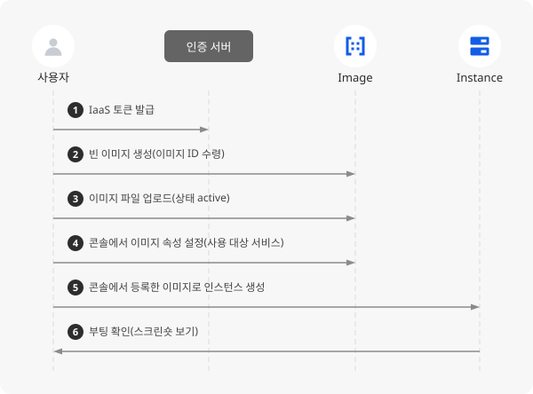

# Image API로 외부 이미지 파일 등록하기

## 시작하기 전에

이미지는 운영체제와 애플리케이션을 담은 가상 디스크로, 인스턴스의 루트 블록 스토리지를 생성하는 데 사용됩니다. Image는 이 이미지를 생성하고 관리하는 서비스로, 이미지 유형에는 NHN Cloud가 제공하는 공용 이미지와 사용자가 인스턴스로 만든 개인 이미지가 있습니다.

온프레미스나 다른 클라우드에서 쓰던 가상 머신 이미지를 NHN Cloud로 가져와야 할 때가 있습니다. 이 작업은 콘솔에서 지원하지 않으며, Image API로만 할 수 있습니다. 빈 이미지를 먼저 만든 다음 그 이미지에 파일을 올리는 두 단계로 진행되며, 등록이 끝나면 콘솔의 개인 이미지와 같은 방식으로 인스턴스를 생성할 수 있습니다.

여기에서는 qcow2 형식의 이미지 파일을 Image API로 등록하고, 콘솔에서 인스턴스 생성에 필요한 이미지 속성을 설정한 다음, 등록한 이미지로 인스턴스를 생성해 정상적으로 부팅되는지 확인하는 방법을 살펴봅니다.



> [!WARNING]
> 사용자가 업로드한 이미지로 생성한 인스턴스는 정상적으로 동작하지 않을 수 있으며, 이에 따른 결과에 대한 책임은 사용자에게 있습니다.

## 사전 준비하기

- 등록할 이미지 파일이 필요합니다. 이 가이드는 qcow2 형식의 Linux 이미지 파일을 기준으로 설명하며, 파일 이름은 `my-image.qcow2`로 가정합니다. 이미지 파일은 API를 호출하는 컴퓨터에 있어야 합니다.

    > [!NOTE]
    > 실습용 이미지 파일이 없다면 Ubuntu가 제공하는 공식 클라우드 이미지(https://cloud-images.ubuntu.com/jammy/current/jammy-server-cloudimg-amd64.img, 약 700MB)를 내려받아 사용할 수 있습니다. 이 파일은 qcow2 형식이고 cloud-init이 설치되어 있어 아래 조건을 모두 충족합니다.

- 이미지 파일은 NHN Cloud 인스턴스 환경에서 부팅되도록 다음 조건에 맞게 준비합니다. 등록한 뒤에는 이미지 파일에 담긴 운영 체제 설정을 바꿀 수 없으므로, 조건에 맞지 않는 항목은 파일을 등록하기 전에 수정해야 합니다.

    | 항목 | 조건 | 설명 |
    | --- | --- | --- |
    | 파일 형식 | qcow2 | 다른 형식의 디스크는 `qemu-img convert` 명령으로 qcow2로 변환합니다. |
    | 부팅 방식 | BIOS(Legacy) 부팅 | UEFI 전용으로 구성된 디스크는 부팅되지 않습니다. |
    | 디스크 드라이버 | virtio 블록·네트워크 드라이버 포함 | 최근 Linux 배포판 커널에는 기본으로 들어 있습니다. |
    | 초기 설정 | cloud-init 설치 | 인스턴스 생성 시 지정한 키페어와 사용자 스크립트를 적용하는 데 필요합니다. 배포판 공식 클라우드 이미지에는 기본으로 설치되어 있습니다. |
    | 네트워크 | DHCP로 IP 주소를 받도록 설정 | 원본 환경의 고정 IP나 MAC 주소에 묶인 설정은 제거합니다. |
    | machine-id | 초기화 | 같은 이미지로 만든 인스턴스끼리 machine-id가 중복되지 않도록 비워 둡니다. 절차는 [Linux machine-id 초기화 가이드](https://docs.nhncloud.com/ko/Compute/Image/ko/console-guide/#guide-for-initialization-of-linux-machine-id)를 참고하세요. |
- API 호출을 위해 `curl`이 설치된 터미널 환경이 필요합니다.
- Image API는 IaaS 토큰으로 인증합니다. 토큰을 발급받으려면 테넌트 ID와 API 비밀번호가 필요하며, 두 값은 NHN Cloud 콘솔에서 **Compute > Instance**를 클릭한 다음 목록 상단의 **API 엔드포인트 설정**을 클릭하면 나타나는 창에서 확인하고 설정할 수 있습니다.
- 등록한 이미지로 인스턴스를 생성해 확인하려면 인스턴스에 연결할 VPC와 서브넷, 키페어가 필요합니다. 기본 인프라 서비스를 처음 사용한다면 [Instance 콘솔 사용 가이드](https://docs.nhncloud.com/ko/Compute/Instance/ko/console-guide/)를 참고하세요.

## 토큰 발급하기

Image API를 호출할 때마다 요청 헤더에 IaaS 토큰을 넣어야 합니다. 토큰은 Identity API로 발급받습니다. 토큰 발급 API의 자세한 내용은 [IaaS 토큰 가이드](https://docs.nhncloud.com/ko/nhncloud/ko/public-api/iaas-token/)를 참고하세요.

1. 다음 명령으로 토큰을 발급받으세요. 플레이스홀더는 다음 값으로 바꿉니다.

    ```sh
    curl -X POST "https://api-identity-infrastructure.nhncloudservice.com/v2.0/tokens" \
      -H "Content-Type: application/json" \
      -d '{
        "auth": {
          "tenantId": "{tenant_id}",
          "passwordCredentials": {
            "username": "{account_id}",
            "password": "{api_password}"
          }
        }
      }'
    ```

    - `{tenant_id}`: **API 엔드포인트 설정** 창에서 복사한 테넌트 ID
    - `{account_id}`: 콘솔에 로그인할 때 쓰는 NHN Cloud 계정 ID(이메일 형식)
    - `{api_password}`: **API 엔드포인트 설정** 창에서 설정한 API 비밀번호

    > [!NOTE]
    > IAM 계정이라면 `username`에 IAM 계정 ID를 입력합니다.

2. 응답에서 `access.token.id` 값을 복사해 두세요. 이 값이 토큰 ID이며, 이후 모든 요청의 `X-Auth-Token` 헤더에 사용합니다. `access.token.expires`가 토큰 만료 시각입니다. 만료된 뒤에는 같은 명령으로 다시 발급받습니다.

    ```json
    {
      "access": {
        "token": {
          "id": "{token_id}",
          "expires": "2026-10-30T09:00:00Z",
          ...
        },
        ...
      }
    }
    ```

## 이미지 등록하기

이미지 등록은 이미지 정보만 가진 빈 이미지를 만드는 단계와 그 이미지에 실제 파일을 올리는 단계로 나뉩니다. 빈 이미지를 만들 때 지정하는 OS 타입과 파일 형식은 실제 파일과 맞아야 하며, OS 타입은 등록한 뒤 바꿀 수 없습니다.

1. 빈 이미지를 생성하세요. `{token_id}`는 발급받은 토큰 ID로 바꿉니다. 필수 필드는 `name`과 `os_type`이고 나머지는 선택이지만, 이 가이드는 콘솔에서 쓰기 편하도록 아래 값을 함께 지정합니다.

    ```sh
    curl -X POST "https://kr1-api-image-infrastructure.nhncloudservice.com/v2/images" \
      -H "X-Auth-Token: {token_id}" \
      -H "Content-Type: application/json" \
      -d '{
        "name": "my-image",
        "disk_format": "qcow2",
        "container_format": "bare",
        "visibility": "private",
        "os_type": "linux",
        "os_distro": "ubuntu",
        "os_version": "22.04",
        "min_disk": 20
      }'
    ```

    - `name`: 콘솔의 이미지 목록에 표시될 이름입니다.
    - `disk_format`, `container_format`: 업로드할 파일의 형식입니다. qcow2 파일은 `qcow2`와 `bare`를 지정합니다.
    - `visibility`: `private`로 지정합니다. 생략하면 `shared`로 등록되어 콘솔 이미지 목록의 **타입** 열에 **공유한 이미지**로 표시됩니다.
    - `os_type`: `linux` 또는 `windows`만 지정할 수 있습니다. 배포판은 `os_distro`에 적습니다.
    - `os_distro`, `os_version`: 콘솔 이미지 목록의 **OS** 열에 배포판 첫 글자를 대문자로 바꿔 `Ubuntu 22.04`처럼 두 값을 이어서 표시합니다. 필수는 아니지만 이미지를 구분하기 쉽도록 적어 두는 것이 좋습니다.
    - `min_disk`: 이 이미지로 인스턴스를 생성할 때 필요한 최소 루트 블록 스토리지 크기(GB)입니다. 이미지 안의 디스크 크기 이상으로 지정합니다. 지정하지 않으면 `0`으로 등록되어 인스턴스 생성 화면의 **블록 스토리지 크기(GB)** 값이 `0`으로 표시되고, 크기를 직접 입력해야 합니다.

2. 응답에서 `id`(이미지 ID)를 복사해 두세요.

    ```json
    {
      "id": "{image_id}",
      "name": "my-image",
      "status": "queued",
      "disk_format": "qcow2",
      "container_format": "bare",
      "visibility": "private",
      "os_type": "linux",
      "os_distro": "ubuntu",
      "os_version": "22.04",
      "min_disk": 20,
      "min_ram": 0,
      ...
    }
    ```

3. 이미지 파일을 업로드하세요. `{image_id}`는 앞에서 복사한 이미지 ID로 바꿉니다. 파일은 바이너리 그대로 전송해야 하므로 `Content-Type`을 `application/octet-stream`으로 지정하고 `--data-binary`로 파일을 지정합니다. 파일이 명령을 실행하는 디렉터리에 없으면 경로를 포함해 지정하세요.

    ```sh
    curl -X PUT "https://kr1-api-image-infrastructure.nhncloudservice.com/v2/images/{image_id}/file" \
      -H "X-Auth-Token: {token_id}" \
      -H "Content-Type: application/octet-stream" \
      --data-binary "@my-image.qcow2"
    ```

    업로드가 끝나면 오류 메시지 없이 프롬프트로 돌아옵니다. 업로드에 걸리는 시간은 파일 크기와 네트워크 속도에 따라 다르며, 수백 MB 크기의 파일은 수십 초에서 몇 분 정도 걸립니다.

4. 이미지 상태를 확인하세요.

    ```sh
    curl "https://kr1-api-image-infrastructure.nhncloudservice.com/v2/images/{image_id}" \
      -H "X-Auth-Token: {token_id}"
    ```

    `status`가 `active`이면 등록이 완료된 것입니다. `size`가 업로드한 파일의 크기(바이트)와 같으면 파일이 온전히 올라간 것입니다.

5. NHN Cloud 콘솔에서 **Compute > Image**를 클릭하세요. 등록한 이미지가 **타입** 열이 **개인 이미지**인 항목으로 목록에 나타나고, **상태** 열의 아이콘에 마우스 포인터를 올리면 `ACTIVE`가 표시됩니다. 인스턴스로 만든 이미지와 달리 **소스 인스턴스** 열은 비어 있습니다.

## 이미지 속성 설정하기

인스턴스로 만든 개인 이미지에는 **사용 대상 서비스** 속성이 자동으로 설정되지만, API로 등록한 이미지에는 이 속성이 비어 있습니다. 속성을 설정하지 않으면 인스턴스 생성 화면의 **개인 이미지** 탭에 이미지가 나타나지 않습니다. 이 속성은 콘솔의 **이미지 수정** 창에서 설정합니다.

1. **Compute > Image**의 이미지 목록에서 등록한 이미지의 체크박스를 선택한 다음 **수정**을 클릭하세요.

2. **이미지 수정** 창의 **사용 대상 서비스**에서 **Instance**를 선택하세요. 나머지 항목은 그대로 둡니다. 이 항목에 포함된 서비스의 생성 화면에서만 이미지가 노출되므로, 인스턴스 템플릿이나 Auto Scale에서도 이 이미지를 쓰려면 **Instance Template**, **Auto Scale**을 함께 선택합니다.

    > [!NOTE]
    > **OS 구분**은 이미지를 등록한 뒤에는 수정할 수 없습니다. `os_type`을 잘못 지정했다면 이미지를 삭제하고 처음부터 다시 등록하세요.

3. **확인**을 클릭하세요. 이미지 수정에 성공했다는 알림이 표시됩니다. 각 항목의 자세한 설명은 [Image 콘솔 사용 가이드의 이미지 수정](https://docs.nhncloud.com/ko/Compute/Image/ko/console-guide/#modify-image)을 참고하세요.

## 등록한 이미지로 인스턴스 생성하기

등록한 이미지가 실제로 부팅되는지는 인스턴스를 만들어 봐야 알 수 있습니다. 인스턴스 생성은 콘솔에서 진행합니다.

1. **Compute > Instance**에서 **인스턴스 생성**을 클릭하세요.

2. **인스턴스 템플릿**은 기본값인 **사용 안 함**, **OS 설정**은 기본값인 **신규 생성 및 설정**으로 둡니다.

3. 이미지 목록에서 **개인 이미지** 탭을 클릭한 다음 등록한 이미지를 선택하세요. **루트 블록 스토리지**의 **블록 스토리지 크기(GB)** 값이 이미지의 `min_disk` 값에 맞춰 자동으로 설정되며, 이 값보다 작게 지정할 수 없습니다. **블록 스토리지 타입**은 기본값을 그대로 두고, **삭제 정책**은 **인스턴스 삭제 시 삭제**를 선택하세요. 기본값인 **인스턴스 삭제 시 유지**로 두면 실습을 마치고 인스턴스를 삭제해도 루트 블록 스토리지가 남아 과금이 이어집니다.

4. **인스턴스 이름**을 입력하고 **인스턴스 타입**, **키페어**를 선택하세요. **가용성 영역**, **배치 정책**, **인스턴스 수** 등 나머지 항목은 기본값을 그대로 둡니다.

5. **네트워크 설정**은 기본값인 **네트워크 인터페이스 생성**으로 둡니다. **네트워크**에서 서브넷을 선택하고 **보안 그룹**은 **default**를 선택하세요. **플로팅 IP**와 **추가 설정**의 항목은 기본값을 그대로 둡니다.

6. 인스턴스 생성에 필요한 설정 값을 모두 입력했다면 **인스턴스 생성**을 클릭하세요. 생성에는 몇 분 정도 소요될 수 있습니다.

## 동작 확인하기

1. **Compute > Instance**에서 생성한 인스턴스의 **상태** 열 아이콘이 초록색이 되고, 아이콘에 마우스 포인터를 올리면 `ACTIVE`가 표시되는지 확인하세요.

2. 인스턴스를 클릭한 뒤 하단 상세 정보의 **기본 정보** 탭에서 **로그** 항목의 **스크린숏 보기**를 클릭하세요. 인스턴스 화면을 캡처한 창이 열립니다. 로그인 프롬프트까지 부팅이 진행된 화면이 보이면 이미지가 정상적으로 동작하는 것입니다. 화면이 갱신되지 않았다면 창의 새로 고침 아이콘을 클릭하세요. **로그 보기**로 부팅 로그를 확인할 수도 있습니다.

3. 인스턴스가 생성되지 않거나 부팅이 멈추면 다음을 확인하세요. 원인별 자세한 해결 방법은 [인스턴스 생성이 실패합니다](instance-creation-failed.md) 가이드의 「원인 2: 개인 이미지로 인스턴스 생성 시 문제」를 참고하세요.

    - 인스턴스 생성 화면의 **개인 이미지** 탭에 이미지가 보이지 않으면 **이미지 수정** 창의 **사용 대상 서비스**에 **Instance**를 추가합니다.
    - 인스턴스는 생성됐지만 부팅이 멈추면 이미지 파일 자체가 NHN Cloud 인스턴스 환경에서 부팅되는 구성인지 확인합니다. cloud-init이 설치된 클라우드용 이미지를 권장합니다.

## 응용하기

- **Windows 이미지 등록**: `os_type`을 `windows`, `min_disk`를 50 이상으로 지정하며 U2 타입은 사용할 수 없습니다. 자세한 내용은 [Instance API 가이드의 인스턴스 생성하기](https://docs.nhncloud.com/ko/Compute/Instance/ko/public-api/#create-instance)를 참고하세요.
- **API로 이미지 속성 수정**: 이름, 최소 블록 스토리지, 사용자 스크립트 기능 등은 이미지 수정 API로도 바꿀 수 있습니다. 자세한 내용은 [Image API 가이드의 이미지 수정](https://docs.nhncloud.com/ko/Compute/Image/ko/public-api/#modify-image)을 참고하세요.
- **공공기관용으로 이미지 이전**: 이미지 다운로드 API로 파일을 내려받아 NHN Cloud(공공기관용)에 이 가이드의 절차대로 등록합니다. 파일을 내려받는 방법은 [Image API 가이드의 이미지 다운로드](https://docs.nhncloud.com/ko/Compute/Image/ko/public-api/#download-image)를 참고하세요.

## 리소스 정리하기

실습으로 만든 리소스는 사용을 마치면 삭제하세요. 인스턴스는 생성한 시점부터 과금되고, 이미지도 등록한 시점부터 블록 스토리지 크기만큼 과금됩니다.

1. **Compute > Instance**에서 만든 인스턴스를 선택한 다음 목록 상단의 더보기(⋯) 아이콘을 클릭하고 **인스턴스 삭제**를 클릭하세요. 삭제 정책을 **인스턴스 삭제 시 삭제**로 설정했으므로 루트 블록 스토리지도 함께 삭제됩니다.

2. 이미지를 삭제하세요. 콘솔에서는 **Compute > Image**에서 이미지를 선택한 다음 **삭제**를 클릭하고, API로는 다음과 같이 호출합니다. 삭제에 성공하면 오류 메시지 없이 프롬프트로 돌아옵니다.

    ```sh
    curl -X DELETE "https://kr1-api-image-infrastructure.nhncloudservice.com/v2/images/{image_id}" \
      -H "X-Auth-Token: {token_id}"
    ```

    > [!WARNING]
    > 이미지를 삭제하면 복구할 수 없습니다. 빈 이미지를 만든 뒤 업로드하지 않은 이미지도 목록에 남아 있으므로 함께 삭제하세요.

## 용어 알아보기

| 용어 | 설명 |
| --- | --- |
| 이미지 | 애플리케이션을 실행하기 위해 필요한 모든 소프트웨어 및 설정이 패키징된 가상 디스크 |
| qcow2 | QEMU/KVM 가상화에서 사용하는 가상 디스크 이미지 파일 형식으로, 실제 기록한 데이터만큼만 파일 크기가 늘어나며 OpenStack 기반 클라우드의 기본 이미지 형식 |
| cloud-init | 클라우드 인스턴스가 처음 부팅될 때 키페어, 네트워크, 사용자 스크립트 같은 초기 설정을 적용하는 초기화 도구 |
| 인스턴스 | 가상의 CPU, 메모리, 기본 디스크로 구성된 가상 서버 |
| 블록 스토리지 | 데이터를 블록 단위로 나눠서 저장하는 블록 수준 데이터 스토리지로, 인스턴스 기본 디스크 외에 추가로 연결하여 사용할 수 있음 |
| 공용 이미지 | NHN Cloud에서 미리 생성하여 기본 제공하는 이미지 |
| 개인 이미지 | 공용 이미지를 토대로 사용자가 자신이 원하는 구성으로 생성한 이미지 |
| IaaS | CPU, 서버, 스토리지 등의 IT 인프라 자원을 네트워크를 통해 제공하는 클라우드 컴퓨팅 형태 |
| 토큰 | API와 상호 작용을 위해 사용자를 인증하고 권한을 부여하는 데 사용되는 식별 정보 |
| 테넌트 | 인스턴스에 대해 공통적인 특정 접근 권한을 공유하는 사용자들의 그룹 |
| 키페어 | 공개 키 기반 구조(PKI, public key infrastructure)를 바탕으로 한 SSH 공개 키, 개인 키 쌍으로, 인스턴스 접속 수단으로 사용됨 |
