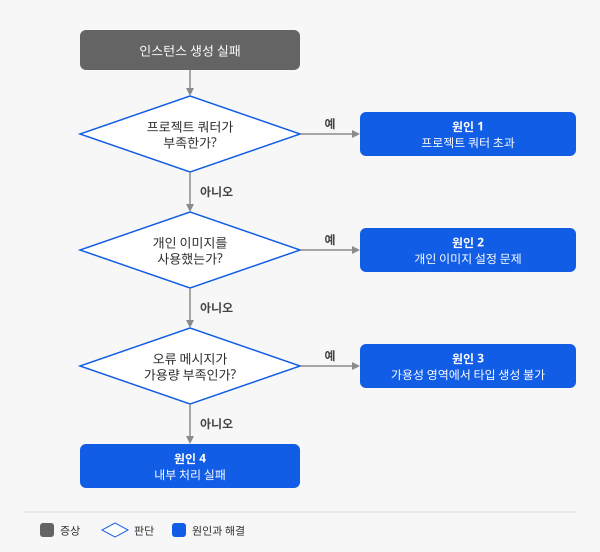

# 인스턴스 생성이 실패합니다

## 증상

NHN Cloud 콘솔 또는 API로 인스턴스를 생성했는데 다음 중 하나로 실패합니다.

- 인스턴스가 생성되지만 오류 상태가 됩니다. 인스턴스 목록의 **상태** 열이 빨간색으로 표시되고, 마우스 포인터를 올리면 `ERROR`가 표시됩니다.
- 생성 요청이 거부되어 오류 메시지만 표시되고 인스턴스가 생성되지 않습니다.

개인 이미지로 생성하거나, 특정 가용성 영역과 인스턴스 타입 조합을 선택했을 때 주로 발생합니다.

## 빠른 확인

1. 생성할 때 표시된 오류 메시지를 확인하세요. 인스턴스가 오류 상태로 생성됐다면 인스턴스를 선택하고 하단 상세 정보의 **기본 정보** 탭에서 **로그 보기**도 확인하세요.
2. 프로젝트의 **쿼터 관리** 탭에서 쿼터가 남아 있는지 확인하세요. 쿼터가 부족하면 원인 1을 확인하세요.
3. 개인 이미지로 생성했다면 공용 이미지로 같은 타입의 인스턴스를 생성해 보세요. 정상적으로 생성되면 원인 2를 확인하세요.

## 원인과 해결 방법

### 원인 1: 프로젝트 쿼터 초과

프로젝트마다 사용할 수 있는 CPU와 메모리 총량이 쿼터로 정해져 있으며, 쿼터를 넘는 생성 요청은 거부됩니다. 사용하지 않는 인스턴스와 블록 스토리지, 생성에 실패해 오류 상태로 남은 인스턴스도 쿼터를 차지합니다. 리소스별 기본 제공량은 [리소스 제공 정책](https://docs.nhncloud.com/ko/nhncloud/ko/resource-policy/#resource-provision-policy-for-instance-service)을 참고하세요.

쿼터를 초과하면 다음 메시지가 표시됩니다.

- 인스턴스 가용량 초과: "사용할 수 있는 인스턴스 가용량이 넘어 추가로 인스턴스를 생성할 수 없습니다. 한도를 높이려면 고객지원에 문의하세요."
- CPU 초과: "사용 가능한 CPU 용량을 초과했습니다. 불필요한 인스턴스를 삭제하고 다시 시도하세요. 한도를 높이려면 고객지원에 문의하세요."
- 메모리 초과: "사용 가능한 메모리 용량을 초과했습니다. 불필요한 인스턴스를 삭제하고 다시 시도하세요. 한도를 높이려면 고객지원에 문의하세요."

**해결 방법**

1. 프로젝트의 **쿼터 관리** 탭에서 CPU와 메모리의 **쿼터**와 **사용량**을 확인하세요.
2. 사용하지 않는 인스턴스와 블록 스토리지, 오류 상태로 남은 인스턴스를 삭제한 뒤 다시 생성하세요.
3. 리소스를 더 줄일 수 없다면 **쿼터 관리** 탭의 **쿼터 조정 신청**을 클릭해 한도 상향을 신청하세요.

### 원인 2: 개인 이미지 설정 문제

개인 이미지로 인스턴스를 생성할 때는 이미지의 속성과 생성 설정이 맞아야 합니다. 다른 환경에서 만든 이미지를 Image API로 등록한 경우에 주로 발생합니다.

| 증상 | 원인 |
| --- | --- |
| 인스턴스 생성 화면의 **개인 이미지** 탭에 이미지가 보이지 않음 | 이미지의 **사용 대상 서비스**에 **Instance**가 선택되어 있지 않음. Image API로 등록한 이미지는 이 속성이 비어 있음 |
| "잘못된 입력 수신: 블록 스토리지 크기 {0}GB는 최소 디스크 이미지 크기 {1}GB보다 작을 수 없습니다." | API 요청의 블록 스토리지 크기가 이미지의 최소 블록 스토리지 크기(`min_disk`)보다 작음 |
| "선택한 인스턴스 타입의 가용량이 부족하여 인스턴스를 생성할 수 없습니다." API 응답: `Image {이미지 ID} property os_type is not defined` | 이미지에 `os_type` 속성이 없음. 실제 가용량과 무관하게 표시되며, 2024년 2월 이전에 만든 개인 이미지에서 발생 |

**해결 방법**

1. 이미지가 **개인 이미지** 탭에 보이지 않으면 **Compute > Image**에서 이미지를 선택하고 **수정**을 클릭한 다음 **이미지 수정** 창의 **사용 대상 서비스**에서 **Instance**를 선택하세요.
2. API로 인스턴스를 생성한다면 블록 스토리지 크기를 이미지의 최소 블록 스토리지 크기 이상으로 지정하세요. 최소 크기는 인스턴스 생성 화면 이미지 목록의 **최소 블록 스토리지(GB)** 열에서 확인할 수 있습니다.
3. 2024년 2월 이전에 만든 개인 이미지에 `os_type` 속성이 없다면 `os_type`을 지정해 다시 등록하세요. `os_type`은 이미지를 등록한 뒤에는 수정할 수 없습니다. 등록 방법은 [Image API로 외부 이미지 파일 등록하기](image-upload-via-api.md)를 참고하세요.
4. 계속 실패하면 공용 이미지로 정상 생성되는지 확인한 결과와 함께 문의하세요. 전달할 정보는 아래 **문의하기**를 참고하세요.

### 원인 3: 선택한 가용성 영역에서 해당 인스턴스 타입을 생성할 수 없음

인스턴스 타입은 리전과 가용성 영역에 따라 제공되는 구성이 다릅니다. 선택한 가용성 영역에 해당 타입을 배치할 수 없으면 생성에 실패하고 "선택한 인스턴스 타입의 가용량이 부족하여 인스턴스를 생성할 수 없습니다." 메시지가 표시됩니다.

**해결 방법**

1. 다른 가용성 영역을 선택해 다시 생성하세요. 같은 타입이라도 가용성 영역에 따라 생성 가능 여부가 다릅니다.
2. 같은 가용성 영역에서 다른 인스턴스 타입으로 생성해 보세요. 특정 타입에서만 실패하는지 확인할 수 있습니다.
3. 여러 대를 한 번에 생성하는 중이라면 수를 줄여 나눠 생성하세요.
4. 특정 가용성 영역에 특정 타입이 반드시 필요하면 생성 가능한 구성을 문의하세요. GPU 인스턴스와 대형 인스턴스 타입은 제공되는 리전과 가용성 영역이 제한적이므로 필요한 시점보다 미리 확인해 두세요.

### 원인 4: 인스턴스 생성 중 내부 처리 실패

인스턴스를 생성하면 루트 블록 스토리지 생성, 네트워크 인터페이스 연결 등 여러 작업이 내부에서 차례로 수행됩니다. 이 중 하나라도 실패하면 인스턴스가 오류 상태가 됩니다. 사용자 설정과 무관하게 일시적으로 발생하며, API로 여러 대를 한꺼번에 생성할 때 일부만 실패하기도 합니다.

**해결 방법**

1. 오류 상태의 인스턴스를 삭제하고 같은 설정으로 다시 생성하세요. 일시적인 문제라면 다시 생성하면 해결됩니다.
2. 다시 생성해도 실패하면 문의하세요. 전달할 정보는 아래 **문의하기**를 참고하세요.

> [!NOTE]
> 인스턴스를 생성할 때 루트 블록 스토리지의 삭제 정책이 **인스턴스 삭제 시 유지**였다면 인스턴스를 삭제해도 루트 블록 스토리지가 남습니다. 남은 블록 스토리지는 요금이 발생하고 쿼터를 차지하므로 **Storage > Block Storage**에서 삭제하세요.

## 문의하기

위 방법으로 해결되지 않으면 [NHN Cloud 고객지원](https://www.nhncloud.com/kr/support/inquiry)에 문의하세요. 다음 정보를 함께 전달하면 원인을 빠르게 확인할 수 있습니다.

| 항목 | 설명 |
| --- | --- |
| 발생 시각 | 오류가 발생한 시각(KST 기준) |
| 프로젝트 ID | **프로젝트 관리** 탭의 **프로젝트 기본 정보** 영역에서 확인 |
| 인스턴스 ID | 오류 상태의 인스턴스를 선택한 뒤 하단 상세 정보의 **기본 정보** 탭에서 인스턴스 이름 아래에 표시 |
| 리전과 가용성 영역 | 생성할 때 선택한 리전과 가용성 영역 |
| 인스턴스 타입과 이미지 | 생성할 때 선택한 인스턴스 타입과 이미지 이름 |
| 오류 메시지와 로그 | 생성할 때 표시된 오류 메시지 전문, **기본 정보** 탭의 **로그 보기** 내용 |
| 이미지 ID와 생성 방법 | 개인 이미지를 사용한 경우. 이미지 ID는 **Compute > Image**에서 이미지를 선택한 뒤 하단 상세 정보의 **기본 정보** 탭에서 확인. 이미지를 만든 방법(인스턴스로 생성, Image API로 등록)도 함께 전달 |
| API 요청과 응답 | API로 생성한 경우 인스턴스 생성 요청과 응답 전문 |
| 블록 스토리지 ID | 삭제되지 않고 남은 블록 스토리지가 있는 경우. **Storage > Block Storage** 목록의 **ID** 열에서 확인 |

## 문제 예방하기

- **개인 이미지 등록 시 속성 설정**: Image API로 이미지를 등록할 때는 `min_disk`를 지정하고, 등록한 뒤 **사용 대상 서비스**에서 **Instance**를 선택하세요. 자세한 절차는 [Image API로 외부 이미지 파일 등록하기](image-upload-via-api.md)를 참고하세요.
- **검증된 조합을 인스턴스 템플릿으로 저장**: 정상 생성을 확인한 이미지, 인스턴스 타입, 네트워크 설정 조합을 인스턴스 템플릿으로 저장해 두면 설정 문제로 인한 생성 실패를 줄일 수 있습니다.
