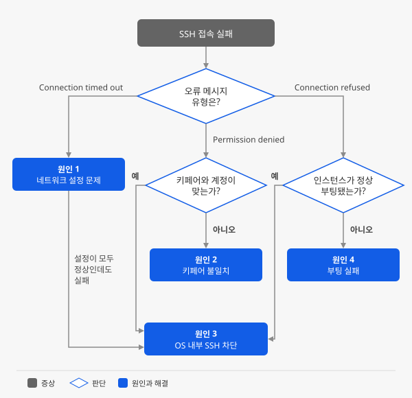

# 인스턴스에 SSH로 접속되지 않습니다

## 증상

SSH 클라이언트로 인스턴스에 접속하면 다음 중 하나의 오류 메시지가 표시되고 접속되지 않습니다.

```text
ssh: connect to host {인스턴스 IP} port 22: Connection timed out
ssh: connect to host {인스턴스 IP} port 22: Connection refused
Permission denied (publickey).
Permission denied (publickey,gssapi-keyex,gssapi-with-mic).
```

이 문서의 `{인스턴스 IP}`는 접속하려는 인스턴스의 플로팅 IP 또는 사설 IP입니다. 명령을 실행할 때는 실제 IP로 바꿔 입력하세요.

인스턴스를 생성한 뒤 처음 접속할 때나, 접속하던 인스턴스에서 다음 작업을 한 뒤에 주로 발생합니다.

- OS 보안 취약점 조치
- 백신 또는 서버 접근 제어 솔루션 설치
- 인스턴스 타입 변경
- OS 패키지 업데이트

오류 메시지에 따라 확인할 원인이 다릅니다.

| 오류 메시지 | 의미 | 확인할 원인 |
| --- | --- | --- |
| `Connection timed out` | 인스턴스에서 응답이 없음 | 원인 1, 원인 3 |
| `Connection refused` | 인스턴스가 SSH 연결을 거부함 | 원인 3, 원인 4 |
| `Permission denied (publickey)` | 키페어 인증에 실패함 | 원인 2, 원인 3 |



## 빠른 확인

1. **인스턴스 상태**: 콘솔 **Compute > Instance**에서 인스턴스를 선택하고 하단 상세 정보의 제목 옆에 표시되는 상태를 확인하세요. `SHUTOFF`이면 인스턴스를 시작한 뒤 다시 접속하세요. `ERROR`이면 아래 **문의하기**를 참고해 문의하세요.
2. **SSH 포트 도달 여부**: 접속하는 컴퓨터에서 다음 명령을 실행하세요.

    ```sh
    # Linux, macOS
    nc -zv {인스턴스 IP} 22
    ```

    ```powershell
    # Windows PowerShell
    Test-NetConnection {인스턴스 IP} -Port 22
    ```

    명령이 성공하면 네트워크 문제가 아니라 인스턴스 내부 설정 문제입니다.

    > [!NOTE]
    > `Test-NetConnection` 결과는 `TcpTestSucceeded` 값으로 판단하세요. `True`이면 포트가 열려 있는 것입니다.

3. **최근 변경 작업**: 보안 취약점 조치나 백신, 서버 접근 제어 솔루션 설치 직후부터 접속되지 않는다면 원인 3을 먼저 확인하세요. 문의 사례에서 가장 많은 원인입니다.
4. **다른 인스턴스 접속 여부**: 같은 프로젝트의 다른 인스턴스에는 정상적으로 접속된다면 네트워크 문제보다는 접속되지 않는 인스턴스의 내부 설정 문제일 수 있습니다.

## 원인과 해결 방법

### 원인 1: 네트워크 설정 문제로 인스턴스에 연결되지 않음

외부에서 인스턴스에 접속하려면 다음 조건을 모두 충족해야 합니다. 하나라도 충족하지 못하면 `Connection timed out`이 발생합니다.

- 인스턴스에 플로팅 IP가 연결되어 있습니다. 사설 IP는 VPC 내부에서만 통신합니다.
- 인스턴스가 속한 서브넷의 라우팅 테이블에 인터넷 게이트웨이가 연결되어 있습니다.
- 보안 그룹과 Network ACL이 SSH 포트를 허용합니다.

VPN을 사용하거나 외부 접속이 가능한 배스천 호스트를 거쳐 접속할 수도 있습니다.

다음 환경에서 자주 발생합니다.

- **SSH 포트를 22번이 아닌 번호로 바꾼 환경**: 인스턴스에서 포트를 바꿔도 보안 그룹과 Network ACL의 규칙은 자동으로 바뀌지 않습니다.
- **접속하는 컴퓨터의 공인 IP가 바뀌는 환경**: IP가 바뀌면 허용 규칙에 등록한 IP와 달라져 접속이 차단됩니다.

**해결 방법**

바깥에서 안쪽 순서로 확인하세요.

1. **플로팅 IP**: 인스턴스를 선택하고 하단 상세 정보의 **네트워크** 탭에서 **플로팅 IP** 열에 값이 있는지 확인하세요. 비어 있으면 인스턴스 목록에서 **플로팅 IP 관리**를 클릭해 연결하세요.
2. **보안 그룹**: **Network > Security Groups**에서 인스턴스에 적용된 보안 그룹을 선택하고 **보안 규칙** 탭에 SSH 포트를 허용하는 수신 규칙이 있는지 확인하세요. 보안 그룹은 허용 규칙만 가지므로 여러 보안 그룹 중 하나에만 허용 규칙이 있어도 됩니다. 규칙이 없으면 **보안 규칙 생성**을 클릭해 다음과 같이 추가하세요.

    - **방향**: `수신`
    - **IP 프로토콜**: `TCP`
    - **포트 범위**: 사용 중인 SSH 포트
    - **원격**: 접속할 IP 대역(CIDR)

    > [!WARNING]
    > SSH 포트를 `0.0.0.0/0`으로 허용하면 무작위 로그인 시도에 노출됩니다. 회사 공인 IP 대역이나 VPN 대역만 허용하세요. 원인을 확인하려고 일시적으로 전체 허용했다면 확인 후 반드시 되돌리세요.

3. **인터넷 게이트웨이**: **Network > Routing**에서 인스턴스가 속한 VPC의 라우팅 테이블을 확인하세요. **인터넷 게이트웨이** 열이 비어 있으면 라우팅 테이블을 선택한 뒤 **인터넷 게이트웨이 연결**을 클릭하세요.
4. **Network ACL**: 서브넷에 Network ACL을 바인딩했다면 **Network > Network ACL**에서 해당 ACL을 선택하고 **ACL Rule** 탭을 확인하세요. 규칙은 **순서**가 낮은 것부터 적용되므로, **적용 방법**이 `차단`인 규칙이 허용 규칙보다 앞에 있으면 차단됩니다. **목적지 포트**와 **출발지 CIDR**에 SSH 포트를 차단하는 규칙이 있는지 확인하세요.

    > [!NOTE]
    > 기본 규칙인 순서 `101`(전체 허용)과 순서 `32765`(전체 차단)만 있다면 모든 트래픽이 통과하므로 Network ACL은 원인이 아닙니다.

5. **접속하는 쪽 네트워크**: 사내 방화벽이나 보안 정책이 SSH 포트의 아웃바운드 통신을 차단하는지 확인하세요. 모바일 테더링 같은 다른 네트워크에서 접속해 보면 구분할 수 있습니다.

위 항목이 모두 정상인데도 접속되지 않으면 인스턴스 내부 설정 문제입니다. 원인 3을 확인하세요.

**NHN Cloud(공공기관용) 환경의 접속 경로**

NHN Cloud(공공기관용)은 SSL VPN을 거친 접속을 기본으로 하며, VPN 대역 밖에서는 SSH 접근이 허용되지 않습니다. 다음을 확인하세요.

1. SSL VPN에 로그인한 뒤 VPN 네트워크에 매핑된 플로팅 IP로 접속하세요. VPN 계정은 리전별로 신청해야 하므로 접속하려는 리전의 계정이 있는지 확인하세요. 자세한 내용은 [SSL VPN 콘솔 사용 가이드](https://docs.gov-nhncloud.com/ko/Security/SSL%20VPN/ko/console-guide/)를 참고하세요.
2. VPN에 로그인한 뒤 `ipconfig` 또는 `ifconfig`로 할당받은 클라이언트 IP를 확인하고, 그 IP를 보안 그룹의 수신 규칙에 추가하세요.
3. VPN 네트워크는 접속 전용 대역이므로 인스턴스의 첫 번째 네트워크 인터페이스(eth0)가 아니라 두 번째 인터페이스(eth1)에 연결하세요.
4. Network Firewall과 SSL VPN을 함께 사용한다면 라우팅 테이블을 확인하세요. Network Firewall용 서브넷과 그 외 리소스(웹 서버, WAF 등)의 라우팅 테이블은 분리되어야 하며, 분리된 라우팅 테이블에 게이트웨이가 `NetworkFirewall_INF_TRAFFIC_VIP`인 라우트가 있어야 합니다. 목적지는 환경에 따라 `0.0.0.0/0` 또는 SSL VPN IP로 다르게 설정할 수 있으므로, 목적지 값이 아니라 해당 게이트웨이로 향하는 라우트가 있는지를 확인하세요.

    > [!NOTE]
    > SSL VPN 정책은 인스턴스가 아니라 VPN 네트워크에 연결된 플로팅 IP에 적용됩니다. 이 플로팅 IP는 Network Firewall NAT 설정 화면에서 **NAT 전 공인 IP**로 표시됩니다.

### 원인 2: 키페어가 일치하지 않거나 개인 키를 사용할 수 없음

인스턴스는 생성할 때 지정한 키페어의 공개 키를 OS 계정의 `authorized_keys`에 등록합니다. 접속할 때는 그 키페어의 개인 키(`{키페어 이름}.pem`)를 사용합니다. 다음 중 하나에 해당하면 `Permission denied (publickey)`가 발생합니다.

| 구분 | 설명 |
| --- | --- |
| 키페어 불일치 | 접속에 사용한 개인 키가 인스턴스에 지정된 키페어의 개인 키가 아님 |
| 개인 키 파일 권한 | 개인 키 파일의 권한이 소유자 외 사용자에게도 허용되어 있음 |
| 접속 계정 이름 | 이미지의 기본 계정과 다름. Rocky Linux는 `rocky`, Ubuntu는 `ubuntu`, Debian은 `debian`, CentOS는 `centos` |

**해결 방법**

1. **Compute > Instance** 목록의 **키페어** 열에 표시된 이름이 접속에 사용하는 개인 키 파일의 이름과 같은지 확인하세요.
2. 접속할 때 `Permissions 0644 for 'your-key.pem' are too open.` 메시지가 표시되면 개인 키 파일의 권한이 맞지 않는 것입니다. 소유자만 읽을 수 있도록 권한을 변경하세요.

    ```sh
    chmod 600 {키페어 이름}.pem
    ```

3. 접속 계정 이름이 이미지의 기본 계정과 같은지 확인하세요. 계정 이름이 다르면 개인 키가 맞아도 접속에 실패합니다. `-v` 옵션을 붙이면 접속에 사용된 계정을 확인할 수 있습니다.

    ```sh
    ssh -i {키페어 이름}.pem rocky@{인스턴스 IP} -v
    ```

    출력에서 `debug1: Authenticating to {인스턴스 IP}:22 as 'rocky'` 줄의 `as` 뒤에 표시된 이름이 접속에 사용된 계정입니다.

4. 개인 키, 권한, 계정 이름이 모두 맞는데도 `Permission denied`가 발생하면 OS 안에서 `authorized_keys`나 sshd 인증 설정이 변경된 것입니다. 원인 3을 확인하세요.

> [!NOTE]
> 개인 키를 분실했다면 새 키페어를 만든 뒤 인스턴스 상세 정보의 **기본 정보** 탭에서 **키페어 > 변경**으로 교체하세요. 키페어 변경에는 다음 조건이 있습니다.
>
> - 인스턴스가 활성 상태여야 하고 기본 인프라 서비스 ADMIN 권한이 필요합니다.
> - Windows 인스턴스와 낮은 버전의 이미지로 생성한 인스턴스는 키페어를 변경할 수 없습니다.
> - 대상 OS 계정의 `authorized_keys`가 새 공개 키로 덮어써집니다. 직접 등록한 다른 공개 키가 있다면 변경하기 전에 백업하고 변경 후 다시 추가하세요.

### 원인 3: OS 안에서 SSH 로그인이 차단됨

문의 사례에서 가장 많은 원인입니다. 다음 항목을 변경했다면 SSH 로그인이 차단되었을 수 있습니다.

- `/etc/ssh/sshd_config`: 포트, 인증 방식, 접속 허용 계정
- PAM 설정: 계정 잠금, 비밀번호 정책
    - Rocky Linux, CentOS 계열: `/etc/pam.d/system-auth`, `/etc/pam.d/password-auth`
    - Ubuntu, Debian 계열: `/etc/pam.d/common-auth`, `/etc/pam.d/common-account`
- `/etc/group`의 `ssh_keys` 그룹: 호스트 키 파일 접근에 사용(Rocky Linux, CentOS 계열만 해당)
- OS 방화벽(firewalld, iptables, ufw)과 SELinux
- 백신이나 서버 접근 제어 솔루션이 적용하는 차단 정책

보안 취약점 조치 과정에서 다음과 같이 변경한 뒤 접속이 차단된 사례가 있습니다.

- `/etc/group`에서 `ssh_keys` 그룹 줄을 주석 처리(`#ssh_keys:x:995:`)함
- 계정 잠금 임계값을 설정하려고 PAM 설정 파일에 규칙을 추가함
- 백신이나 서버 접근 제어 솔루션을 설치함

설정을 변경해도 이미 연결된 세션은 유지됩니다. 따라서 접속 실패는 다시 접속할 때 발생합니다. 변경하고 며칠 뒤에 발견하면 어떤 변경이 원인인지 찾기 어렵습니다.

**해결 방법**

SSH로 접속할 수 없으므로 시리얼 콘솔로 인스턴스에 접속해 확인하세요. 시리얼 콘솔은 SSH 대신 시리얼 포트를 사용하는 긴급용 접속 수단으로, 보안 그룹이나 sshd 상태와 관계없이 사용할 수 있습니다.

> [!WARNING]
> 시리얼 콘솔은 다음 조건을 충족해야 사용할 수 있습니다. 준비 방법은 아래 **문제 예방하기**를 참고하세요.
>
> - OS 계정의 비밀번호가 설정되어 있어야 합니다. 키페어로는 로그인할 수 없으며, 접속이 불가한 상태에서는 설정할 수 없습니다.
> - 인스턴스가 시리얼 콘솔로 출력하도록 설정되어 있어야 합니다.
> - 2026년 1월 27일 이전에 생성한 인스턴스는 인스턴스를 중지한 뒤 시작해야 합니다. 인스턴스 재부팅으로는 적용되지 않습니다.
> - 2024년 11월 26일 이전에 생성한 인스턴스는 GRUB 설정도 변경해야 합니다.
> - Windows 인스턴스는 지원하지 않으며, 개인이 업로드한 이미지로 만든 인스턴스는 접속이 보장되지 않습니다.
>
> 시리얼 콘솔을 사용할 수 없으면 아래 **문의하기**를 참고해 문의하세요.

1. 인스턴스를 선택하고 하단 상세 정보의 **기본 정보** 탭의 **로그** 항목에서 **시리얼 콘솔 연결**을 클릭하세요. 인스턴스당 하나의 연결만 가능하고 한 번에 최대 10분간 접속됩니다.
2. 비밀번호를 설정해 둔 OS 계정으로 로그인하세요.
3. 최근에 수정한 파일을 원래대로 되돌리세요. `/etc/group`의 `ssh_keys` 그룹을 주석 처리했다면 주석을 해제하세요.
4. sshd를 재시작한 뒤, 시리얼 콘솔 세션을 닫지 않은 상태에서 다른 터미널로 SSH 접속을 확인하세요.

### 원인 4: 인스턴스가 정상 부팅되지 않음

인스턴스 상태는 실행 중이지만 OS가 부팅 도중 멈추면 sshd가 시작되지 않아 `Connection refused`가 발생합니다. 커널이 정상적으로 기동되지 않은 경우가 해당합니다.

**해결 방법**

1. 인스턴스를 선택하고 하단 상세 정보의 **기본 정보** 탭의 **로그** 항목에서 **로그 보기**와 **스크린숏 보기**로 부팅이 멈춘 위치를 확인하세요. 두 기능은 시리얼 콘솔을 사용할 수 없는 인스턴스에서도 사용할 수 있습니다.
2. 조치가 필요하면 **시리얼 콘솔 연결**로 접속하세요.

    > [!NOTE]
    > 시리얼 콘솔은 접속 후 10분이 지나면 연결이 끊기며, 다시 접속하면 됩니다. 다시 접속한 뒤 검은 화면만 표시되면 Enter 키를 누르세요. 인스턴스당 하나의 연결만 가능하므로 다른 창에서 접속 중이라면 그 창을 먼저 닫으세요.

3. 커널 문제로 판단되면 재부팅 중 GRUB 메뉴에서 이전 커널을 선택해 부팅하세요. 부팅에 성공하면 문제가 없는 커널을 기본값으로 지정하세요.

    > [!WARNING]
    > 시리얼 콘솔로 인스턴스에 접속하여 부팅 방법을 변경하면 부팅에 실패할 수 있으며, 이에 따른 결과에 대한 책임은 사용자에게 있습니다.

4. 시리얼 콘솔에 접속해 Enter 키를 눌러도 검은 화면만 표시된다면 인스턴스가 시리얼 콘솔로 출력하도록 설정되어 있지 않은 것입니다. 이 상태에서는 인스턴스 내부를 확인할 수 없으므로 아래 **문의하기**를 참고해 원격 지원을 요청하세요.

## 문의하기

위 방법으로 해결되지 않거나 인스턴스에 접속할 수 없으면 [NHN Cloud 고객지원](https://www.nhncloud.com/kr/support/inquiry)에 문의하세요.

SSH와 시리얼 콘솔을 모두 사용할 수 없다면 NHN Cloud가 인스턴스에 직접 접근해 조치하는 원격 지원이 필요합니다. 문의 본문에 **"접근하여 조치 부탁드립니다"** 문구와 다음 정보를 적어 주세요.

| 항목 | 설명 |
| --- | --- |
| 리전 | 인스턴스가 있는 리전 |
| 프로젝트 ID | **프로젝트 관리** 탭의 **프로젝트 기본 정보** 영역에서 확인 |
| 인스턴스 ID | 인스턴스를 선택한 뒤 하단 상세 정보의 **기본 정보** 탭에서 인스턴스 이름 아래에 표시 |
| 작업 내용 | 접속 실패 직전에 수행한 작업 |
| 복구 방법 | NHN Cloud가 대신 수행할 작업을 명령어 단위로 기재 |
| 루트 비밀번호 | 설정한 값. 없으면 임의 설정을 요청 |
| 작업 시간 | 재부팅이 가능한 시간대. 루트 비밀번호가 없으면 재부팅해야 접속할 수 있음 |
| 연락처 | 조치 진행 상황을 안내받을 연락처 |

> [!NOTE]
> 원격 지원은 전달받은 절차를 NHN Cloud가 대신 수행하는 방식입니다. 되돌릴 파일과 줄, 실행할 명령어를 구체적으로 적거나 파일로 정리해 첨부하면 조치가 빨라집니다.

원인을 빠르게 확인할 수 있도록 다음 자료도 함께 전달하세요.

- 접속 실패 시각(KST 기준)
- `ssh -i {키페어 이름}.pem {계정}@{인스턴스 IP} -v` 실행 결과 전문
- `nc -zv {인스턴스 IP} 22` 또는 `Test-NetConnection {인스턴스 IP} -Port 22` 실행 결과
- 같은 대역의 다른 인스턴스에서 사설 IP로 접속을 시도한 결과
- 인스턴스에 적용된 보안 그룹의 **보안 규칙** 화면 캡처
- 시리얼 콘솔 화면 캡처(검은 화면도 그대로 캡처)
- 인스턴스 안에서 확인할 수 있다면 다음 로그
    - Rocky Linux, CentOS 계열: `/var/log/messages`, `journalctl -u sshd`
    - Ubuntu, Debian 계열: `/var/log/syslog`, `journalctl -u ssh`

인스턴스 내부와 네트워크 구성을 함께 확인해야 하면 담당자 초대를 요청받을 수 있습니다. 요청받으면 **멤버 관리** 탭에서 **기술 지원 담당자 추가**를 클릭해 조직과 프로젝트 양쪽에 초대하세요.

## 문제 예방하기

- **시리얼 콘솔 준비**: 시리얼 콘솔은 접속할 수 없는 상태에서는 준비할 수 없으므로 평상시에 설정해 두세요.

    1. 2026년 1월 27일 이전에 생성한 인스턴스는 서비스에 영향이 없는 시간에 **인스턴스 중지** 후 **인스턴스 시작**을 실행하세요.
    2. 2024년 11월 26일 이전에 생성한 인스턴스는 GRUB 설정 파일에 다음 값을 지정한 뒤 적용하세요. 설정 파일과 적용 명령은 OS 계열에 따라 다릅니다.

        ```text
        GRUB_TIMEOUT=3
        GRUB_TERMINAL="console serial"
        GRUB_SERIAL_COMMAND="serial --speed=9600 --unit=0 --word=8 --parity=no --stop=1"
        ```

        ```sh
        # Ubuntu, Debian 계열
        sudo vi /etc/default/grub.d/50-cloudimg-settings.cfg
        sudo update-grub
        ```

        ```sh
        # Rocky Linux, CentOS 계열
        sudo vi /etc/default/grub
        sudo grub2-mkconfig -o /boot/grub2/grub.cfg
        ```

    3. SSH로 인스턴스에 접속해 시리얼 콘솔 로그인에 사용할 OS 계정의 비밀번호를 설정하세요. 시리얼 콘솔에서는 키페어가 아니라 계정 비밀번호로 로그인합니다.
    4. **기본 정보** 탭의 **시리얼 콘솔 연결**로 접속해 `login:`이 표시되는지 확인하세요. 검은 화면만 표시되면 Enter 키를 누르세요.
    5. `login:`이 표시되지 않으면 커널 부팅 인자에 시리얼 콘솔 출력이 설정되어 있는지 확인하세요.

        ```sh
        # console=ttyS0이 있어야 시리얼 콘솔로 출력됩니다
        cat /proc/cmdline
        systemctl is-enabled serial-getty@ttyS0.service
        ```

    6. `console=ttyS0`이 없으면 커널 부팅 인자를 추가한 뒤 인스턴스를 재부팅하세요.

        Rocky Linux, CentOS 계열은 `grubby`를 사용합니다.

        ```sh
        sudo grubby --update-kernel=ALL --args="console=tty0 console=ttyS0,115200n8"
        sudo systemctl enable serial-getty@ttyS0.service
        ```

        Ubuntu, Debian 계열은 `/etc/default/grub`의 `GRUB_CMDLINE_LINUX` 줄에 다음 값을 지정한 뒤 적용합니다.

        ```text
        GRUB_CMDLINE_LINUX="console=tty0 console=ttyS0,115200n8"
        ```

        ```sh
        sudo vi /etc/default/grub
        sudo update-grub
        sudo systemctl enable serial-getty@ttyS0.service
        ```

- **한 대에서 먼저 검증**: OS 설정을 변경할 때는 같은 이미지로 만든 인스턴스 한 대에서 재부팅까지 확인한 뒤 다른 인스턴스에 적용하세요.
- **변경 내역과 복구 절차 기록**: 변경한 파일과 줄을 기록해 두면 복구가 빨라지고, 원격 지원을 요청할 때 그대로 전달할 수 있습니다.
