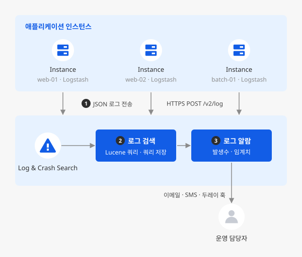

# Log & Crash Search로 여러 인스턴스의 로그를 중앙에서 수집하고 알람 받기

## 시작하기 전에

Log & Crash Search는 애플리케이션과 서버에서 발생한 로그를 한곳에 모아 저장하고, 검색·분석·알람 기능을 제공하는 로그 관리 서비스입니다. 로그는 HTTP 기반의 로그 수집 API로 전송하며, SDK나 Logstash 같은 로그 수집 도구를 사용해 이 API를 호출할 수 있습니다. 수집한 로그는 Lucene 쿼리 문법(오픈 소스 검색 엔진 Apache Lucene의 검색어 표현 방식)으로 검색하고, 특정 조건의 로그가 일정 수 이상 발생하면 알람을 받을 수 있습니다.

여기에서는 여러 인스턴스에 흩어져 있는 애플리케이션 로그 파일을 Logstash로 Log & Crash Search에 전송하고, 수집한 로그를 검색한 뒤 오류 로그가 급증하면 알람을 받도록 파이프라인을 구성하는 방법을 살펴봅니다.



## 사전 준비하기

- 로그를 전송할 인스턴스를 준비합니다. 여기에서는 Linux 인스턴스 3대(`web-01`, `web-02`, `batch-01`)에서 애플리케이션이 `/var/log/myapp/` 아래에 로그 파일을 기록하고 있다고 가정합니다.
- Logstash 8.x는 기본 설정에서 JVM 힙 메모리를 1GB로 잡으므로, 메모리가 2GB 이상인 인스턴스를 사용하세요. 메모리가 1GB인 인스턴스에서 실행하려면 `/etc/logstash/jvm.options`의 `-Xms`, `-Xmx` 값을 `256m` 정도로 줄이세요.
- 인스턴스에서 로그 수집 엔드포인트(`api-logncrash.nhncloudservice.com`)로 HTTPS(443) 아웃바운드 통신이 가능해야 합니다. 인스턴스의 보안 그룹에 IPv4 송신 규칙(HTTPS 443, DNS 53)이 있는지 확인하세요. 송신 규칙이 IPv6에만 있으면 도메인 조회부터 실패해 로그를 전송할 수 없습니다. 플로팅 IP가 없는 프라이빗 서브넷의 인스턴스라면 NAT 게이트웨이 등 인터넷으로 나가는 경로를 먼저 구성하세요. 인터넷을 거치지 않고 전송하려면 서비스 게이트웨이로 Log & Crash Search 엔드포인트를 연결할 수도 있습니다. 이때는 HTTP(80)만 지원하므로 Logstash 설정의 `url`을 `http://`로 시작하도록 바꿔야 합니다. 자세한 내용은 [서비스 엔드포인트](https://docs.nhncloud.com/ko/Network/Service%20Gateway/ko/service-endpoint/)를 참고하세요.
- 프로젝트에서 다음 역할이 필요합니다. 프로젝트 ADMIN 역할이 있으면 별도로 부여하지 않아도 됩니다.
    - **Log & Crash Search PERMISSION**: 서비스 활성화·비활성화
    - **Log & Crash Search ADMIN**: Appkey 확인, 로그 검색, 알람 설정
- 알람을 받을 운영 담당자는 프로젝트 멤버로 초대되어 있어야 합니다. 프로젝트 멤버만 알람 수신자로 추가할 수 있습니다. 멤버가 아닌 담당자에게 알리려면 콜백 수신지(email, Dooray)를 사용하세요.

### 서비스 활성화하기

1. NHN Cloud 콘솔에서 로그를 수집할 프로젝트를 선택하세요.
2. **Data & Analytics > Log & Crash Search**를 선택해 서비스를 활성화하세요.

    > [!NOTE]
    > 서비스를 활성화한 뒤 약 5분이 지나야 로그를 전송할 수 있습니다. 활성화 직후 전송한 로그는 수집되지 않을 수 있으므로, 이후 단계는 5분 뒤에 진행하세요.

### Appkey 확인하기

로그 수집 API는 Appkey로 로그가 저장될 프로젝트를 구분합니다. 전송 설정에 넣어야 하므로 미리 확인해 둡니다.

1. **Data & Analytics > Log & Crash Search > 로그 검색**을 클릭하세요.
2. 화면 상단의 **URL & Appkey**를 클릭해 Appkey를 확인하세요.

## 로그 전송 구성하기

전송 방식과 로그 포맷을 정한 뒤, API로 전송 경로를 먼저 확인하고 Logstash로 로그 파일 전송을 자동화합니다.

### 전송 방식 선택하기

Log & Crash Search로 로그를 보내는 방법은 크게 두 가지입니다. 어느 방식이든 같은 로그 수집 API(`/v2/log`)를 호출합니다.

| 구분 | 애플리케이션 내장(SDK·API 직접 호출) | 로그 수집 도구(Logstash) |
|---|---|---|
| 동작 위치 | 애플리케이션 코드 안 | 애플리케이션 밖에서 로그 파일을 읽음 |
| 코드 수정 | 필요 | 필요 없음 |
| 적합한 경우 | 모바일·게임 앱, 크래시 수집, 새로 개발하는 서비스 | 이미 파일로 로그를 남기는 서버 애플리케이션, 웹 서버 로그 |

여기에서는 기존 애플리케이션 코드를 고치지 않고 여러 인스턴스의 로그를 모으는 것이 목적이므로 Logstash 방식을 사용합니다. 앱에 SDK를 내장하는 방법은 [NHN Cloud SDK 사용 가이드](https://docs.nhncloud.com/ko/nhncloud/ko/nhncloud-sdk/overview/)를 참고하세요.

### 로그 포맷 정하기

로그 수집 API는 JSON 형식의 로그를 받으며, 다음 3개 필드는 반드시 포함해야 합니다.

- `projectName`: Appkey
- `projectVersion`: 사용자가 정하는 버전. 영문 대소문자, 숫자, `-`, `.`, `_`만 사용할 수 있습니다.
- `logVersion`: 로그 포맷 버전. `v2`로 고정합니다.

로그 메시지는 `body` 필드에 담고, 로그를 보낸 서버는 `host` 필드로 구분합니다. 그 밖의 필드는 사용자 정의 필드로 저장되며, 필드 이름의 접두사에 따라 검색 방식이 달라집니다.

- 접두사 없음(예: `service`): 값이 정확히 일치할 때만 검색됩니다. 서비스 이름, 환경처럼 값이 정해진 필드에 적합합니다.
- `txt` 접두사(예: `txtStackTrace`): 값의 일부 문자열로도 검색할 수 있습니다. 스택 추적처럼 긴 텍스트를 담는 필드에 사용합니다.
- `long`, `double` 접두사(예: `longElapsedMs`): 숫자로 저장되어 범위로 검색할 수 있습니다.

애플리케이션 로그가 텍스트 한 줄이라면 그대로 `body`에 담으면 됩니다. 다만 로그 레벨, 처리 시간 같은 값을 별도 필드로 검색하고 알람 조건에 쓰려면, 애플리케이션이 다음처럼 JSON 한 줄(구조화 로그)로 로그를 남기는 편이 좋습니다.

```json
{"logLevel":"ERROR","message":"payment request failed","service":"order-api","longElapsedMs":3021}
```

자세한 필드 규칙과 크기 제한은 [Log & Crash Search API 가이드](https://docs.nhncloud.com/ko/Data%20&%20Analytics/Log%20&%20Crash%20Search/ko/api-guide/)를 참고하세요.

### API로 전송 테스트하기

Logstash를 설정하기 전에 인스턴스에서 API를 직접 호출해 네트워크 경로와 Appkey가 올바른지 확인합니다. 이렇게 해 두면 나중에 전송이 안 될 때 Logstash 설정 문제인지 바로 가려낼 수 있습니다.

```sh
curl -X POST "https://api-logncrash.nhncloudservice.com/v2/log" \
  -H "Content-Type: application/json" \
  -d '{
    "projectName": "{appkey}",
    "projectVersion": "1.0.0",
    "logVersion": "v2",
    "body": "log pipeline test",
    "logLevel": "INFO",
    "host": "web-01"
  }'
```

응답의 `isSuccessful`이 `true`이면 전송에 성공한 것입니다.

```json
{
    "header": {
        "isSuccessful": true,
        "resultCode": 0,
        "resultMessage": "Success"
    }
}
```

### Logstash로 로그 파일 수집하기

각 인스턴스에 Logstash를 설치하고, 로그 파일을 읽어 수집 API 형식으로 바꿔 전송하도록 설정합니다. Logstash 설치 방법은 [Elastic 공식 문서](https://www.elastic.co/guide/en/logstash/current/installing-logstash.html)를 참고하세요.

1. 파이프라인 설정 파일(예: `/etc/logstash/conf.d/logncrash.conf`)을 만들고 다음 내용을 입력하세요. JSON 한 줄 형식의 로그를 수집하는 예시입니다. 다른 형식의 로그를 수집하는 설정은 [Logstash SDK 사용 가이드](https://docs.nhncloud.com/ko/Data%20&%20Analytics/Log%20&%20Crash%20Search/ko/logstash-sdk-guide/)를 참고하세요.

    ```ruby
    input {
      file {
        path => [ "/var/log/myapp/*.log" ]
        codec => "json"
        ecs_compatibility => "disabled"
      }
    }

    filter {
      mutate {
        # Logstash가 덧붙이는 메타 필드를 빼서 전송 크기를 줄입니다.
        remove_field => [ "@version", "@timestamp", "path", "tags", "event" ]
        # 로그 메시지를 Log & Crash Search의 body 필드로 옮깁니다.
        rename => { "message" => "body" }
        add_field => {
          "projectName" => "{appkey}"
          "projectVersion" => "1.0.0"
          "logVersion" => "v2"
          "logSource" => "logstash"
          "logType" => "myapp"
        }
      }
    }

    output {
      http {
        url => "https://api-logncrash.nhncloudservice.com/v2/log"
        http_method => "post"
        format => "json"
      }
    }
    ```
    - `path`는 반드시 절대 경로로 입력합니다.
    - `ecs_compatibility`를 끄면 `host` 필드가 호스트 이름 문자열로 들어갑니다. 로그 검색에서 `host:web-01`처럼 인스턴스별로 로그를 구분하는 데 사용합니다.
    - `remove_field`의 `event`는 Logstash 8.x의 `json` 코덱이 원본 로그 줄 전체를 `event.original`에 한 번 더 저장한 필드입니다. 같은 내용이 두 번 전송되지 않도록 제거합니다.
    - `logType`은 로그 종류를 구분하는 값입니다. 애플리케이션별로 다르게 지정하면 검색할 때 범위를 좁히기 쉽습니다.

2. Logstash를 시작하세요.

    ```sh
    sudo systemctl enable --now logstash
    ```

    Logstash는 시작한 뒤에 파일에 추가된 로그부터 전송합니다. 시작 전에 파일에 기록되어 있던 로그는 전송하지 않습니다.

3. 나머지 인스턴스에도 같은 설정 파일을 배포하고 Logstash를 시작하세요. Appkey가 같으므로 모든 인스턴스의 로그가 한 프로젝트에 모이고, `host` 필드로 출처를 구분할 수 있습니다.

## 로그 검색하기

수집한 로그는 **Data & Analytics > Log & Crash Search > 로그 검색**에서 확인합니다. 검색 대상 기간은 기본 24시간이며, 검색 결과는 시간대별 막대 차트와 로그 목록으로 표시됩니다.

1. 검색창에 Lucene 쿼리를 입력하세요. 예를 들어 다음과 같이 범위를 좁힐 수 있습니다.

    - `logType:myapp AND logLevel:ERROR`: 애플리케이션의 오류 로그만 조회합니다.
    - `host:web-01 AND logLevel:ERROR`: 특정 인스턴스의 오류 로그만 조회합니다.
    - `longElapsedMs:[3000 TO *]`: 처리 시간이 3초 이상인 요청을 조회합니다.

2. 차트에서 로그가 급증한 막대를 클릭하세요. 검색 기간이 그 시간대로 좁아져 장애 시점의 로그를 빠르게 찾을 수 있습니다.
3. **선택한 필드** 오른쪽의 **추가**를 클릭하고, **선택 가능 필드** 창에서 `service`, `longElapsedMs`처럼 함께 볼 사용자 정의 필드를 클릭한 뒤 **저장**을 클릭하세요. `logLevel`, `host`는 기본으로 선택되어 있어 로그 목록에서 인스턴스와 레벨을 바로 비교할 수 있습니다.
4. 자주 보는 쿼리는 **쿼리 저장**으로 저장하세요. 다음부터 검색창 왼쪽의 **저장 쿼리 선택**이나 **저장 쿼리 목록** 탭에서 바로 불러올 수 있어, 별도 대시보드 없이도 팀원 모두 같은 조건으로 로그를 볼 수 있습니다.

## 로그 알람 설정하기

로그 검색만으로는 장애를 사후에야 알게 됩니다. 오류 로그가 일정 수 이상 발생하면 바로 알 수 있도록 로그 알람을 설정합니다.

1. **Data & Analytics > Log & Crash Search > 알람 > 로그 알람 설정**을 클릭하세요.
2. **알람 추가**를 클릭하세요.
3. 알람 정보를 입력하세요.

    - **알람 제목**: `myapp-error-burst`처럼 알람 내용을 알 수 있는 이름을 입력합니다.
    - **알람 쿼리**: `logType:myapp AND logLevel:ERROR`를 입력합니다. 로그 검색에서 확인한 쿼리를 그대로 쓰면 알람이 어떤 로그를 세는지 미리 확인할 수 있습니다.
    - **알람 유형**: **발생수**를 선택합니다. 오류 로그는 평소에 거의 없어서, 증감률보다 건수로 판단하는 편이 명확합니다.
    - **알람 규칙**: `>=`를 선택합니다.
    - **임계치**: `10`을 입력합니다.
    - **발생 주기(분)**: `5`를 입력합니다. 5분 동안 오류 로그가 임계치(10건) 이상 쌓이면 알람이 발생합니다.
    - **스누즈**: `30`을 입력합니다. 장애가 이어지는 동안 같은 알람이 5분마다 반복해서 오지 않도록, 한 번 알린 뒤 30분 동안은 알람을 보내지 않습니다.
    - **알람 수신자**: 운영 담당자의 이메일 주소를 입력하고 **추가**를 클릭한 뒤, **전파 방법**에서 **Email**, **SMS** 중 받을 방법을 선택합니다. 프로젝트에 초대된 멤버만 추가할 수 있으며, SMS는 멤버 계정에 등록된 휴대전화 번호로 발송됩니다.
    - **콜백 수신지**: 팀 메신저로 함께 받으려면 프로토콜에서 **Dooray**를 선택하고 두레이 훅 URL을 입력한 뒤 **추가**를 클릭합니다. **http(s)**, **email**도 선택할 수 있습니다. 알람 메시지에는 마지막 로그 원문이 함께 실리며, 여기에는 `projectName`(Appkey)도 포함됩니다. 콜백을 받는 대화방이나 메일 주소는 관계자만 볼 수 있도록 관리하세요.

4. **저장**을 클릭하세요. 저장하면 **로그 알람 설정** 목록에 알람이 추가됩니다.

## 동작 확인하기

임계치 이상의 오류 로그를 일부러 기록해 알람이 실제로 오는지 확인합니다.

1. 인스턴스에서 다음 명령을 실행해 오류 로그 12건을 로그 파일에 기록하세요. Logstash가 이 로그를 읽어 전송합니다.

    ```sh
    for i in $(seq 1 12); do
      echo '{"logLevel":"ERROR","message":"alarm test","service":"order-api"}' | sudo tee -a /var/log/myapp/app.log > /dev/null
    done
    ```

2. **로그 검색**에서 `body:"alarm test"`로 검색해 12건이 모두 수집되었는지 확인하세요. 수집되지 않았다면 Logstash 로그(`/var/log/logstash/logstash-plain.log`)에서 전송 오류를 확인하세요. `The project(...) is not registered` 오류(`401`)가 있으면 설정 파일의 `projectName`에 입력한 Appkey가 올바른지 확인하세요.
3. 5분 정도 지난 뒤 수신자에게 알람(이메일 또는 SMS)과 두레이 메시지가 도착했는지 확인하세요.
4. **알람 > 로그 알람 이력**의 **알람 설정 목록**에서 등록한 알람을 클릭하세요. 오른쪽 목록에 알람 발생 시간과 로그 인입 시간이 기록되었는지 확인하세요.

## 응용하기

- **컨테이너 로그 수집**: NCS에서 Fluent Bit 사이드카로 컨테이너 로그를 전송합니다. ([NCS 사용자 가이드](https://docs.nhncloud.com/ko/Container/NCS/ko/user-guide/))
- **앱 크래시 수집**: 모바일 앱에 SDK를 넣어 크래시와 앱 로그를 함께 수집합니다. ([NHN Cloud SDK 사용 가이드](https://docs.nhncloud.com/ko/nhncloud/ko/nhncloud-sdk/overview/))
- **로그 장기 보관**: 로그 외부 보관 설정으로 로그를 외부 Object Storage에 보관합니다. ([Log & Crash Search 콘솔 사용 가이드](https://docs.nhncloud.com/ko/Data%20&%20Analytics/Log%20&%20Crash%20Search/ko/console-guide/))

## 리소스 정리하기

실습으로 따라 했다면, 더 이상 쓰지 않는 설정과 서비스를 정리해 불필요한 요금이 나가지 않게 하세요. 만든 순서의 반대로 정리합니다.

1. **알람 > 로그 알람 설정**에서 `myapp-error-burst` 행의 **동작** 열에 있는 삭제 아이콘을 클릭하고, 확인 창에서 **삭제**를 클릭하세요.
2. 각 인스턴스에서 Logstash를 중지하고 자동 시작을 해제하세요.

    ```sh
    sudo systemctl disable --now logstash
    ```

3. 프로젝트에서 Log & Crash Search를 더 이상 사용하지 않는다면 서비스를 비활성화하세요. 저장된 로그는 보관 기간에 따라 요금이 발생합니다. 콘솔 상단의 프로젝트를 선택한 뒤 **프로젝트 관리 > 이용 중인 서비스**에서 Log & Crash Search 오른쪽의 **비활성화**를 클릭하고, 확인 창에서 '위 내용을 모두 확인하였고, 서비스 비활성화 시 정보 삭제에 동의합니다.'를 선택한 뒤 **확인**을 클릭합니다.

    > [!WARNING]
    > 서비스를 비활성화하면 수집한 로그와 알람 설정이 삭제되며 복구할 수 없습니다. 필요한 로그는 먼저 **로그 검색**에서 **CSV저장** 또는 **JSON저장**으로 내려받아 두세요. 다시 활성화하면 Appkey가 새로 발급되므로, Logstash 설정 파일의 `projectName`도 새 Appkey로 바꿔야 합니다.

## 용어 알아보기

| 용어 | 설명 |
|---|---|
| 인스턴스 | 가상의 CPU, 메모리, 기본 디스크로 구성된 가상 서버 |
| Appkey | NHN Cloud의 각 서비스별로 발급되는 고유 인증 키. API 요청 시 서비스 식별과 유효성 검증에 사용하며, 콘솔의 서비스 화면 오른쪽 상단 URL & Appkey에서 확인 |
| 프로젝트 | 조직 내에서 일정 단위로 서비스 이용을 관리하기 위해 생성하는 그룹 |
| 엔드포인트 | 요청을 받아 응답을 제공하는 서비스를 사용할 수 있는 지점. 주로 API 엔드포인트를 의미하며, URL 형식이 사용됨 |
| 콜백 | 함수를 미리 등록해 두었다가 특정 이벤트가 발생했을 때 호출되도록 하는 방법, 또는 그렇게 등록되고 호출되는 함수 |
| 웹훅 | 사용자 정의 콜백을 사용하여 웹 페이지 또는 웹 애플리케이션의 동작을 보강하거나 변경하는 방법 |
