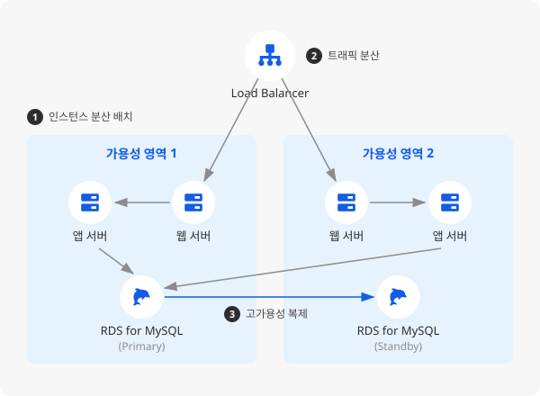

# 멀티 가용성 영역(AZ)으로 고가용성 구성하기

## 시작하기 전에

가용성 영역(availability zone, AZ)은 독립된 전원과 네트워크를 갖춘 데이터 센터로, 인스턴스가 만들어지는 물리적인 위치입니다. 한 가용성 영역에 장애가 발생해도 다른 가용성 영역은 영향을 받지 않으며, 가용성 영역 간 네트워크 통신에는 별도 비용이 들지 않습니다. 반대로 리소스를 하나의 가용성 영역에만 배치하면, 그 가용성 영역에 장애가 발생했을 때 서비스 전체가 중단됩니다.

여기에서는 인스턴스와 데이터베이스를 2개 이상의 가용성 영역에 나눠 배치하고 로드 밸런서로 트래픽을 분산해, 한 가용성 영역에 장애가 발생해도 서비스가 유지되는 고가용성(high availability) 구조를 만드는 방법을 살펴봅니다.



## 사전 준비하기

- 사용 중인 프로젝트에서 가용성 영역을 2개 이상 사용할 수 있어야 합니다. 사용 가능한 가용성 영역은 리전마다 고정되어 있지 않고, 조직을 생성할 때 사업 조건에 따라 제한될 수 있습니다. 콘솔의 인스턴스 생성 화면에서 선택할 수 있는 가용성 영역을 확인하거나, 다음 API로 현재 프로젝트에서 사용 가능한 가용성 영역 목록을 조회하세요.

    ```http
    GET /v2/{tenant_id}/os-availability-zone
    ```

    필요한 가용성 영역이 목록에 없으면 조직 관리자에게 가용성 영역 추가를 요청합니다.

- VPC와 서브넷이 준비되어 있어야 합니다. NHN Cloud의 서브넷은 특정 가용성 영역에 속하지 않으므로, 가용성 영역 수만큼 서브넷을 나눠 만들 필요가 없습니다. 기존 서브넷을 그대로 사용해도 되고, 새로 만들려면 **Network > Subnet**에서 생성합니다.
- 각 가용성 영역에 인스턴스를 생성할 수 있을 만큼 쿼터(리소스 할당량)가 남아 있어야 합니다. 쿼터가 부족하면 콘솔에서 먼저 증설을 요청하세요.
- Load Balancer, RDS for MySQL 서비스가 활성화되어 있어야 합니다.

## 가용성 영역별로 리소스 분산 배치하기




### 인스턴스를 가용성 영역별로 나눠 생성하기

한 가용성 영역에 장애가 발생해도 다른 가용성 영역의 인스턴스가 요청을 처리할 수 있도록, 같은 역할의 인스턴스를 서로 다른 가용성 영역에 하나 이상씩 생성합니다.

1. NHN Cloud 콘솔에서 **Compute > Instance**를 클릭하세요.
2. 웹 서버 인스턴스를 생성하면서 **인스턴스 정보**의 **가용성 영역**에서 첫 번째 가용성 영역(예: `kr-pub-a`)을 선택합니다. 기본값인 **임의의 가용성 영역**을 그대로 두면 가용성 영역이 임의로 정해져, 두 인스턴스가 같은 가용성 영역에 생성될 수 있습니다. 목록에 표시되는 가용성 영역 이름은 프로젝트마다 다를 수 있습니다.
3. 같은 설정으로 웹 서버 인스턴스를 하나 더 생성하고, 이번에는 두 번째 가용성 영역(예: `kr-pub-b`)을 선택합니다.
4. 앱 서버 인스턴스도 같은 방법으로 두 가용성 영역에 나눠 생성합니다.

인스턴스를 생성한 뒤에는 가용성 영역을 바꿀 수 없으므로, 생성할 때 가용성 영역을 정확히 선택하세요.



### 로드 밸런서에 두 가용성 영역의 인스턴스 등록하기

로드 밸런서의 멤버는 VPC 단위로 등록하고, 서브넷은 가용성 영역에 속하지 않습니다. 따라서 서로 다른 가용성 영역의 인스턴스도 같은 멤버 그룹에 함께 등록할 수 있습니다.

1. NHN Cloud 콘솔에서 **Network > Load Balancer**를 클릭하세요.
2. 로드 밸런서를 생성하고, 앞에서 두 가용성 영역에 만든 웹 서버 인스턴스를 모두 멤버로 등록합니다.
3. 헬스 체크를 설정합니다.

헬스 체크를 설정하면 응답하지 않는 멤버를 로드 밸런서가 트래픽 분산 대상에서 자동으로 제외합니다. 한 가용성 영역 전체에 장애가 발생해도 나머지 가용성 영역의 인스턴스로 서비스를 계속할 수 있습니다.



### RDS for MySQL을 고가용성으로 생성하기

데이터베이스도 한 가용성 영역에만 있으면 그 가용성 영역의 장애에 함께 영향을 받습니다. RDS for MySQL의 고가용성 옵션을 사용하면 Primary와 Standby DB 인스턴스가 서로 다른 가용성 영역에 자동으로 생성되므로, 가용성 영역을 따로 지정하지 않아도 됩니다.

1. NHN Cloud 콘솔에서 **Database > RDS for MySQL**을 클릭하세요.
2. DB 인스턴스를 생성하면서 **고가용성** 옵션을 사용으로 설정합니다.

Standby는 Primary의 데이터를 복제하면서 대기합니다. Primary에 장애가 발생하면 장애 조치(failover)가 자동으로 실행되어 Standby가 새로운 Primary로 전환됩니다. 장애 조치 후에도 접속 엔드포인트는 바뀌지 않으므로, 애플리케이션의 데이터베이스 접속 정보를 수정하지 않아도 됩니다.

장애 조치 과정에서 RDS for MySQL은 장애가 발생한 Primary의 보안 그룹 연결을 끊어 새로운 접속을 차단합니다. 두 DB 인스턴스가 동시에 Primary로 동작하는 스플릿 브레인(split brain)을 막으려는 동작입니다. 보안 그룹은 새로 맺는 연결에만 적용되므로, 이미 맺어진 연결을 끊으려고 다음 동작도 함께 실행합니다.

- Standby에서 장애가 발생한 Primary로 SSH 접속이 되면 Primary의 MySQL을 종료합니다.
- SSH 접속이 되지 않으면 Primary의 가상 서버(VM)를 재시작합니다.

> [!NOTE]
> 고가용성 옵션으로 Primary와 Standby를 서로 다른 가용성 영역에 두는 방식은 RDS for MariaDB, RDS for PostgreSQL에서도 같습니다. 다만 이 단계에서 설명한 장애 조치 세부 동작은 RDS for MySQL 기준이므로, 다른 DB 엔진은 해당 서비스의 사용자 가이드를 참고하세요. RDS for MS-SQL은 데이터베이스 미러링으로 고가용성을 구성하므로 구성 방식이 다릅니다.




## 동작 확인하기

고가용성 구성은 실제로 장애가 발생하기 전까지 결과가 드러나지 않으므로, 한 가용성 영역에 장애가 발생한 상황을 만들어 서비스가 유지되는지 확인합니다. 운영 환경에 영향이 없는 시간대나 테스트 환경에서 확인하세요.

1. 한 가용성 영역의 인스턴스를 중지합니다. 로드 밸런서의 멤버 상태에서 해당 인스턴스가 비정상으로 표시되고, 나머지 가용성 영역의 인스턴스로만 트래픽이 전달되는지 확인합니다.
2. **DB 인스턴스** 목록에서 Primary DB 인스턴스를 선택하고 **⋯** 버튼을 클릭한 뒤 **DB 인스턴스 재시작**을 클릭하세요. **DB 인스턴스 재시작** 창에서 **장애 조치를 이용해 DB 인스턴스를 재시작합니다.**를 선택하고 **확인**을 클릭하세요. Primary를 그냥 재시작하면 서비스가 끊기지만, 장애 조치를 이용하면 끊기는 시간을 최소화할 수 있습니다.

    재시작이 끝나면 Primary와 Standby의 역할이 바뀌었는지, 애플리케이션이 접속 정보를 바꾸지 않고 데이터베이스에 계속 접속하는지 확인합니다. 실제 장애에서 일어나는 자동 장애 조치를 그대로 재현할 수는 없지만, 역할 전환과 접속 유지는 이 방법으로 확인할 수 있습니다.

    > [!WARNING]
    > Standby DB 인스턴스를 선택했을 때 **⋯** 메뉴에 나타나는 **Standby 승격**과 **Standby 강제 승격**으로는 장애 조치를 테스트할 수 없습니다. 두 기능은 Standby를 고가용성 구성에서 분리해 별도의 Primary로 만들며, 분리한 뒤에는 원래 구성으로 되돌릴 수 없어 고가용성을 다시 구성해야 합니다. 특히 **Standby 강제 승격**은 복제가 끝나기를 기다리지 않고 바로 분리하므로, 복제 지연이 있으면 그만큼 데이터가 유실됩니다.

## 응용하기

- **Read Replica로 읽기 확장**: 다른 가용성 영역에 Read Replica를 만들어 읽기 성능을 높입니다. [RDS for MySQL DB 인스턴스 가이드](https://docs.nhncloud.com/ko/Database/RDS%20for%20MySQL/ko/db-instance/)
- **가용성 영역별 자동 확장**: 가용성 영역마다 스케일링 그룹을 만들어 같은 로드 밸런서 멤버 그룹에 연결합니다. [Auto Scale 콘솔 사용 가이드](https://docs.nhncloud.com/ko/Compute/Auto%20Scale/ko/console-guide/)

## 리소스 정리하기

실습 목적으로 따라 한 경우, 만든 순서의 역순으로 리소스를 삭제해 불필요한 과금을 방지합니다.

1. **Database > RDS for MySQL**에서 생성한 DB 인스턴스를 삭제합니다.
2. **Network > Load Balancer**에서 생성한 로드 밸런서를 삭제합니다.
3. **Compute > Instance**에서 두 가용성 영역에 생성한 인스턴스를 삭제합니다.

> [!WARNING]
> DB 인스턴스를 삭제하면 저장된 데이터도 함께 삭제됩니다. 보관해야 할 데이터가 있다면 삭제하기 전에 백업하세요.

## 용어 알아보기

| 용어 | 설명 |
|---|---|
| 가용성 영역 | 독립된 전원 및 네트워크를 갖춘 데이터 센터로, 인스턴스가 만들어지는 물리적인 위치 |
| 고가용성 | 시스템이 상당히 오랜 기간 동안 지속적으로 정상 운영이 가능한 성질 |
| VPC | 가상 사설 클라우드. 논리적으로 분리된 가상의 네트워크 |
| 서브넷 | Subnetwork를 의미하여, IP 네트워크를 더 작은 단위로 세분화한 IP 주소 영역 |
| 로드 밸런서 | 인스턴스의 트래픽 부하 분산 기능을 제공하는 서비스 |
| 헬스 체크 | 설정한 값에 따라 Pool 내에 속한 엔드포인트에 대해 접근성을 확인하는 기능 |
| 고가용성 인스턴스 | RDS 서비스에서 고가용성을 보장하도록 설정된 인스턴스 |
| 장애 조치 | 서버, 시스템, 네트워크 등에 이상이 생겼을 때 예비 시스템으로 자동 전환하는 기능 |
| 엔드포인트 | 요청을 받아 응답을 제공하는 서비스를 사용할 수 있는 지점. 주로 API 엔드포인트를 의미하며, URL 형식이 사용됨 |
| 보안 그룹 | 인스턴스의 송수신 트래픽을 제어하는 기능 |
| 스플릿 브레인 | 고가용성 구성의 두 노드가 동시에 Primary로 동작해 데이터가 서로 어긋나는 상태 |
| 복제 지연 | 복제 과정에서 발생하는 지연 |
| Read Replica | 읽기 성능을 높이기 위해 읽기 전용으로 사용하는 복제본 DB 인스턴스 |
| 스케일링 그룹 | Auto Scale 서비스에서 인스턴스를 추가로 생성 또는 삭제하는 조건과, 조건이 만족하는 경우 수행할 행동을 정의한 것 |
