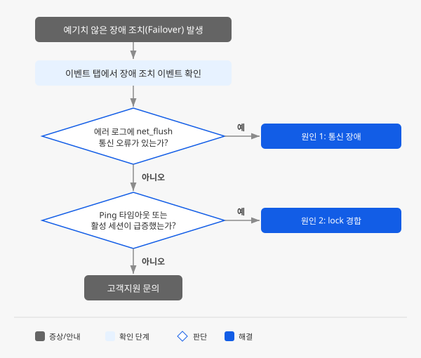

# RDS for MySQL 고가용성이 중단되거나 예기치 않은 장애 조치가 발생합니다

## 증상

RDS for MySQL 고가용성 구성에서 예기치 않은 장애 조치(Failover)가 발생합니다. 장애 조치가 진행되는 동안 데이터베이스 연결이 일시 중단되며, 장애 조치가 완료되면 기존 Primary는 Failed Over Primary로, Standby는 새 Primary로 역할이 변경됩니다.

DB 인스턴스 목록에서 해당 인스턴스를 선택한 뒤 하단 상세 화면의 **로그** 탭에서 `error.log`의 **로그 보기**를 클릭하면 다음과 같은 메시지가 나타납니다.

```text
[ERROR] [MY-011161] [Server] Semi-sync master failed on net_flush() before waiting for slave reply.
[Note] [MY-011171] [Server] Stop semi-sync binlog_dump to slave (server_id: {standby_server_id}).
```

에러 로그에 InnoDB의 디스크 flush 지연 메시지가 함께 나타나는 경우도 있습니다.

```text
[Note] [MY-011953] [InnoDB] Page cleaner took 4392ms to flush 4000 and evict 0 pages
```

`FLUSH TABLES WITH READ LOCK` 등 장시간 lock을 유발하는 쿼리가 원인인 경우에는 MHA(고가용성 감시) 로그에 다음과 같은 메시지가 나타납니다.

```text
Got timeout on MySQL Ping(INSERT) child process and killed it!
```

## 진단 흐름도



## 빠른 확인

장애 조치가 발생하면 RDS for MySQL 콘솔의 **이벤트** 탭에서 이벤트 코드 `INSTC_26_00`(DB 인스턴스 장애 조치 발생)과 `INSTC_26_01`(DB 인스턴스 장애 조치 완료) 이벤트를 확인할 수 있습니다. **이벤트 발생 일시**와 **이벤트 메시지**를 기록해 두세요. 이후 원인 분석과 고객지원 문의 시 필요합니다.

## 원인과 해결 방법

RDS for MySQL 고가용성 구성에서 Standby는 Primary의 상태를 주기적으로 확인(Ping)합니다. Ping이 4회 연속 실패하면 Primary가 서비스를 제공하지 못한다고 판단하여 자동으로 장애 조치를 수행합니다.

### 원인 1: Primary-Standby 간 통신 장애

Primary와 Standby는 서로 다른 가용성 영역(AZ)에 위치하며, 네트워크를 통해 데이터를 복제합니다. 두 인스턴스 사이의 통신에 장애가 발생하면 Standby가 Primary의 헬스체크에 연속으로 실패하고 장애 조치가 수행됩니다.

실제 사례에서 확인된 두 가지 패턴이 있습니다.

**패턴 A: 네트워크 통신 오류**

Primary에서 Standby로의 데이터 전송이 실패하고, semi-sync 복제의 `net_flush()`가 실패합니다. 에러 로그에 통신 패킷 오류와 복제 중단 메시지가 나타납니다.

```text
[ERROR] [MY-013129] [Server] A message intended for a client cannot be sent there as no client-session is attached. Therefore, we're sending the information to the error-log instead: MY-001158 - Got an error reading communication packets
[ERROR] [MY-011161] [Server] Semi-sync master failed on net_flush() before waiting for slave reply.
[Note] [MY-011171] [Server] Stop semi-sync binlog_dump to slave (server_id: {standby_server_id}).
```

**패턴 B: 디스크 flush 지연이 동반되는 통신 오류**

InnoDB Page Cleaner의 디스크 flush 작업이 수 초 이상 지연되면서 통신 오류가 함께 발생합니다. 에러 로그에 flush 지연 메시지와 통신 오류 메시지가 함께 나타납니다.

```text
[Note] [MY-011953] [InnoDB] Page cleaner took 4392ms to flush 4000 and evict 0 pages
[ERROR] [MY-011161] [Server] Semi-sync master failed on net_flush() before waiting for slave reply.
```

**해결 방법**

장애 조치가 완료되면 Standby가 새 Primary로 승격되어 서비스가 자동으로 복구됩니다. 접속을 위한 내부 도메인의 A record가 새 Primary로 변경되므로 애플리케이션의 접속 정보를 수정할 필요는 없습니다. A record 변경에 약 3초가 소요되며, 실제 소요 시간은 클라이언트의 DNS 캐시 정책에 따라 달라질 수 있습니다.

장애 조치 후 고가용성 구성을 복원하려면 다음 순서로 진행합니다.

1. 장애 조치 후 기존 Primary는 Failed Over Primary 상태가 됩니다. Failed Over Primary를 복구하거나 재구축하기 전까지 장애 조치가 수행되지 않으므로, 고가용성 구성을 빠르게 복원하는 것이 중요합니다.
2. **Failed Over Primary 복구**를 먼저 시도합니다. 데이터 정합성이 유지되었고 바이너리 로그가 유실되지 않았다면 복구에 성공합니다. DB 인스턴스 목록에서 Failed Over Primary를 선택한 뒤 드롭다운 메뉴에서 **Failed Over Primary 복구**를 클릭합니다.
3. 복구에 실패하면 **Failed Over Primary 재구축**을 수행합니다. 재구축은 Failed Over Primary의 데이터를 모두 제거하고 새 Primary를 기반으로 다시 구성합니다.
4. 데이터 보정이 필요한 경우 **Failed Over Primary 분리**를 선택할 수 있습니다. 분리하면 각각 독립된 DB 인스턴스로 운영되며, 분리 후에는 원래 구성으로 복구할 수 없습니다.
5. 동일한 장애 조치가 반복되면 Standby가 위치한 장비의 통신 문제일 수 있습니다. 이 경우 고가용성을 비활성화한 뒤 다시 활성화하여 Standby를 새 장비에 재구성하거나, [NHN Cloud 고객지원](https://www.nhncloud.com/kr/support/inquiry)에 문의해 Standby 마이그레이션을 요청합니다.

> [!NOTE]
> RDS for MySQL에서 Primary와 Standby 간 바이너리 로그의 position 차이가 100,000,000 이상이면 장애 조치가 수행되지 않습니다. 복제 지연이 큰 상태에서는 고가용성 보호가 작동하지 않을 수 있습니다.

### 원인 2: 장시간 쿼리·lock 경합으로 인한 헬스체크 실패

고가용성 감시 프로세스는 Primary의 `rds_maintenance` 데이터베이스에 주기적으로 INSERT를 수행해 상태를 확인합니다. global lock이 걸려 이 INSERT가 반복적으로 타임아웃되면 Ping 체크에 실패하고 장애 조치가 수행됩니다.

실제 사례에서 고객 계정으로 `FLUSH TABLES WITH READ LOCK` 쿼리가 수행되어 global read lock이 발생했고, 고가용성 감시 계정이 `rds_maintenance` DB에 접근하지 못해 장애 조치가 발생한 패턴이 확인되었습니다.

`FLUSH TABLES WITH READ LOCK` 외에도 다음과 같은 쿼리가 동일한 문제를 유발할 수 있습니다.

- 대용량 테이블에 대한 장시간 DDL(`ALTER TABLE`, `CREATE INDEX` 등)
- 오래 실행되는 트랜잭션이 점유한 lock과 다른 쿼리 사이의 경합
- 장시간 실행되는 `mysqldump`(기본 옵션으로 `--lock-tables`가 활성화됨)

**해결 방법**

1. DB 인스턴스 하단 상세 화면의 **로그** 탭에서 `error.log`를 확인합니다. Ping 타임아웃 관련 메시지가 있는지, 장애 조치 발생 직전의 시간대에 어떤 로그가 남았는지 확인합니다.
2. **서버 대시보드**에서 장애 조치 발생 시각 전후의 지표를 확인합니다. **기본 MySQL 지표** 레이아웃의 **Connection** 차트에서 **running**(활성 세션 수)이 급증했거나, **Queries Per Second** 차트에서 이상 패턴이 나타났다면 이 원인에 해당합니다.
3. 장애 조치의 원인이 된 쿼리를 식별합니다. `FLUSH TABLES WITH READ LOCK`은 백업 도구나 복제 설정 과정에서 자동으로 수행되는 경우가 있습니다. 외부 백업 도구를 사용하고 있다면 RDS for MySQL 내장 백업 기능으로 대체하는 것을 검토합니다.
4. 장시간 DDL은 서비스 부하가 적은 시간대에 수행하고, 작업 전에 DB 인스턴스 목록에서 Primary를 선택한 뒤 `…` 드롭다운 메뉴에서 **고가용성 일시 중지**를 클릭해 불필요한 장애 조치를 방지합니다. 작업이 끝나면 같은 메뉴에서 **고가용성 다시 시작**을 클릭합니다.

## 문의하기

위 방법으로 해결되지 않거나 장애 조치가 반복적으로 발생하면 [NHN Cloud 고객지원](https://www.nhncloud.com/kr/support/inquiry)에 문의하세요. 통신 장애는 인프라 측 확인이 필요한 경우가 있으며, Standby 마이그레이션 등 NHN Cloud의 조치가 필요할 수 있습니다. 문의 시 다음 정보를 함께 전달하면 빠른 진단에 도움이 됩니다.

- 장애 조치가 발생한 DB 인스턴스의 ID
- 장애 조치가 발생한 시각(KST 기준)
- DB 엔진 버전
- **이벤트** 탭에 표시된 장애 조치 관련 이벤트 내용
- **서버 대시보드**의 장애 조치 전후 시간대 지표 스크린샷
- MySQL 에러 로그에서 장애 조치 전후의 로그(`SHOW VARIABLES LIKE 'log_error'`로 경로 확인)
- 동일 증상의 반복 발생 여부와 발생 빈도

## 문제 예방하기

- **Ping 간격을 워크로드에 맞게 조정**: DB 인스턴스 그룹 상세의 **기본 정보** 탭에서 Ping 간격을 확인할 수 있습니다. **수정**을 클릭하면 1~600초 범위에서 변경할 수 있습니다. 기본값은 3초이며, Ping 방식은 INSERT 또는 SELECT 중 선택할 수 있습니다. Ping 간격이 짧으면 일시적인 부하에도 장애 조치가 발생할 수 있으므로, I/O 부하가 높은 환경에서는 Ping 간격을 늘려 불필요한 장애 조치를 줄일 수 있습니다. 다만, Ping 간격이 너무 길면 실제 장애 감지가 늦어지므로 적절한 균형이 필요합니다.
- **스토리지 사용량 모니터링**: Primary의 데이터 스토리지 사용량이 가득 차면 고가용성 감시 프로세스가 장애로 감지해 장애 조치를 수행합니다. DB 인스턴스 생성 시 **기본 알림**을 활성화하면 스토리지 사용량 95% 이상, 남은 사용량 5,120MB 이하 시 알림을 받을 수 있습니다. 이미 생성한 DB 인스턴스라면 **알림 그룹** 탭에서 직접 알림 그룹을 설정합니다.
- **장시간 lock을 유발하는 쿼리 주의**: `FLUSH TABLES WITH READ LOCK`, 대용량 테이블 DDL, 장시간 `mysqldump` 등은 global lock을 유발해 헬스체크가 실패할 수 있습니다. 외부 백업 도구 대신 RDS for MySQL 내장 백업 기능을 사용하면 이 문제를 방지할 수 있습니다.
- **장시간 작업 시 고가용성 일시 중지 활용**: 대량 INSERT, DDL 변경, 데이터 마이그레이션 등 장시간 부하가 예상되는 작업을 수행할 때는 DB 인스턴스 목록에서 Primary를 선택한 뒤 `…` 드롭다운 메뉴의 **고가용성 일시 중지**를 사용할 수 있습니다. 고가용성 일시 중지 중에는 장애를 감지하지 않으므로, 일시적인 부하로 인한 불필요한 장애 조치를 방지할 수 있습니다. 다만, 장시간 일시 중지 상태를 유지하면 실제 장애 시 보호받지 못하므로 작업이 끝나면 같은 메뉴에서 **고가용성 다시 시작**을 클릭합니다.

